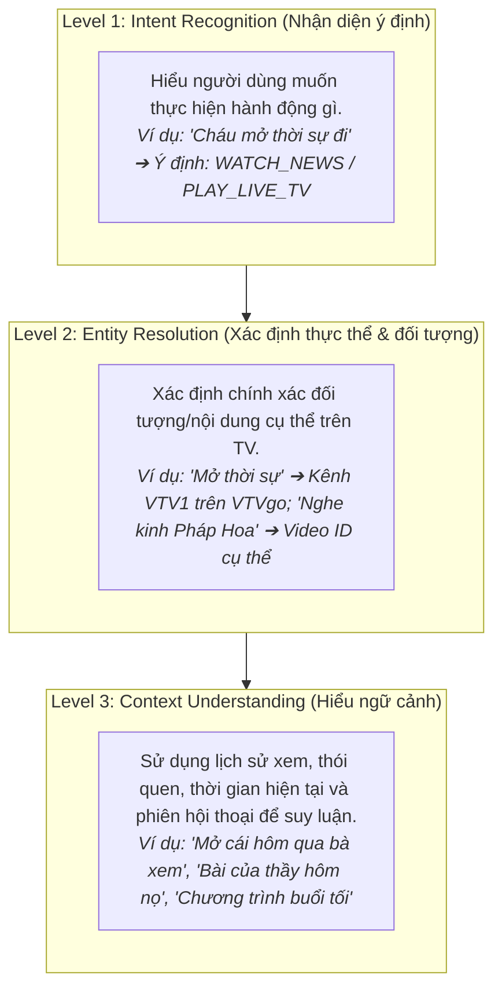
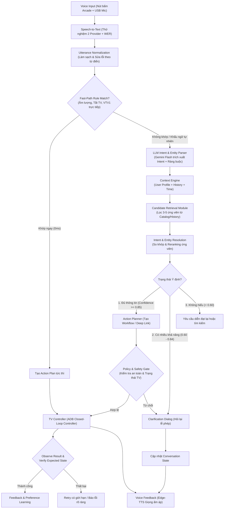

# TÀI LIỆU ĐẶC TẢ DỰ ÁN: TRỢ LÝ TV THÔNG MINH HIỂU NGỮ CẢNH CHO NGƯỜI CAO TUỔI
**(Context-Aware Conversational TV Assistant for Elderly People)**

**Dự án:** Smart TV Voice Assistant for Grandparents  
**Tầm nhìn cốt lõi:** Chuyển đổi từ một hệ thống nhận diện câu lệnh cứng (*Voice Command System*) thành một **Trợ lý TV đàm thoại có khả năng hiểu ngữ cảnh, thói quen và sở thích (*Context-Aware Conversational Assistant*)**.  
**Nguyên tắc chỉ đạo:**  
1. *Không bắt ông bà phải học cách nói chuyện với máy. Máy phải học cách hiểu khẩu ngữ tự nhiên, thói quen sinh hoạt và cách diễn đạt đời thường của ông bà.*  
2. *Khoảng cách giữa "Hiểu đúng câu nói" và "Thực thi đúng trên thiết bị" là nơi xuất hiện phần lớn khó khăn. LLM hiểu tốt không đồng nghĩa hệ thống sẽ bật đúng nội dung.*  
3. *Hỏi lại đúng lúc là một năng lực, không phải thất bại.*  
**Nền tảng kiến trúc:** Thiết bị phần cứng để bàn (Smart TV Pod: Raspberry Pi + Nút bấm Arcade + Mic) $\leftrightarrow$ Clean Architecture thuần Python (4-Tier Context Engine + Candidate Retrieval + Policy Gate) $\leftrightarrow$ Điều khiển Smart TV qua Wi-Fi (ADB Closed-Loop / Android Deep Links / Workflows).

---

## 1. TỔNG QUAN ĐỊNH HƯỚNG & BÀI TOÁN THỰC TẾ

### 1.1. Sự khác biệt mang tính bước ngoặt của dự án

| Tiêu chí | Trợ lý giọng nói thông thường (Voice Command System) | Trợ lý TV hiểu ngữ cảnh (Context-Aware Assistant) |
| :--- | :--- | :--- |
| **Yêu cầu đối với người dùng** | Phải nhớ và nói đúng cú pháp ("Mở ứng dụng YouTube", "Tìm kiếm kinh Phật", "Chọn video 1"). | Nói ngôn ngữ tự nhiên, khẩu ngữ đời thường ("Cháu bật bài kinh cho bà nghe", "Mở cái hôm qua bà xem"). |
| **Khả năng tìm kiếm** | Khớp từ khóa máy móc (Exact Keyword / Regex). | Hiểu ngữ nghĩa (Semantic Understanding) kết hợp hồ sơ người dùng. |
| **Xử lý câu lệnh** | Từng câu lệnh độc lập, không trạng thái (*Stateless*). | Hiểu ngữ cảnh hội thoại liên tiếp (*Stateful Multi-turn*). |
| **Dữ liệu nội dung** | Danh sách ứng dụng/kênh cứng nhắc. | Kết hợp danh mục tuyển chọn, lịch sử xem và sở thích cá nhân. |
| **Mức độ thích ứng** | Không học từ người dùng, cấu hình cố định. | **Học từ hành vi**: Tự điều chỉnh mức ưu tiên theo tần suất và thời gian thực. |
| **Cơ chế ra quyết định** | Cố gắng thực thi ngay (dễ mở sai nội dung). | Phân cấp độ tin cậy: **Biết khi nào cần thực thi ngay, khi nào cần lễ phép hỏi lại**. |

### 1.2. Vấn đề thực tế của người cao tuổi (Pain Points)
- **Giao diện Smart TV quá phức tạp:** Quá nhiều ứng dụng, banner quảng cáo, menu nhiều tầng làm ông bà dễ bị lạc hoặc bấm nhầm.
- **Rào cản từ trợ lý TV mặc định:**
  - Micro trên remote TV thường tích hợp trợ lý chung (Google Assistant), chỉ tìm từ khóa chung chung, không tự động chuyển đúng kênh truyền hình trực tiếp (VTV1 trên VTVgo) hay chọn đúng bài kinh quen thuộc.
  - Phím micro trên remote nhỏ, phải giữ tay liên tục, không phù hợp với người già run tay hoặc phát âm ngập ngừng.
- **Cách nói dựa vào ngữ cảnh:** Ông bà thường nói theo thói quen và thời điểm (*"Bật cái kinh hôm nọ"*, *"Hôm nay có thời sự chưa cháu?"*, *"Mở chương trình ông hay xem buổi tối"*). Nếu không có ngữ cảnh, hệ thống không thể xử lý được.

### 1.3. Giải pháp tổng thể: Smart TV Pod để bàn
Xây dựng một **Smart TV Pod (Hộp trợ lý để bàn)** độc lập:
- **Phần cứng tương tác:**
  - 1 nút bấm Arcade lớn (đường kính 30–60mm), màu đỏ viền đen, bấm êm tay có tiếng "tách" cơ học rõ ràng (**Cơ chế Push-to-Talk** kiểm soát chính xác thời điểm thu âm, triệt tiêu tiếng ồn TV).
  - 1 micro USB định hướng lọc ồn tốt.
  - 1 đèn LED trạng thái đa màu (Xanh lam = Đang nghe, Vàng = Đang suy luận/tra cứu, Xanh lá = Thành công, Đỏ = Cần hỏi lại hoặc lỗi).
  - 1 loa mini phát phản hồi thưa gửi ấm áp, kính cẩn (*"Dạ, cháu đang bật VTV1 cho ông bà đây ạ"*).
- **Phần mềm lõi (100% Pure Python):**
  - Tách rời độc lập giữa Tầng Nghiệp vụ (Domain/Application) và Tầng Thiết bị (Infrastructure).
  - Tích hợp **4-Tier Context Engine** kết hợp **Candidate Retrieval & Policy Gate**.
  - Điều khiển Smart TV Android/Xiaomi qua Wi-Fi bằng giao thức ADB theo cơ chế vòng lặp đóng (**Closed-Loop Control**).

---

## 2. BA TẦNG NĂNG LỰC NHẬN THỨC CỦA HỆ THỐNG



- **Level 1 (Intent Recognition):** Phân tích câu nói thuộc nhóm ý định nào (`PLAY_LIVE_TV`, `WATCH_CONTENT`, `SYSTEM_CONTROL`, `CLARIFICATION_REPLY`).
- **Level 2 (Entity Resolution):** Rút trích và chuẩn hóa thực thể (`channel: vtv1`, `category: BUDDHIST`, `action: volume_up`).
- **Level 3 (Context Understanding):** Giải mã các đại từ chỉ định và tham chiếu thời gian dựa trên bối cảnh thực tế.

---

## 3. THIẾT KẾ CHI TIẾT 4 PHÂN HỆ CONTEXT ENGINE

```
┌────────────────────────────────────────────────────────────────────────┐
│                          CONTEXT ENGINE                                │
├──────────────────────────────────┬─────────────────────────────────────┤
│ 1. USER PROFILE                  │ 2. VIEWING HISTORY                  │
│  - Danh mục ưu tiên (Phật giáo,  │  - Lịch sử xem theo mốc thời gian   │
│    Thời sự, Cải lương...)        │  - Nguồn gốc sự kiện (Source)       │
│  - Kênh truyền hình yêu thích    │  - Trạng thái hoàn thành (Status)   │
│  - Cấu hình UX (nói chậm, hỏi kỹ)│  - Phân biệt xem 1 lần vs Thích     │
├──────────────────────────────────┼─────────────────────────────────────┤
│ 3. ENVIRONMENTAL CONTEXT         │ 4. CONVERSATION CONTEXT             │
│  - Giờ hiện tại trong ngày       │  - Trạng thái hội thoại (Stateful)  │
│  - Khung giờ sinh hoạt quen thuộc│  - Ý định đang xử lý (active_intent)│
│  - Trạng thái hiện tại của TV    │  - Slot đang chờ giải đáp (pending) │
└──────────────────────────────────┴─────────────────────────────────────┘
```

### 3.1. User Profile (Hồ sơ sở thích ổn định)
Lưu trữ sở thích lâu dài của ông bà, giúp thu hẹp phạm vi tìm kiếm ngay từ đầu (**Giải quyết một phần bài toán Cold Start**):
```json
{
  "user_id": "grandmother",
  "preferences": {
    "categories": ["BUDDHIST", "NEWS", "TRADITIONAL_MUSIC"],
    "favorite_channels": ["VTV1"],
    "favorite_content": [
      {
        "name": "Kinh A Di Đà",
        "author_or_speaker": "Thầy Thích Trí Thoát",
        "priority_score": 95
      }
    ]
  },
  "interaction_preferences": {
    "speech_rate": "SLOW",
    "confirmation_level": "HIGH",
    "honorific": "cháu"
  }
}
```

### 3.2. Viewing History (Nhật ký theo dõi nội dung có độ tin cậy)
Dữ liệu quan trọng nhất để giải mã các câu nói mang tính tham chiếu thời gian:
- **Nguyên tắc kiến trúc cốt tử:** *Không được coi lịch sử xem là nguồn dữ liệu hoàn chỉnh tuyệt đối. Cần lưu cả nguồn gốc và mức độ tin cậy của từng sự kiện.*
```json
{
  "content_id": "content_buddhist_001",
  "title": "Kinh A Di Đà - Thầy Thích Trí Thoát",
  "event": "PLAYED",
  "source": "VOICE_ASSISTANT",
  "timestamp": "2026-11-02T06:00:00+07:00",
  "duration_seconds": 1800,
  "completion_status": "UNKNOWN",
  "was_skipped_immediately": false
}
```
- Phân biệt rõ:
  - `source = "VOICE_ASSISTANT"`: Do trợ lý kích hoạt (độ tin cậy cao).
  - `source = "TV_OBSERVED"`: Quan sát thấy trên TV (có thể do người khác dùng remote).
  - `completion_status = "UNKNOWN"`: Hệ thống chỉ biết đã gửi lệnh phát, **không tự tiện kết luận người dùng đã nghe hết** nếu không có phản hồi tiếp theo.

### 3.3. Environmental Context (Ngữ cảnh môi trường & Thời gian)
- Thời gian hiện tại, thứ trong tuần.
- Trạng thái TV quan sát được: `power: ON/OFF`, ứng dụng đang chiếm màn hình (`mCurrentFocus`).
- Khung giờ thói quen: 05:30–07:00 (Phật giáo), 11:30–12:15 (Thời sự), 18:30–19:45 (Thời sự VTV1).
- *Quy tắc:* Khung giờ là **tín hiệu hỗ trợ suy luận**, không được phép tự động ép buộc nội dung nếu câu nói của ông bà có ý định khác.

### 3.4. Conversation Context (Ngữ cảnh hội thoại đa lượt có cấu trúc)
Không lưu toàn bộ text thô rồi kỳ vọng LLM tự hiểu. Duy trì cấu trúc trạng thái đối thoại rõ ràng:
```json
{
  "session_id": "sess_20261102_0930",
  "active_intent": "WATCH_MUSIC",
  "pending_slot": "MUSIC_TYPE",
  "slots": {
    "category": "BOLERO",
    "artist": null,
    "collection": null
  },
  "last_candidates": ["content_music_01", "content_music_02"],
  "currently_playing": "content_buddhist_001",
  "last_action": "PLAY_LIVE_TV",
  "dialogue_state": "AWAITING_USER_CHOICE",
  "ttl_seconds": 90
}
```
*Quy tắc hết hạn trạng thái:* Sau 90 giây không có tương tác, phiên hội thoại tự động đóng. Câu nói *"Mở cái đó"* sau 30 phút sẽ không còn tham chiếu tới danh sách cũ.

---

## 4. LUỒNG XỬ LÝ HYBRID AI & CANDIDATE RETRIEVAL

Kiến trúc áp dụng nguyên tắc kiểm soát chặt chẽ:  
**LLM hiểu ý định $\to$ Candidate Retrieval tìm dữ liệu $\to$ LLM lựa chọn trong tập ứng viên $\to$ Application kiểm tra an toàn $\to$ TV Controller thực thi.**



### 4.1. Ba trạng thái xử lý ý định (Intent States)
| Trạng thái | Điều kiện | Xử lý của hệ thống |
| :--- | :--- | :--- |
| **Đủ thông tin** | Xác định duy nhất 1 nội dung mục tiêu với độ tin cậy $\ge 0.85$. | Thực thi ngay lập tức. |
| **Có nhiều khả năng** | Có 2–3 ứng viên phù hợp với số điểm xấp xỉ nhau (0.60 – 0.84). | Lễ phép hỏi lại để người dùng chọn: *"Bà muốn nghe Kinh A Di Đà hay Kinh Pháp Hoa ạ?"* |
| **Không hiểu / Mơ hồ** | Không tìm thấy ứng viên hoặc câu nói quá cụt ngủn ($< 0.60$). | Yêu cầu diễn đạt lại thân thiện: *"Bà muốn nghe kinh Phật hay nghe ca nhạc ạ?"* |

### 4.2. Cấu trúc JSON trích xuất từ LLM (Tuyệt đối không để LLM tự bịa ID)
LLM chỉ được phép trích xuất cấu trúc ý định, không được tự tạo `content_id`, `deep_link` hoặc câu lệnh ADB:
```json
{
  "intent": "WATCH_CONTENT",
  "entities": {
    "category": "BUDDHIST",
    "temporal_reference": "YESTERDAY",
    "content_reference": "PREVIOUSLY_WATCHED",
    "speaker": null,
    "title_hint": "bài kinh hôm qua"
  },
  "constraints": {
    "preferred_user": "grandmother"
  },
  "needs_context": true,
  "confidence_score": 0.92
}
```
Sau đó, lớp Application đối chiếu với kết quả trả về từ Candidate Retrieval và chỉ cho phép LLM lựa chọn trong danh sách ID có thực:
```json
{
  "candidate_ids": ["buddhist_001", "buddhist_002", "buddhist_003"],
  "selected_id": "buddhist_001",
  "selection_reason": "Recently watched Buddhist content yesterday"
}
```

---

## 5. ĐỘNG CƠ HỌC SỞ THÍCH (PREFERENCE LEARNING ENGINE)

Hệ thống điều chỉnh sở thích bằng **Quy tắc có trọng số (Rule-based Heuristic)** kết hợp dữ liệu sự kiện, **không sử dụng Machine Learning phức tạp** ở giai đoạn đầu.

### 5.1. Thứ tự ưu tiên tín hiệu hành vi
1. **Người dùng chủ động yêu cầu nội dung đích danh (+3 điểm):** Tín hiệu mạnh nhất.
2. **Người dùng chủ động lựa chọn nội dung khi được gợi ý (+2 điểm).**
3. **Người dùng thường xuyên nghe lại nhiều lần (+3 điểm).**
4. **Người dùng nghe trong thời gian dài (> 80% thời lượng) (+2 điểm).**
5. **Nội dung bị bấm đổi bài hoặc hiệu chỉnh ("Không phải bài này") (-3 điểm).**
6. **Nội dung được mở nhưng tắt đột xuất:** Ghi nhận trung tính, không trừ điểm mù quáng (tránh phạt nhầm khi có khách hoặc bận việc gia đình).

---

## 6. KIỂM SOÁT HÀNH ĐỘNG & CHÍNH SÁCH AN TOÀN (POLICY & SAFETY GATE)

### 6.1. Nguyên tắc Closed-Loop Control cho ADB
Gửi lệnh ADB là giao thức "mù". Do đó TV Controller phải tuân thủ chu trình khép kín:
```
Command ➔ Execute ➔ Observe Result (dumpsys) ➔ Verify Expected State ➔ Success / Retry / Report Failure
```
- **Kiểm tra trạng thái mục tiêu:** Sau khi mở VTVgo hoặc YouTube, truy vấn `dumpsys window | grep -E "mCurrentFocus"` để xác nhận màn hình đã chuyển sang đúng ứng dụng.
- **Cấm Retry mù quáng:** Với các lệnh không có tính lũy đẳng (non-idempotent) như nút chuyển đổi trạng thái, cấm retry tự động khi không biết trạng thái thực.

---

## 7. MA TRẬN 13 RỦI RO & CHIẾN LƯỢC PHÒNG NGỪA (RISK MATRIX)

Bảng phân loại rủi ro kỹ thuật cần giải quyết theo mức độ ưu tiên:

| STT | Rủi ro kỹ thuật | Mức độ | Ưu tiên | Chiến lược phòng ngừa & Giải pháp kiến trúc |
| :---: | :--- | :---: | :---: | :--- |
| **1** | **STT nhận diện sai giọng người cao tuổi** | Rất cao | **P0** | Dùng nút cơ Push-to-Talk; xây dựng từ điển tên riêng/thầy; đo WER trên 2 dịch vụ STT. |
| **2** | **LLM hiểu sai ý định người dùng** | Cao | **P0** | Phân 3 trạng thái (Đủ $\to$ Chạy; Nhiều khả năng $\to$ Hỏi lại; Không hiểu $\to$ Hỏi lại). |
| **3** | **Thiếu dữ liệu lịch sử (Cold Start)** | Cao | **P0** | Nạp sẵn hồ sơ sở thích (Pre-seed); tạo sẵn Catalog 30–50 bài quen thuộc; ghi nhật ký từ ngày đầu. |
| **4** | **Deep Link không hoạt động / Video bị đổi** | Cao | **P0** | Thiết kế bảng Catalog có `launch_strategy` (Workflow vs DeepLink) và trường `last_verified`. |
| **5** | **ADB không ổn định, ngủ sâu, đổi IP** | Cao | **P0** | Đặt IP tĩnh cho TV; cơ chế Auto-reconnect; cơ chế xác thực ghép đôi ổn định. |
| **6** | **Không xác định được trạng thái TV** | Cao | **P0** | Áp dụng Closed-Loop Control: Command $\to$ Execute $\to$ Observe $\to$ Verify. |
| **7** | **Quản lý hội thoại sai lệch** | Trung bình | **P1** | Quản lý Conversation State có cấu trúc; thiết lập TTL hết hạn 60–90 giây. |
| **8** | **Học sai sở thích (Preference Poisoning)** | Trung bình | **P1** | Chỉ học từ lệnh của Trợ lý; ưu tiên yêu cầu chủ động; dùng quy tắc trọng số đơn giản. |
| **9** | **Độ trễ hệ thống quá cao (> 2.5s)** | Trung bình | **P1** | Giữ Fast-Path cục bộ; phát âm báo "Ting" tức thì; phát câu thưa gửi đệm trước. |
| **10**| **Mất kết nối Internet** | Trung bình | **P1** | Các lệnh cơ bản (âm lượng, tắt TV, kênh VTV1) hoạt động Offline 100%. |
| **11**| **Rò rỉ dữ liệu cá nhân & Giọng nói** | Thấp - TB | **P1** | Chỉ gửi context tối thiểu lên LLM; bảo vệ cổng ADB; không lưu file âm thanh thừa. |
| **12**| **Khó đánh giá hiệu quả thực tế của AI** | Trung bình | **P1** | Thu thập tập test 30–50 câu thực tế từ ông bà; đo 6 chỉ số định lượng. |
| **13**| **Âm thanh TV và tiếng vọng gây nhiễu mic** | Cao | **P1** | Nút bấm Push-to-Talk ngắt cứng; cơ chế ngắt thu khi TTS đang nói (Half-Duplex). |

---

## 8. NHỮNG ĐIỀU TUYỆT ĐỐI KHÔNG NÊN LÀM NGAY (OUT-OF-SCOPE FOR MVP)

Để dự án không bị phình to phạm vi và thất bại giữa chừng, các hạng mục sau **bị loại bỏ hoàn toàn khỏi giai đoạn MVP**:

| Hạng mục ý tưởng | Quyết định | Lý do kỹ thuật |
| :--- | :---: | :--- |
| **Huấn luyện LLM riêng** | ❌ **Không làm** | Không cần thiết, tốn kém tài nguyên và không giải quyết được bài toán thực thi. |
| **Fine-tuning model** | ❌ **Chưa làm** | Chưa có đủ tập dữ liệu sạch của người cao tuổi để tinh chỉnh. |
| **Vector Database riêng (Chroma/Pinecone)** | ❌ **Chưa làm** | SQLite kết hợp FTS5 và lọc metadata hoàn toàn đáp ứng tốt quy mô 30–100 nội dung. |
| **Preference Learning bằng Machine Learning** | ❌ **Chưa làm** | Thuật toán Heuristic có trọng số minh bạch, dễ gỡ lỗi và kiểm chứng hơn nhiều. |
| **Nhận diện giọng nói Offline (Vosk/Whisper local)**| ❌ **Chưa làm** | Cần ưu tiên kiểm chứng chất lượng nhận diện giọng ông bà qua Cloud STT trước. |
| **Tự động bấm bỏ qua quảng cáo (Skip Ad)** | ❌ **Loại khỏi MVP** | Giao diện YouTube thay đổi liên tục, ADB gửi phím mù dễ bấm nhầm vào nội dung khác. |
| **Mở tin nhắn TikTok** | ❌ **Loại bỏ vĩnh viễn**| Không phục vụ nhu cầu cốt lõi xem TV của người già, làm phân tán kiến trúc. |
| **Điều khiển nhiều TV cùng lúc** | ❌ **Chưa làm** | Tăng phức tạp mạng; MVP tập trung duy nhất vào 1 TV trong phòng khách. |
| **Tự động chủ động gợi ý nội dung (Proactive)** | ❌ **Để giai đoạn sau**| Cần giải quyết trọn vẹn bài toán phản hồi chính xác trước khi làm trợ lý chủ động. |

---

## 9. THỨ TỰ 6 BƯỚC KIỂM CHỨNG KHẢ THI (TECHNICAL FEASIBILITY CHECKLIST)

Tuyệt đối không mua linh kiện đắt tiền hay viết code kiến trúc đồ sộ trước khi hoàn thành **6 bước Proof of Concept (PoC)** sau:

```
[ ] PoC 1 – Khả năng điều khiển TV:
    Kết nối ADB Wi-Fi ổn định, mở YouTube, mở VTVgo, phát video cụ thể, xử lý mất kết nối/sleep.
[ ] PoC 2 – Chất lượng thu âm và STT:
    Thu âm 30–50 câu nói thực tế của ông bà trong phòng có tiếng TV, đo tỷ lệ nhận diện đúng (WER).
[ ] PoC 3 – Intent Recognition:
    Thử nghiệm Gemini Flash phân tích 30–50 câu khẩu ngữ thực tế thành cấu trúc JSON chuẩn.
[ ] PoC 4 – Context Retrieval:
    Lưu dữ liệu lịch sử vào SQLite và xử lý thành công các câu tham chiếu ("hôm qua", "vừa rồi").
[ ] PoC 5 – Conversation State:
    Thử nghiệm đàm thoại 2 lượt: hỏi xác nhận làm rõ và xử lý khi người dùng đổi ý ("không phải bài này").
[ ] PoC 6 – Tích hợp End-to-end:
    Nút bấm ➔ Thu âm ➔ Hiểu ý định ➔ Tìm nội dung ➔ Điều khiển TV ➔ Phản hồi giọng nói.
```

---

## 10. ĐỀ XUẤT PHẠM VI MVP THỰC TẾ & TIÊU CHUẨN NGHIỆM THU

### 10.1. Phạm vi cốt lõi của MVP
**Một trợ lý Smart TV Pod – Một TV Xiaomi – Một người dùng chính – 30 đến 50 nội dung tuyển chọn.**
- **7 Tình huống bắt buộc phải chạy ổn định:**
  1. Mở nội dung quen thuộc bằng cách diễn đạt tự nhiên (*"Cháu bật kinh cho bà nghe"*).
  2. Mở lại nội dung đã xem hôm qua (*"Mở bài hôm qua"*).
  3. Mở nội dung thường nghe vào buổi sáng (*"Bật cái bà hay nghe buổi sáng"*).
  4. Yêu cầu đổi nội dung khác (*"Cho bà nghe bài khác"*).
  5. Điều chỉnh âm lượng và tắt TV (*"To lên cháu", "Bà đi ngủ đây tắt TV đi"*).
  6. Hỏi lại lễ phép khi yêu cầu mơ hồ (*"Hôm trước bà nghe Kinh A Di Đà hay Pháp Hoa ạ?"*).
  7. Hoạt động bình thường với các lệnh điều khiển cơ bản khi mất kết nối Internet.

### 10.2. Ba tiêu chuẩn nghiệm thu cốt tử (Golden Acceptance Criteria)
1. **Khả năng điều khiển TV thực tế:** Mở đúng ứng dụng và phát đúng nội dung mục tiêu một cách ổn định trong các tình huống đã định sẵn.
2. **Khả năng hiểu câu nói tự nhiên:** Hiểu đúng những câu nói tự nhiên chưa từng xuất hiện trong danh sách câu mẫu.
3. **Sử dụng lịch sử & ngữ cảnh có trách nhiệm:** Giải quyết đúng các yêu cầu tham chiếu thời gian mà **không tự tiện đoán mò khi thiếu dữ liệu**.
