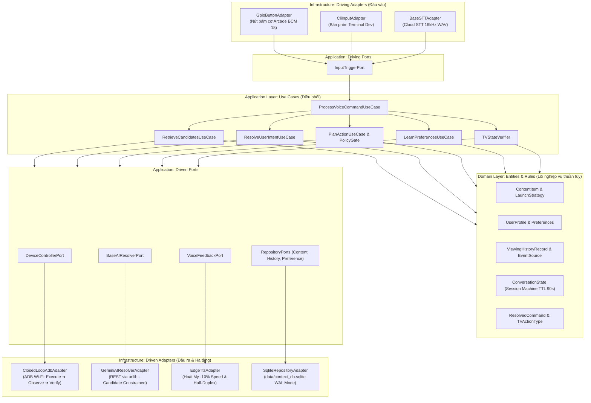
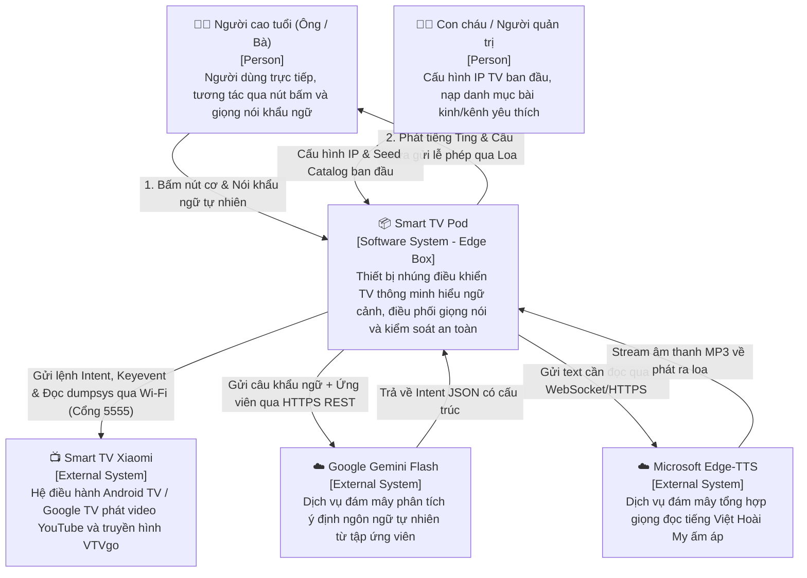
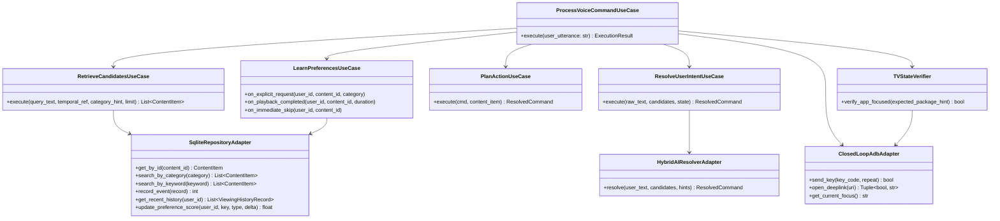
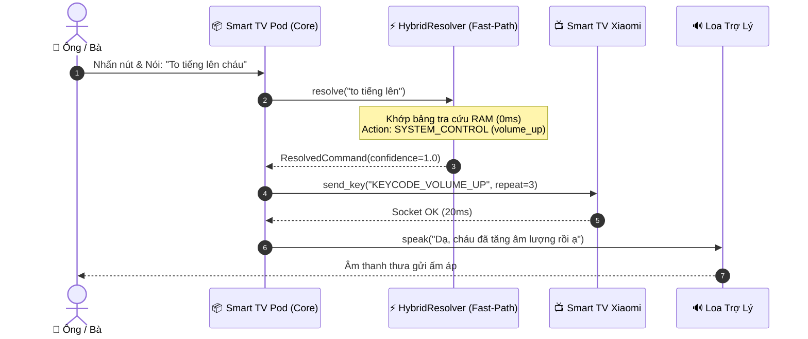
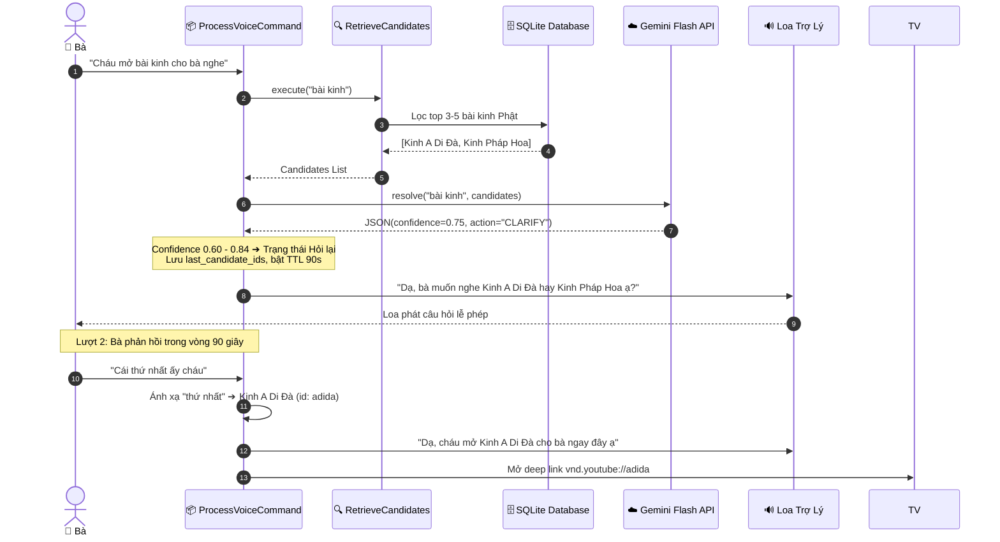
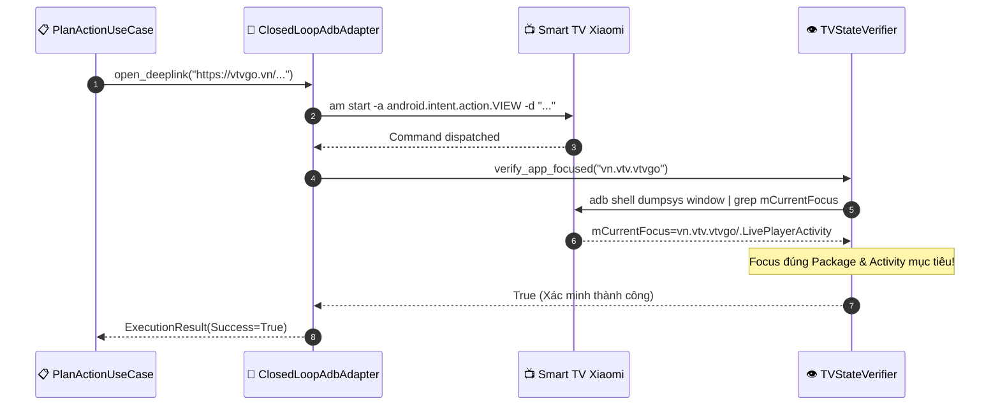
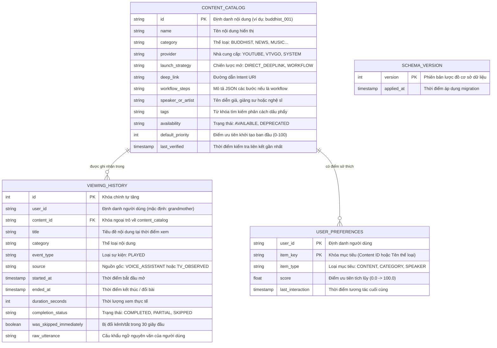

# TÀI LIỆU THIẾT KẾ KIẾN TRÚC PHẦN MỀM (SAD)
## DỰ ÁN: TRỢ LÝ TV THÔNG MINH HIỂU NGỮ CẢNH CHO NGƯỜI CAO TUỔI
### (Context-Aware Conversational TV Assistant for Elderly People)

**Mã tài liệu:** SAD-TV-ASSISTANT-2026  
**Phiên bản:** 2.0 (Clean Architecture & Edge-Centric Design)  
**Tiêu chuẩn áp dụng:** ISO/IEC/IEEE 42010:2011 (Systems and software engineering - Architecture description) & C4 Model  
**Tài liệu cơ sở:** SRS v2.1 ([srs.md](file:///d:/mic-control/srs.md))  
**Ngày phát hành:** 02/11/2026  
**Trạng thái:** Đã phê duyệt (Approved)  

---

## MỤC LỤC
1. [I. GIỚI THIỆU (INTRODUCTION)](#i-giới-thiệu-introduction)
   - 1.1 Mục đích (Purpose)
   - 1.2 Phạm vi kiến trúc (Scope)
   - 1.3 Thuật ngữ & Từ viết tắt (Definitions & Acronyms)
   - 1.4 Tài liệu tham chiếu (References)
2. [II. TỔNG QUAN KIẾN TRÚC (ARCHITECTURE OVERVIEW)](#ii-tổng-quan-kiến-trúc-architecture-overview)
   - 2.1 Các yếu tố chi phối kiến trúc (Architecture Drivers)
   - 2.2 Mục tiêu kiến trúc (Architectural Goals)
   - 2.3 Ràng buộc kiến trúc (Architectural Constraints)
   - 2.4 Phong cách kiến trúc (Architecture Style: Hexagonal / Ports & Adapters)
   - 2.5 Sơ đồ kiến trúc tổng quan (High-Level Architecture Diagram)
3. [III. BỐI CẢNH HỆ THỐNG (SYSTEM CONTEXT)](#iii-bối-cảnh-hệ-thống-system-context)
   - 3.1 Sơ đồ bối cảnh hệ thống (C4 Context Diagram)
   - 3.2 Các tác nhân và Hệ thống bên ngoài (Actors & External Systems)
   - 3.3 Giao diện đối ngoại (External Interfaces)
4. [IV. THIẾT KẾ KIẾN TRÚC CHI TIẾT (ARCHITECTURAL DESIGN)](#iv-thiết-kế-kiến-trúc-chi-tiết-architectural-design)
   - 4.1 Khung nhìn Logic (Logical View & Layer Separation)
   - 4.2 Sơ đồ thành phần (C4 Component Diagram)
   - 4.3 Trách nhiệm của các thành phần (Component Responsibilities)
   - 4.4 Thiết kế tương tác (Sequence Diagrams)
     - Luồng 1: Fast-Path tức thì Offline
     - Luồng 2: AI-Path với Candidate Retrieval & Đối thoại làm rõ
     - Luồng 3: Điều khiển TV vòng lặp đóng (Closed-Loop ADB)
   - 4.5 Khung nhìn triển khai (C4 Deployment View)
   - 4.6 Ngăn xếp công nghệ & Cơ sở lựa chọn (Technology Stack & Justification)
5. [V. KIẾN TRÚC DỮ LIỆU (DATA ARCHITECTURE)](#v-kiến-trúc-dữ-liệu-data-architecture)
   - 5.1 Mô hình dữ liệu quan hệ (Entity-Relationship Diagram - ERD)
   - 5.2 Thiết kế cơ sở dữ liệu vật lý (SQLite WAL Mode & Schema Versioning)
   - 5.3 Luồng dữ liệu (Data Flow Diagram - DFD Level 1)
   - 5.4 Vòng đời dữ liệu (Data Lifecycle & Session TTL)
   - 5.5 Bảo vệ và cô lập dữ liệu (Data Privacy & Minimal Context)
6. [VI. KIẾN TRÚC BẢO MẬT (SECURITY ARCHITECTURE)](#vi-kiến-trúc-bảo-mật-security-architecture)
   - 6.1 Yêu cầu bảo mật cốt lõi
   - 6.2 Mô hình đe dọa (STRIDE Threat Model)
   - 6.3 Xác thực và Kiểm soát truy cập (Authentication & Access Control)
   - 6.4 Bảo vệ dữ liệu truyền tải và lưu trữ (Data Protection)
   - 6.5 Các chốt chặn an toàn (Policy Gate & Safeguards)
   - 6.6 Giám sát và Kiểm toán (Audit Logging)
7. [VII. THUỘC TÍNH CHẤT LƯỢNG (QUALITY ATTRIBUTES)](#vii-thuộc-tính-chất-lượng-quality-attributes)
   - 7.1 Hiệu năng và Ngân sách độ trễ (Performance & Latency Budget)
   - 7.2 Khả năng mở rộng (Scalability)
   - 7.3 Tính sẵn sàng và Khả năng chịu lỗi (Availability & Fault Tolerance)
   - 7.4 Độ tin cậy và Toàn vẹn (Reliability & Robustness)
   - 7.5 Khả năng bảo trì và Kiểm thử (Maintainability & Testability)
   - 7.6 Khả năng tương tác (Interoperability)
8. [VIII. CÁC QUYẾT ĐỊNH KIẾN TRÚC (ARCHITECTURAL DECISIONS - ADRS)](#viii-các-quyết-định-kiến-trúc-architectural-decisions---adrs)
   - 8.1 ADR-01: Lựa chọn Hexagonal Architecture (Ports & Adapters)
   - 8.2 ADR-02: Lựa chọn SQLite nhúng WAL Mode thay vì Vector Database
   - 8.3 ADR-03: Lựa chọn Candidate-Constrained Selection thay vì Dump Prompt
   - 8.4 ADR-04: Lựa chọn Closed-Loop ADB Control thay vì Fire-and-Forget
   - 8.5 ADR-05: Lựa chọn Push-to-Talk cơ học & Half-Duplex Gating
   - 8.6 ADR-06: Tách rời Fast-Path Offline và AI-Path
   - 8.7 Bảng đánh đổi kiến trúc (Architectural Trade-offs)
9. [IX. KIẾN TRÚC VẬN HÀNH (OPERATIONAL ARCHITECTURE)](#ix-kiến-trúc-vận-hành-operational-architecture)
   - 9.1 Chiến lược triển khai (Deployment Strategy: Linux systemd)
   - 9.2 Quản lý cấu hình (Configuration Management)
   - 9.3 Giám sát và Quan sát hệ thống (Monitoring & Observability)
   - 9.4 Sao lưu và Phục hồi sau sự cố (Backup & Disaster Recovery)
   - 9.5 Chiến lược kiểm thử tự động (Automated Testing Strategy)
10. [X. PHỤ LỤC (APPENDICES)](#x-phụ-lục-appendices)
    - 10.1 Từ điển kiến trúc (Architecture Glossary)
    - 10.2 Bảng truy vết: SRS Requirements ➔ Drivers ➔ Decisions ➔ Components
    - 10.3 Tài liệu tham khảo kỹ thuật

---

## I. GIỚI THIỆU (INTRODUCTION)

### 1.1 Mục đích (Purpose)
Tài liệu Thiết kế Kiến trúc Phần mềm (SAD) này cung cấp cái nhìn toàn diện, sâu sắc và có hệ thống về kiến trúc của hệ thống **Smart TV Pod (Context-Aware Conversational TV Assistant for Elderly People)**.  
Tài liệu làm rõ:
- Cơ cấu tổ chức các tầng, các module và ranh giới trách nhiệm (*Boundary Separation*).
- Cách thức các thành phần phối hợp để giải quyết bài toán tương tác tự nhiên của người cao tuổi.
- Cơ sở khoa học của các quyết định thiết kế cốt lõi (ADRs) và các phân tích đánh đổi (*Trade-offs*).
- Cách hệ thống đáp ứng các thuộc tính chất lượng khắt khe về độ trễ, mức tiêu thụ RAM, an toàn vật lý và tính độc lập mạng.

Đối tượng phục vụ: Kiến trúc sư phần mềm, lập trình viên phát triển, kỹ sư kiểm thử (QA/QC), và người vận hành hệ thống nhúng.

### 1.2 Phạm vi kiến trúc (Scope)
* **Trong phạm vi kiến trúc (In-Scope):**
  - Toàn bộ thiết kế phần mềm chạy trên thiết bị Smart TV Pod (Raspberry Pi / PC Dev).
  - Tầng lõi nghiệp vụ thuần túy (Domain Entities & Value Objects).
  - Tầng điều phối ca sử dụng (Application Use Cases & Ports).
  - Tầng hạ tầng chuyển đổi (Infrastructure Adapters: SQLite Persistence, Closed-Loop ADB, Gemini Flash REST, Edge-TTS, GPIO PTT).
  - Cơ chế quản lý dữ liệu ngữ cảnh (User Profile, Viewing History, Conversation State).
  - Chiến lược bảo mật, phân cấp tin cậy (Policy Gate) và vận hành dịch vụ nền (Linux systemd).
* **Ngoài phạm vi kiến trúc (Out-of-Scope):**
  - Thiết kế vi mạch phần cứng bo mạch hoặc firmware bên trong TV Xiaomi.
  - Hạ tầng mạng viễn thông đám mây của Google (Gemini) hoặc Microsoft (Edge-TTS).

### 1.3 Thuật ngữ & Từ viết tắt (Definitions & Acronyms)

| Viết tắt / Khái niệm | Tên tiếng Anh đầy đủ | Ý nghĩa kiến trúc |
| :--- | :--- | :--- |
| **SAD** | Software Architecture Document | Tài liệu đặc tả kiến trúc phần mềm. |
| **Clean Architecture** | Clean / Hexagonal Architecture | Kiến trúc phân tầng độc lập dựa trên nguyên lý Dependency Inversion. |
| **ADR** | Architecture Decision Record | Bản ghi nhận quyết định kiến trúc và cơ sở đánh đổi. |
| **PTT** | Push-to-Talk | Cơ chế ngắt luồng thu âm vật lý bằng nút cơ. |
| **AEC** | Acoustic Echo Cancellation | Khử tiếng vọng âm thanh giữa micro và loa. |
| **TTL** | Time-To-Live | Thời gian sống của phiên làm việc trong RAM (90 giây). |
| **WAL** | Write-Ahead Logging | Chế độ ghi nhật ký trước của SQLite giúp tăng tốc độ đọc/ghi đồng thời. |
| **Closed-Loop** | Closed-Loop Control | Kiểm soát vòng lặp đóng: Phát lệnh ➔ Quan sát ➔ Xác minh ➔ Xử lý lỗi. |
| **Idempotent** | Idempotent Action | Thao tác gửi nhiều lần vẫn giữ nguyên trạng thái hệ thống. |
| **RSS** | Resident Set Size | Dung lượng bộ nhớ RAM thực tế tiến trình chiếm dụng trong hệ điều hành. |

### 1.4 Tài liệu tham chiếu (References)
1. **SRS v2.1:** [srs.md](file:///d:/mic-control/srs.md) - Software Requirements Specification.
2. **Khung dự án:** [khung.md](file:///d:/mic-control/khung.md) - Tài liệu đặc tả bài toán và trải nghiệm người cao tuổi.
3. **Tech Stack:** [tech-stack.md](file:///d:/mic-control/tech-stack.md) - Tài liệu công nghệ và phần cứng.
4. **Robert C. Martin (Uncle Bob):** *Clean Architecture: A Craftsman's Guide to Software Structure and Design*.
5. **Alistair Cockburn:** *Hexagonal Architecture (Ports and Adapters Pattern)*.
6. **Simon Brown:** *The C4 Model for Visualising Software Architecture*.

---

## II. TỔNG QUAN KIẾN TRÚC (ARCHITECTURE OVERVIEW)

### 2.1 Các yếu tố chi phối kiến trúc (Architecture Drivers)
Kiến trúc của Smart TV Pod được định hình bởi 5 yếu tố chi phối cốt tử:
1. **Đặc thù người dùng cao tuổi (Elderly Ergonomics):** Giọng nói chậm, ngập ngừng, khẩu ngữ mang tính ngữ cảnh thời gian (*"mở cái hôm qua"*, *"bật bài sáng nay"*); tay run không bấm được remote; cần phản hồi giọng nói kính cẩn, tốc độ chậm rãi.
2. **Tính bất định của AI (LLM Non-determinism & Hallucination):** LLM có thể sinh ID ảo, nhầm lẫn video hoặc trả về JSON sai cú pháp. Kiến trúc phải cách ly AI, chỉ cho phép chọn trong tập ứng viên có thực (Candidate-Constrained).
3. **Ranh giới điều khiển vật lý (Physical Device Gating):** ADB là giao thức "mù" (open-loop). Gửi lệnh không đồng nghĩa TV phát thành công. Kiến trúc phải có chu trình khép kín xác minh và kiểm soát an toàn lệnh nhạy cảm (tắt TV).
4. **Giới hạn tài nguyên phần cứng nhúng (Edge Constraints):** Thiết bị chạy 24/7 trên Raspberry Pi Zero 2W với 512MB RAM. Ứng dụng phải cực kỳ tinh gọn ($< 45\text{MB}$ RAM), không được dùng Docker nặng hay server database độc lập.
5. **Sống sót khi mất Internet (Offline Survivability):** Khi đứt mạng gia đình, các lệnh cơ bản (âm lượng, tắt TV, kênh thời sự VTV1) bắt buộc phải hoạt động bình thường qua Fast-Path.

### 2.2 Mục tiêu kiến trúc (Architectural Goals)
* **Độc lập công nghệ (Modularity & Decoupling):** Lõi nghiệp vụ (Domain) không phụ thuộc vào bất kỳ thư viện bên ngoài nào. Có thể thay thế Gemini bằng Local LLM, thay Edge-TTS bằng loa khác, thay Xiaomi bằng Samsung mà không sửa đổi Domain.
* **Độ trễ thấp & Phản hồi nhạy bén (Low Latency):** Phản hồi cảm giác nút bấm $< 15\text{ms}$; Fast-Path gửi lệnh $< 50\text{ms}$; AI-Path gửi lệnh $< 1.8\text{s}$ (p95).
* **An toàn & Minh bạch (Safety First):** Khống chế tỷ lệ mở sai nội dung (*Wrong Action Rate*) dưới $3\%$. Thà hỏi lại lễ phép còn hơn đoán mò.

### 2.3 Ràng buộc kiến trúc (Architectural Constraints)
* **Ngôn ngữ triển khai:** 100% Pure Python 3.10+ (Không đa ngôn ngữ, không cài Node.js).
* **Bộ nhớ:** Resident Set Size (RSS) của tiến trình $< 45\text{MB}$ RAM.
* **Lưu trữ:** SQLite3 nhúng sẵn trong Python standard library; không cài đặt PostgreSQL/MySQL/MongoDB/Redis.
* **Mạng nội bộ:** Giao tiếp TV hoàn toàn qua giao thức ADB TCP/IP cổng 5555 qua mạng Wi-Fi LAN gia đình.

### 2.4 Phong cách kiến trúc (Architecture Style: Hexagonal / Ports & Adapters)
Hệ thống áp dụng phong cách **Clean Architecture / Hexagonal Architecture (Ports and Adapters)**:
- **Tâm điểm (Domain):** Chứa các thực thể và quy tắc nghiệp vụ bất biến.
- **Vòng trong (Application):** Chứa các Ca sử dụng (Use Cases) điều phối luồng xử lý và định nghĩa các Cổng giao tiếp trừu tượng (Ports).
- **Vòng ngoài (Infrastructure):** Chứa các Bộ điều hợp (Adapters) cụ thể hóa công nghệ: ADB, SQLite, Gemini, Edge-TTS, GPIO.
- **Quy tắc phụ thuộc (Dependency Inversion Rule):** Mọi phụ thuộc mã nguồn đều hướng từ ngoài vào trong. Vòng trong tuyệt đối không biết chi tiết triển khai của vòng ngoài.

### 2.5 Sơ đồ kiến trúc tổng quan (High-Level Architecture Diagram)



---

## III. BỐI CẢNH HỆ THỐNG (SYSTEM CONTEXT)

### 3.1 Sơ đồ bối cảnh hệ thống (C4 Context Diagram)



### 3.2 Các tác nhân và Hệ thống bên ngoài (Actors & External Systems)
* **Người cao tuổi (Primary Actor):** Tác nhân trung tâm thụ hưởng giải pháp.
* **Smart TV Xiaomi (Controlled System):** Thiết bị chịu sự điều khiển qua mạng nội bộ; chứa các ứng dụng phát nội dung: VTVgo (`vn.vtv.vtvgo`), YouTube TV (`com.google.android.youtube.tv`).
* **Google Gemini Flash API:** Cung cấp năng lực suy luận ngữ nghĩa nhanh ($< 700\text{ms}$), phân tích khẩu ngữ thành cấu trúc JSON.
* **Microsoft Edge-TTS:** Cung cấp âm thanh phản hồi thân thiện, chuẩn xác giọng vùng miền tiếng Việt.
* **Cloud Speech-to-Text (STT):** Tiếp nhận buffer âm thanh Linear PCM 16kHz WAV và chuyển đổi thành văn bản.

### 3.3 Giao diện đối ngoại (External Interfaces)
1. **Giao diện Nút cơ & Cảm quan:** GPIO BCM 18 (Nút bấm Arcade PTT), GPIO 23/24 (LED RGB), Loa mini USB (Âm báo Ting & Giọng thưa gửi).
2. **Giao diện ADB TCP/IP (Mạng LAN):** Cổng TCP `5555` kết nối socket trực tiếp tới TV Xiaomi.
3. **Giao diện Đám mây (Internet):** HTTPS TLS 1.3 (Cổng TCP `443`) kết nối Gemini và Edge-TTS.

---

## IV. THIẾT KẾ KIẾN TRÚC CHI TIẾT (ARCHITECTURAL DESIGN)

### 4.1 Khung nhìn Logic (Logical View & Layer Separation)

Hệ thống được chia làm 3 tầng nghiêm ngặt:
* **Tầng 1: Domain Layer (Lõi miền nghiệp vụ):**
  - Chứa toàn bộ các thực thể: `ContentItem`, `UserProfile`, `ViewingHistoryRecord`, `ConversationState`, `ResolvedCommand`.
  - Không có bất kỳ phụ thuộc nào vào framework, hệ điều hành hay thư viện ngoài.
* **Tầng 2: Application Layer (Ca sử dụng & Cổng giao tiếp):**
  - Định nghĩa các Driving Ports: `InputTriggerPort`.
  - Định nghĩa các Driven Ports: `DeviceControllerPort`, `BaseAIResolverPort`, `VoiceFeedbackPort`, `ContentRepositoryPort`, `HistoryRepositoryPort`, `PreferenceRepositoryPort`.
  - Triển khai các Use Cases: `ProcessVoiceCommandUseCase`, `RetrieveCandidatesUseCase`, `ResolveUserIntentUseCase`, `PlanActionUseCase`, `LearnPreferencesUseCase`, `TVStateVerifier`.
* **Tầng 3: Infrastructure Layer (Bộ chuyển đổi hạ tầng):**
  - Triển khai chi tiết phần cứng và giao thức mạng: `ClosedLoopAdbAdapter`, `SqliteRepositoryAdapter`, `GeminiAIResolverAdapter`, `HybridAIResolverAdapter`, `EdgeTtsAdapter`, `GpioButtonAdapter`, `CliInputAdapter`.

### 4.2 Sơ đồ thành phần (C4 Component Diagram)



### 4.3 Trách nhiệm của các thành phần (Component Responsibilities)

| Thành phần (Component) | Tầng kiến trúc | Trách nhiệm chính trong hệ thống |
| :--- | :--- | :--- |
| **`ProcessVoiceCommandUseCase`** | Application | **Tổng chỉ huy (Orchestrator):** Tiếp nhận văn bản khẩu ngữ, điều phối tuần tự qua Retriever $\to$ Resolver $\to$ Planner $\to$ Device $\to$ Verifier $\to$ Learning $\to$ Voice. |
| **`RetrieveCandidatesUseCase`** | Application | **Trích xuất ứng viên (RAG for TV):** Truy vấn SQLite lọc 3–5 ứng viên phù hợp nhất dựa trên từ khóa, thể loại và mốc thời gian (*"hôm qua"*). |
| **`ResolveUserIntentUseCase`** | Application | **Phân loại ý định 3 trạng thái:** Đánh giá Calibrated Confidence: $\ge 0.85$ thực thi; $0.60–0.84$ hỏi lại làm rõ; $< 0.60$ yêu cầu nói lại. Xử lý hội thoại đa lượt. |
| **`PlanActionUseCase`** | Application | **Lập kế hoạch & Chốt an toàn (Policy Gate):** Ánh xạ chiến lược mở nội dung (Deep Link / Workflow); chặn lệnh tắt TV khi không chắc chắn. |
| **`TVStateVerifier`** | Application | **Xác minh trạng thái TV:** Gọi ADB `dumpsys window` kiểm tra xem màn hình foreground có đúng package/activity mục tiêu không. |
| **`LearnPreferencesUseCase`** | Application | **Động cơ học hành vi Heuristic:** Điều chỉnh điểm ưu tiên theo công thức thưởng phạt (+3 yêu cầu, +2 xem hết, -2 đổi bài). |
| **`ClosedLoopAdbAdapter`** | Infrastructure | **Điều khiển TV vòng lặp đóng:** Quản lý kết nối ADB Wi-Fi, gửi keyevent/deeplink, tự phục hồi khi mất mạng, giới hạn retry tối đa 2 lần. |
| **`SqliteRepositoryAdapter`** | Infrastructure | **Lưu trữ dữ liệu nhúng:** Thực thi các thao tác CRUD an toàn với ACID và FTS5 trên file cục bộ `data/context_db.sqlite`. |
| **`HybridAIResolverAdapter`** | Infrastructure | **Bộ định tuyến lai:** Bắt lệnh nhanh Fast-Path trong $< 20\text{ms}$ Offline; chuyển tiếp khẩu ngữ tự nhiên sang Gemini Flash. |
| **`EdgeTtsAdapter`** | Infrastructure | **Phản hồi âm thanh:** Tổng hợp giọng đọc Hoài My ấm áp (-10% speed) và kích hoạt cơ chế Half-Duplex Gating khóa mic khi phát. |

### 4.4 Thiết kế tương tác (Sequence Diagrams)

#### Luồng 1: Fast-Path tức thì Offline (Âm lượng, Tắt TV, Kênh VTV1)


#### Luồng 2: AI-Path với Candidate Retrieval & Đối thoại làm rõ (Clarification)


#### Luồng 3: Điều khiển TV vòng lặp đóng (Closed-Loop ADB Execution & Verification)


### 4.5 Khung nhìn triển khai (C4 Deployment View)

```mermaid
flowchart TD
    subgraph ROOM ["Phòng khách gia đình"]
        subgraph POD_NODE ["Smart TV Pod (Đặt tại bàn trà)"]
            OS["Linux OS (Raspberry Pi OS 64-bit)"]
            subgraph PYTHON_PROC ["Tiến trình Python 3.10 (systemd service)"]
                App["app.py (Orchestrator)"]
                Core["Clean Architecture Modules"]
                DB_Engine["SQLite 3.40 (In-process Engine)"]
            end
            Storage["Thẻ nhớ MicroSD: data/context_db.sqlite"]
            HW_Btn["Nút bấm Arcade máy thùng 30/60mm"]
            HW_Mic["Micro USB định hướng lọc ồn"]
            HW_Spk["Loa mini USB 3W"]
            HW_LED["LED RGB 5mm"]
        end

        subgraph TV_NODE ["Khu vực kệ TV"]
            TV_Device["📺 Smart TV Xiaomi (Android TV 11.0)"]
            TV_Apps["Ứng dụng: VTVgo, YouTube TV"]
            TV_Daemon["adbd daemon (Lắng nghe TCP Port 5555)"]
        end

        subgraph NETWORK ["Mạng Wi-Fi LAN gia đình (Router 2.4GHz)"]
            WLAN["Wi-Fi 802.11 b/g/n (Dải IP LAN: 192.168.1.0/24)"]
        end
    end

    subgraph CLOUD ["Đám mây Internet (WAN)"]
        Gemini_Cloud["Google Cloud: Gemini Flash API (Port 443)"]
        EdgeTTS_Cloud["Microsoft Azure: Edge-TTS Service (Port 443)"]
    end

    HW_Btn -- "GPIO 18" --> Core
    HW_LED <-- "GPIO 23/24" -- Core
    HW_Mic -- "USB Audio" --> Core
    Core -- "USB Audio" --> HW_Spk
    DB_Engine <--> Storage

    PYTHON_PROC <--> WLAN
    WLAN <--> TV_Daemon
    TV_Daemon --> TV_Apps

    PYTHON_PROC <-- "TLS 1.3" --> Gemini_Cloud
    PYTHON_PROC <-- "TLS 1.3" --> EdgeTTS_Cloud
```

### 4.6 Ngăn xếp công nghệ & Cơ sở lựa chọn (Technology Stack & Justification)

| Thành phần | Công nghệ lựa chọn | Các lựa chọn đã bị loại bỏ | Cơ sở kỹ thuật lựa chọn |
| :--- | :--- | :--- | :--- |
| **Ngôn ngữ lõi** | **Pure Python 3.10+** | Node.js, C++, Go | Thư viện chuẩn phong phú, code ngắn gọn, tích hợp sẵn SQLite, tiêu thụ RAM cực thấp ($< 45\text{MB}$), dễ bảo trì. |
| **Cơ sở dữ liệu** | **SQLite3 nhúng (WAL Mode)** | PostgreSQL, Redis, MongoDB | 0 cấu hình, không tốn tiến trình nền riêng, hỗ trợ ACID, Full-Text Search FTS5, file gói gọn trong thẻ nhớ. |
| **Mô hình AI** | **Google Gemini Flash (qua REST)** | OpenAI GPT-4, Llama cục bộ | Độ trễ cực nhanh ($< 700\text{ms}$), chi phí cực thấp, hỗ trợ tiếng Việt xuất sắc, gọi qua `urllib` chuẩn không cần SDK nặng. |
| **Tổng hợp giọng** | **Microsoft Edge-TTS** | Google TTS, eSpeak, Festival | Giọng Hoài My tiếng Việt rất tự nhiên, ấm áp, ngắt nghỉ rõ ràng, hỗ trợ điều chỉnh tốc độ đọc chậm (-10%). |
| **Điều khiển TV** | **ADB Wi-Fi (Cổng 5555)** | Hồng ngoại (IR Blaster), HDMI-CEC | Điều khiển 2 chiều không bị cản tầm nhìn, mở sâu được link video/kênh truyền hình (Deep Link), quan sát được trạng thái qua dumpsys. |
| **Giao tiếp phần cứng**| **Linux sysfs / RPi.GPIO** | Arduino trung gian | Giao tiếp trực tiếp bo mạch Raspberry Pi, độ trễ bắt ngắt nút bấm $< 15\text{ms}$. |

---

## V. KIẾN TRÚC DỮ LIỆU (DATA ARCHITECTURE)

### 5.1 Mô hình dữ liệu quan hệ (Entity-Relationship Diagram - ERD)



### 5.2 Thiết kế cơ sở dữ liệu vật lý (SQLite WAL Mode & Schema Versioning)
* **Tệp lưu trữ:** `data/context_db.sqlite`.
* **Cơ chế tối ưu (WAL Mode):**  
  Thực thi lệnh `PRAGMA journal_mode=WAL;` và `PRAGMA synchronous=NORMAL;` khi khởi tạo kết nối. Điều này cho phép các tác vụ đọc (truy vấn ứng viên) và tác vụ ghi (nhật ký xem) diễn ra đồng thời mà không bị khóa file (*Database Lock*).
* **Quản lý phiên bản (Schema Versioning):** Bảng `schema_version` lưu vết phiên bản migration. Khi khởi động, `init_database()` kiểm tra phiên bản hiện tại để áp dụng các câu lệnh `ALTER TABLE` tự động nếu có bản cập nhật mới.

### 5.3 Luồng dữ liệu (Data Flow Diagram - DFD Level 1)

```
[Người dùng] ──(Khẩu ngữ thô)──> [1.0 Bắt âm thanh & STT]
                                            │
                                 (Chuỗi văn bản đã làm sạch)
                                            ▼
[SQLite DB] <──(Lọc ứng viên)── [2.0 Context Engine & Retrieval]
                                            │
                                  (3-5 Ứng viên phù hợp)
                                            ▼
[Cloud AI]  <──(Prompt + Ứng viên)─ [3.0 AI Intent Resolution]
                                            │
                                 (ResolvedCommand có cấu trúc)
                                            ▼
                                [4.0 Policy Gate & Planning]
                                            │
                                 (Lệnh an toàn đã xác thực)
                                            ▼
[Smart TV]  <──(Lệnh ADB Wi-Fi)── [5.0 Closed-Loop Controller]
                                            │
                                 (Sự kiện phát thành công)
                                            ▼
[SQLite DB] <──(Ghi nhật ký)──── [6.0 History & Learning Engine]
```

### 5.4 Vòng đời dữ liệu (Data Lifecycle & Session TTL)
1. **Dữ liệu hội thoại tạm thời (In-Memory Session):** Đối tượng `ConversationState` lưu trữ trong RAM; có thời gian sống **TTL 90 giây**. Nếu quá 90 giây không có tương tác, toàn bộ slot và ID ứng viên tự động reset về `IDLE`.
2. **Dữ liệu âm thanh tạm thời:** Buffer âm thanh Linear PCM trong RAM bị giải phóng và xóa hoàn toàn ngay sau khi STT trả về văn bản.
3. **Dữ liệu nhật ký xem lâu dài:** Lưu trữ trong SQLite. Định kỳ mỗi 90 ngày hoặc khi database đạt 2.000 bản ghi, hệ thống tự động dọn dẹp các bản ghi cũ không quan trọng để kiểm soát dung lượng file $< 20\text{MB}$.

### 5.5 Bảo vệ và cô lập dữ liệu (Data Privacy & Minimal Context)
* **Nguyên tắc Minimal Context:** Tuyệt đối không gửi toàn bộ lịch sử xem gia đình lên Cloud LLM. Chỉ gửi tối đa 5 ứng viên đã lọc ẩn danh cùng câu khẩu ngữ hiện tại.
* **Không lưu trữ giọng nói:** Không ghi file `.wav` lâu dài trên thẻ nhớ SD để bảo vệ quyền riêng tư gia đình.

---

## VI. KIẾN TRÚC BẢO MẬT (SECURITY ARCHITECTURE)

### 6.1 Yêu cầu bảo mật cốt lõi
1. Ngăn chặn thiết bị lạ chiếm quyền điều khiển Smart TV trong mạng LAN.
2. Bảo vệ thông tin đời tư sinh hoạt của gia đình khỏi việc rò rỉ lên Internet.
3. Bảo vệ khóa bí mật (API Keys) khỏi việc bị trích xuất trái phép.

### 6.2 Mô hình đe dọa (STRIDE Threat Model)

| Đe dọa (STRIDE) | Nguy cơ cụ thể đối với hệ thống | Biện pháp kỹ thuật kiểm soát trong kiến trúc |
| :--- | :--- | :--- |
| **Spoofing (Giả mạo)** | Kẻ xấu trong mạng LAN giả mạo lệnh gửi tới cổng ADB TV. | Cấu hình tường lửa IP tĩnh; chỉ chấp nhận lệnh từ MAC/IP của Smart TV Pod. |
| **Tampering (Can thiệp dữ liệu)** | File database `context_db.sqlite` bị chỉnh sửa bất hợp pháp. | Phân quyền file hệ thống Linux `chmod 600` chỉ user tiến trình mới có quyền đọc/ghi. |
| **Repudiation (Chối bỏ)** | Không xác định được nguyên nhân TV phát nội dung lạ. | Lưu trường `source = 'VOICE_ASSISTANT'` trong `viewing_history` để đối soát. |
| **Information Disclosure (Lộ dữ liệu)** | Giọng nói hoặc thói quen sinh hoạt bị rò rỉ ra ngoài. | Xóa buffer audio ngay sau khi dùng; chỉ truyền dữ liệu context tối thiểu qua TLS 1.3. |
| **Denial of Service (Từ chối dịch vụ)**| Người dùng nhấn nút liên tục làm nghẽn tiến trình; API Cloud bị spam. | Cơ chế Debounce nút bấm cơ; hàng đợi đơn luồng cho Use Case; giới hạn timeout API 3s. |
| **Elevation of Privilege (Leo thang quyền)**| Hacker lợi dụng quyền ADB shell để cài mã độc vào TV Xiaomi. | Ứng dụng chạy dưới quyền non-root user trên Linux; chỉ thực thi danh sách trắng các lệnh ADB. |

### 6.3 Xác thực và Kiểm soát truy cập (Authentication & Access Control)
* **Xác thực ADB:** Sử dụng cơ chế xác thực khóa công khai RSA (`adbkey` / `adbkey.pub`) lưu an toàn tại `/home/pi/.android/`.
* **Phân quyền ứng dụng:** Tiến trình chạy dưới user hệ thống giới hạn quyền `smartpod`, không chạy dưới quyền `root`.

### 6.4 Bảo vệ dữ liệu truyền tải và lưu trữ (Data Protection)
* Mọi kết nối ra ngoài Internet (Gemini API, Edge-TTS) đều bắt buộc mã hóa qua giao thức **TLS 1.3** trên cổng 443.
* API Keys được lưu trữ trong tệp môi trường `.env` với quyền phân cấp hạn chế.

### 6.5 Các chốt chặn an toàn (Policy Gate & Safeguards)
* **Cấm AI gọi phần cứng:** Toàn bộ lệnh điều khiển TV phải bắt nguồn từ `PlanActionUseCase`. Mô hình AI chỉ trả về đối tượng dữ liệu Intent, không có quyền gọi trực tiếp bất kỳ tiến trình hệ thống nào.
* **Chặn lệnh tắt TV nhạy cảm:** Nếu câu nói không dứt khoát hoặc Calibrated Confidence $< 0.85$, lệnh tắt TV bắt buộc phải chuyển thành câu hỏi xác nhận bằng giọng nói.

### 6.6 Giám sát và Kiểm toán (Audit Logging)
Hệ thống sử dụng module `logging` chuẩn của Python với cơ chế ghi file xoay vòng (*Rotating File Logging*):
- File ghi: `logs/pod.log` (tối đa 5MB/file, lưu trữ tối đa 3 file).
- Định dạng chuẩn: `[TIMESTAMP] [LEVEL] [COMPONENT] Message` phục vụ việc truy vết khi có sự cố.

---

## VII. THUỘC TÍNH CHẤT LƯỢNG (QUALITY ATTRIBUTES)

### 7.1 Hiệu năng và Ngân sách độ trễ (Performance & Latency Budget)

Kiến trúc phân bổ ngân sách thời gian xử lý nghiêm ngặt nhằm đảm bảo người già không bị cảm giác chờ đợi:

| Mắt xích trong chu trình | Ngân sách thời gian (Target) | Phương thức tối ưu hóa kiến trúc |
| :--- | :---: | :--- |
| **Phản hồi nút bấm $\to$ LED & Ting** | **$< 15\text{ms}$** | Bắt ngắt phần cứng GPIO trực tiếp, không qua polling. |
| **Fast-Path Offline Dispatch** | **p50 $< 20\text{ms}$, p95 $< 50\text{ms}$** | Bảng ánh xạ băm (Hash Map) trong RAM, gửi thẳng socket ADB. |
| **Thu âm & Chuyển giọng (STT)** | **$< 600\text{ms}$** | Stream trực tiếp luồng audio 16kHz PCM WAV. |
| **Candidate Retrieval (SQLite)** | **p95 $< 10\text{ms}$** | Sử dụng chỉ mục Index trên `category` và FTS5 trên thẻ `tags`. |
| **Phân tích ý định qua LLM** | **$< 700\text{ms}$** | Dùng model Gemini Flash với System Prompt rút gọn $< 400$ tokens. |
| **Closed-Loop ADB Dispatch** | **$< 150\text{ms}$** | Socket TCP/IP nội bộ trong mạng LAN gia đình. |
| **Tổng ngân sách Dispatch Latency** | **p50 $< 1.5\text{s}$, p95 $< 1.8\text{s}$** | Đảm bảo TV nhận lệnh điều khiển trong vòng dưới 2 giây. |
| **Bộ nhớ thường trú (RAM RSS)** | **$< 45\text{MB}$** | Sử dụng thư viện chuẩn Python, cấu trúc dữ liệu Dataclass nhẹ. |

### 7.2 Khả năng mở rộng (Scalability)
* **Mở rộng nội dung:** Thiết kế bảng `content_catalog` cho phép mở rộng từ 30 bài lên 500 bài quen thuộc mà thời gian truy vấn SQLite vẫn duy trì $< 15\text{ms}$.
* **Mở rộng thiết bị:** Thay đổi TV Xiaomi sang Samsung Tizen hoặc Android TV khác chỉ cần viết thêm một `SamsungDeviceAdapter` triển khai `DeviceControllerPort` mà không sửa đổi Domain Use Cases.

### 7.3 Tính sẵn sàng và Khả năng chịu lỗi (Availability & Fault Tolerance)
* **Dịch vụ tự phục hồi:** Ứng dụng chạy dưới dạng `systemd` daemon. Nếu xảy ra sự cố sập nguồn hoặc crash đột ngột, hệ thống tự động khởi động lại trong vòng $< 5\text{giây}$.
* **Tự kết nối lại ADB:** Nếu TV tắt màn hình sang chế độ ngủ hoặc đổi địa chỉ mạng, `ClosedLoopAdbAdapter` tự động thực thi chuỗi kết nối lại trong vòng $< 3.0\text{s}$ khi có lệnh mới.
* **Sống sót khi rớt Internet:** 100% các lệnh điều khiển hệ thống thiết yếu hoạt động hoàn toàn Offline.

### 7.4 Độ tin cậy và Toàn vẹn (Reliability & Robustness)
* **Chống đóng kén sở thích (Exploration vs Exploitation):** Thuật toán Heuristic quy định cứ 5 lần mở nội dung cùng thể loại thì có 1 lần đề xuất nội dung mới để người già không cảm thấy nhàm chán.
* **Khống chế Wrong Action Rate:** Áp dụng phân nhánh 3 trạng thái. Nếu không tự tin $\ge 0.85$, hệ thống luôn hỏi lại làm rõ thay vì mở liều nội dung sai.

### 7.5 Khả năng bảo trì và Kiểm thử (Maintainability & Testability)
* **Kiểm thử tự động 100% không cần phần cứng:** Nhờ Ports & Adapters, toàn bộ các Use Case nghiệp vụ được kiểm thử tự động bằng `MockDeviceAdapter` và `ConsoleVoiceAdapter` (22 unit tests hiện hành chạy trong $0.6\text{s}$).
* **Dependency Injection:** Toàn bộ phụ thuộc được nạp từ ngoài vào tại `app.py`, dễ dàng mock để viết integration test.

### 7.6 Khả năng tương tác (Interoperability)
* Sử dụng chuẩn giao tiếp công nghiệp mở: REST JSON (Cloud AI), Android Intent Scheme (`vtvgo://`, `vnd.youtube://`), TCP socket (ADB).

---

## VIII. CÁC QUYẾT ĐỊNH KIẾN TRÚC (ARCHITECTURAL DECISIONS - ADRS)

### 8.1 ADR-01: Lựa chọn Hexagonal Architecture (Ports & Adapters)
* **Bối cảnh:** Hệ thống cần giao tiếp với nhiều phần cứng khác nhau (bàn phím PC dev vs nút bấm GPIO Raspberry Pi; điện thoại test vs TV Xiaomi; Cloud LLM vs Offline rule).
* **Quyết định:** Áp dụng kiến trúc Clean / Hexagonal Architecture. Tách biệt tuyệt đối Domain (Entities) $\leftrightarrow$ Application (Use Cases & Ports) $\leftrightarrow$ Infrastructure (Adapters).
* **Hệ quả:** Code có tính module cao, kiểm thử tự động 100% các use cases mà không cần cắm TV thật hay phần cứng Pi.

### 8.2 ADR-02: Lựa chọn SQLite nhúng WAL Mode thay vì Vector Database
* **Bối cảnh:** Cần lưu trữ lịch sử xem, hồ sơ sở thích và tìm kiếm nội dung quen thuộc của ông bà trên bo mạch nhúng hạn chế RAM (512MB).
* **Các phương án cân nhắc:**
  1. *Vector Database riêng (ChromaDB, Pinecone):* Quá nặng, tốn $> 200\text{MB}$ RAM, phụ thuộc thư viện native C++.
  2. *Plain JSON file:* Không hỗ trợ tìm kiếm có chỉ mục, dễ bị hỏng file (corrupted) khi mất điện đột ngột.
  3. *SQLite nhúng sẵn:* Có sẵn trong Python standard library, hỗ trợ ACID, Full-Text Search FTS5, tốn $< 5\text{MB}$ RAM.
* **Quyết định:** Lựa chọn **SQLite3 nhúng với WAL Mode**.
* **Hệ quả:** Tiết kiệm tối đa tài nguyên phần cứng, an toàn dữ liệu tuyệt đối khi mất điện.

### 8.3 ADR-03: Lựa chọn Candidate-Constrained Selection thay vì Dump Prompt
* **Bối cảnh:** Đưa toàn bộ danh mục hàng nghìn video vào System Prompt của LLM sẽ gây tốn chi phí token, tăng độ trễ và tăng nguy cơ AI bịa ra ID không tồn tại.
* **Quyết định:** Áp dụng mô hình 2 tầng (RAG for TV): Tầng 1 dùng SQLite lọc 3–5 ứng viên phù hợp $\to$ Tầng 2 chỉ gửi 3–5 ứng viên này cho Gemini Flash lựa chọn.
* **Hệ quả:** Giảm độ trễ xử lý LLM xuống $< 700\text{ms}$, triệt tiêu nguy cơ AI tự sinh ra ID ảo.

### 8.4 ADR-04: Lựa chọn Closed-Loop ADB Control thay vì Fire-and-Forget
* **Bối cảnh:** Lệnh ADB gửi qua Wi-Fi là một chiều. Gửi lệnh thành công không có nghĩa video đã phát trên màn hình TV (có thể TV bị đơ hoặc kẹt popup).
* **Quyết định:** Thiết kế TV Controller theo chu trình khép kín: *Execute ➔ Observe (`dumpsys window`) ➔ Verify Expected State ➔ Success / Retry / Report*. Cấm retry mù quáng với các lệnh non-idempotent.
* **Hệ quả:** Hệ thống biết chính xác trạng thái TV, tự động đưa TV về màn hình chính an toàn nếu app bị treo.

### 8.5 ADR-05: Lựa chọn Push-to-Talk cơ học & Half-Duplex Gating
* **Bối cảnh:** TV trong phòng khách thường phát âm thanh rất lớn. Nếu dùng kích hoạt giọng nói rảnh tay (Wake-word "Hey Siri") và Voice Activity Detection (VAD), hệ thống sẽ liên tục bị kích hoạt nhầm hoặc nhận dạng nhầm tiếng phát thanh viên thời sự.
* **Quyết định:** Sử dụng nút bấm cơ lớn màu đỏ (Push-to-Talk cơ học) để kiểm soát thời điểm thu âm, kết hợp cơ chế Half-Duplex Gating khóa micro khi loa đang phát thưa gửi.
* **Hệ quả:** Loại bỏ hoàn toàn tạp âm TV sau khi nhả nút; loại bỏ triệt để hiện tượng micro tự nghe lại tiếng của loa; người già cảm thấy an tâm vì chỉ khi bấm nút máy mới nghe.

### 8.6 ADR-06: Tách rời Fast-Path Offline và AI-Path
* **Bối cảnh:** Khi ông bà muốn tăng âm lượng hoặc tắt TV, việc phải chờ gọi Cloud LLM (mất 1.5s - 2.5s) và phụ thuộc Internet là bất hợp lý.
* **Quyết định:** Tách thành 2 luồng: Fast-Path xử lý cục bộ bằng bảng băm trong RAM ($< 50\text{ms}$, Offline 100%); AI-Path chỉ kích hoạt khi gặp câu khẩu ngữ phức tạp.
* **Hệ quả:** Độ trễ các lệnh cơ bản đạt mức tức thì, hệ thống vẫn dùng được khi mất mạng.

### 8.7 Bảng đánh đổi kiến trúc (Architectural Trade-offs)

| Lựa chọn kiến trúc | Lợi ích đạt được (Pros) | Đánh đổi chấp nhận (Cons / Costs) | Biện pháp giảm thiểu đánh đổi |
| :--- | :--- | :--- | :--- |
| **Push-to-Talk bằng nút cơ** | Khống chế nhiễu TV tuyệt đối sau khi nhả nút; đơn giản hóa kiến trúc. | Người già phải đưa tay nhấn giữ nút thay vì nói rảnh tay từ xa. | Dùng nút Arcade to đường kính 60mm, bấm cực êm, đặt ngay tại bàn trà cạnh chỗ ngồi. |
| **SQLite nhúng thay vì Vector DB** | Tinh gọn, tiêu thụ RAM $< 5\text{MB}$, không tốn CPU tính toán vector. | Tìm kiếm ngữ nghĩa tự do trên hàng triệu video YouTube bị hạn chế. | Tập trung vào danh mục 30–50 nội dung quen thuộc của ông bà; tìm kiếm tự do dùng YouTube fallback. |
| **Phân nhánh 3 trạng thái (Clarification)**| Giảm Wrong Action Rate xuống $< 3\%$, tránh làm người già bực bội. | Phát sinh thêm 1 lượt đối thoại khi yêu cầu nằm ở vùng mơ hồ ($0.60–0.84$). | Giới hạn câu hỏi chỉ chọn giữa 2 phương án ngắn gọn (*"Bài 1 hay Bài 2 ạ"*). |

---

## IX. KIẾN TRÚC VẬN HÀNH (OPERATIONAL ARCHITECTURE)

### 9.1 Chiến lược triển khai (Deployment Strategy: Linux systemd)
Hệ thống được đóng gói thành một dịch vụ nền độc lập trên Linux OS:
- File cấu hình: `/etc/systemd/system/smartpod.service`
```ini
[Unit]
Description=Smart TV Pod Voice Assistant for Grandparents
After=network-online.target
Wants=network-online.target

[Service]
Type=simple
User=pi
WorkingDirectory=/home/pi/mic-control
ExecStart=/usr/bin/python3 /home/pi/mic-control/app.py
Restart=always
RestartSec=5
EnvironmentFile=/home/pi/mic-control/.env

[Install]
WantedBy=multi-user.target
```
- Cơ chế khởi động: Tự động chạy cùng hệ điều hành khi cắm điện; tự động khôi phục sau sự cố sập nguồn.

### 9.2 Quản lý cấu hình (Configuration Management)
* Tách biệt cấu hình theo môi trường:
  - Môi trường Dev (PC): Chạy giả lập CLI bàn phím qua `CliInputAdapter`, target IP tùy biến.
  - Môi trường Production (Pi): Kích hoạt `GpioButtonAdapter`, target IP trỏ tới IP tĩnh của TV Xiaomi.
* Toàn bộ cấu hình nạp từ tệp `config/settings.py` kết hợp biến môi trường `.env`.

### 9.3 Giám sát và Quan sát hệ thống (Monitoring & Observability)
* **Telemetry cục bộ:** Ghi vết thời gian thực thi của từng chặng qua `logger.info()`:
  - `[PERF] FastPath: 18ms`
  - `[PERF] Retrieval: 6ms | IntentLLM: 620ms | TotalDispatch: 1420ms`
* **Cơ chế xoay vòng Log:** File log được giới hạn tối đa 5MB, tự động xoay vòng tối đa 3 file sao lưu tại thư mục `logs/`.

### 9.4 Sao lưu và Phục hồi sau sự cố (Backup & Disaster Recovery)
* Tệp cơ sở dữ liệu `data/context_db.sqlite` được tự động sao lưu định kỳ hàng tuần sang tệp `data/context_db.sqlite.bak`.
* Khi tệp chính bị lỗi do mất điện đột ngột, script khởi động tự động khôi phục từ bản backup gần nhất.

### 9.5 Chiến lược kiểm thử tự động (Automated Testing Strategy)
* **Bộ kiểm thử đơn vị & tích hợp (Unit & Integration Tests):** Toàn bộ nằm trong thư mục `tests/`, sử dụng framework `unittest` chuẩn của Python.
* **Lệnh thực thi:**
  ```powershell
  python -m unittest discover tests/
  ```
* **Quy chuẩn CI:** 100% các ca kiểm thử phải vượt qua (Pass) trước khi phát hành phiên bản mới.

---

## X. PHỤ LỤC (APPENDICES)

### 10.1 Từ điển kiến trúc (Architecture Glossary)
* **Domain Model:** Mô hình đại diện cho các khái niệm nghiệp vụ độc lập với công nghệ.
* **Use Case:** Ca sử dụng mô tả chuỗi hành động mà hệ thống thực hiện để mang lại kết quả có giá trị cho tác nhân.
* **Port:** Giao diện trừu tượng hóa phương thức giao tiếp giữa Application và thế giới bên ngoài.
* **Adapter:** Lớp chuyển đổi kỹ thuật cụ thể triển khai các phương thức của Port.
* **Heuristic Learning:** Thuật toán học thói quen dựa trên các quy tắc kinh nghiệm có trọng số minh bạch.

### 10.2 Bảng truy vết: SRS Requirements ➔ Drivers ➔ Decisions ➔ Components

| Mã SRS | Yêu cầu nghiệp vụ | Yếu tố chi phối (Driver) | Quyết định kiến trúc (ADR) | Component đảm nhiệm | Tệp Test xác minh |
| :---: | :--- | :--- | :--- | :--- | :--- |
| **FR-01** | Thu âm PTT & STT | Khử nhiễu TV, người già ngập ngừng | ADR-05 (PTT cơ học & Half-Duplex) | `GpioButtonAdapter`, `BaseSTTAdapter` | `test_ai_resolver.py` |
| **FR-02** | Fast-Path Offline | Độ trễ $< 50\text{ms}$, sống sót mất mạng | ADR-06 (Tách Fast-Path Offline) | `HybridAIResolverAdapter` | `test_ai_resolver.py` |
| **FR-03** | User Profile & Cold Start | Giải quyết ngày đầu chưa có lịch sử | ADR-02 (SQLite nhúng + Seed Catalog) | `SqliteRepositoryAdapter` | `test_context_engine.py` |
| **FR-04** | Viewing History có nguồn | Phân biệt xem bằng remote vs trợ lý | ADR-02 (Cột source trong SQLite) | `SqliteRepositoryAdapter` | `test_context_engine.py` |
| **FR-05** | Ngữ cảnh thời gian | Giải quyết câu *"hôm qua", "buổi sáng"* | ADR-03 (Candidate Retrieval 2 tầng) | `RetrieveCandidatesUseCase` | `test_candidate_retrieval.py` |
| **FR-06** | Hội thoại đa lượt | Người già nói ngắn *"cái thứ nhất"* | In-Memory Session Machine (TTL 90s) | `ConversationState`, `ResolveIntent` | `test_end_to_end_orchestrator.py` |
| **FR-07** | Candidate Retrieval | Triệt tiêu ID ảo, tăng tốc AI | ADR-03 (Candidate-Constrained) | `RetrieveCandidatesUseCase` | `test_candidate_retrieval.py` |
| **FR-08** | Phân loại ý định 3 trạng thái| Khống chế Wrong Action Rate $< 3\%$ | Phân nhánh Calibrated Confidence | `ResolveUserIntentUseCase` | `test_end_to_end_orchestrator.py` |
| **FR-09** | Policy Safety Gate | An toàn thiết bị vật lý, cấm tắt nhầm | ADR-01 (Chốt an toàn Application) | `PlanActionUseCase` | `test_end_to_end_orchestrator.py` |
| **FR-10** | Closed-Loop ADB | Khắc phục giao thức ADB "mù" | ADR-04 (Closed-Loop Observe dumpsys) | `ClosedLoopAdbAdapter`, `TVVerifier` | `test_end_to_end_orchestrator.py` |
| **FR-11** | Preference Learning | Hệ thống tự thích ứng theo thời gian | Heuristic Rule (+3, +2, -2, -3) | `LearnPreferencesUseCase` | `test_context_engine.py` |
| **FR-12** | Phản hồi thưa gửi kính cẩn | Tâm lý người già, chậm rãi lễ phép | ADR-05 (Edge-TTS -10% & Half-Duplex) | `EdgeTtsAdapter` | `test_end_to_end_orchestrator.py` |

### 10.3 Tài liệu tham khảo kỹ thuật
1. IEEE Std 1471-2000 / ISO/IEC 42010: Recommended Practice for Architectural Description of Software-Intensive Systems.
2. Android Open Source Project (AOSP): Activity Manager & Window Manager Internal Commands.
3. SQLite Development Team: *SQLite WAL Mode & Performance Optimization Guide*.

