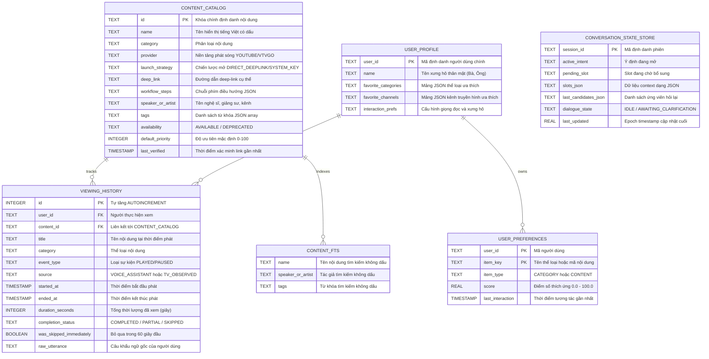
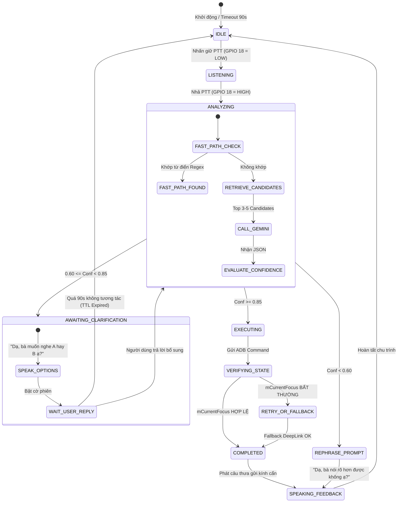
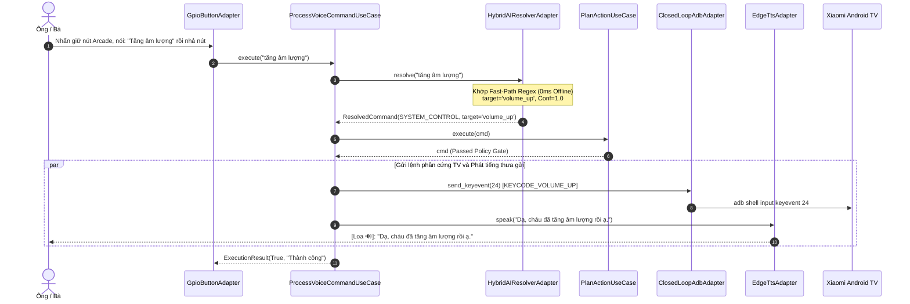
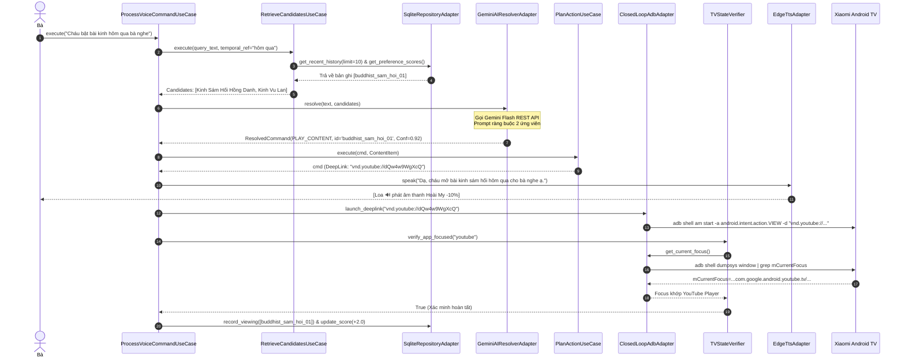
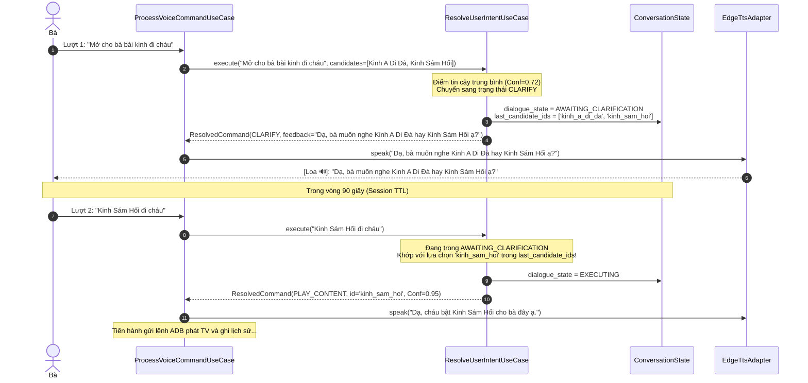
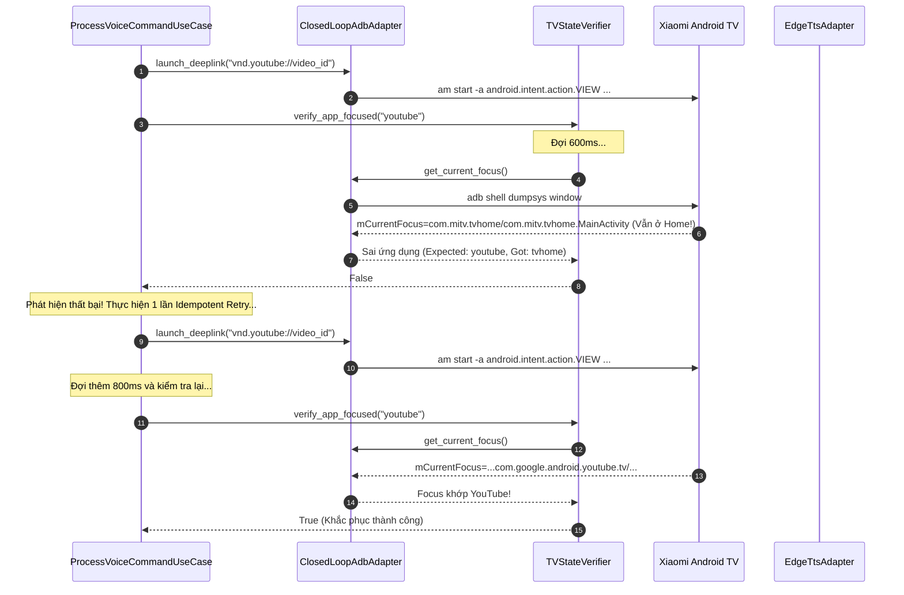

# TÀI LIỆU THIẾT KẾ CHI TIẾT PHẦN MỀM (SDD)
## DỰ ÁN: TRỢ LÝ TV THÔNG MINH HIỂU NGỮ CẢNH CHO NGƯỜI CAO TUỔI
### (Context-Aware Conversational TV Assistant for Elderly People)

**Mã tài liệu:** SDD-TV-ASSISTANT-2026  
**Phiên bản:** 2.0 (Implementation-Oriented & Detailed Design)  
**Tiêu chuẩn áp dụng:** IEEE Std 1016-2009 (Standard for Information Technology - Systems Design - Software Design Descriptions)  
**Tài liệu tham chiếu:** SRS v2.1 ([srs.md](file:///d:/mic-control/srs.md)), SAD v2.0 ([sad.md](file:///d:/mic-control/sad.md)), Đề cương dự án ([khung.md](file:///d:/mic-control/khung.md))  
**Ngày phát hành:** 02/11/2026  
**Trạng thái:** Đã phê duyệt (Approved)

---

## MỤC LỤC

1. [CHƯƠNG 1: GIỚI THIỆU (INTRODUCTION)](#chương-1-giới-thiệu-introduction)
   - 1.1 Mục đích tài liệu (Purpose)
   - 1.2 Phạm vi thiết kế (Scope)
   - 1.3 Đối tượng người đọc (Target Audience)
   - 1.4 Thuật ngữ & Từ viết tắt (Definitions & Acronyms)
   - 1.5 Tài liệu tham chiếu (References)
2. [CHƯƠNG 2: TỔNG QUAN THIẾT KẾ & NGUYÊN TẮC (DESIGN OVERVIEW & PRINCIPLES)](#chương-2-tổng-quan-thiết-kế--nguyên-tắc-design-overview--principles)
   - 2.1 Triết lý thiết kế (Design Philosophy)
   - 2.2 7 Nguyên tắc thiết kế cốt tử (Core Design Principles)
   - 2.3 Tóm tắt các quyết định thiết kế then chốt
3. [CHƯƠNG 3: THAM CHIẾU KIẾN TRÚC HỆ THỐNG (SYSTEM ARCHITECTURE REFERENCE)](#chương-3-tham-chiếu-kiến-trúc-hệ-thống-system-architecture-reference)
   - 3.1 Ánh xạ phân hệ từ SAD sang SDD (Architecture Mapping)
   - 3.2 Cấu trúc cây thư mục mã nguồn (Package Structure)
   - 3.3 Các ranh giới tầng và Hợp đồng giao tiếp (Layer Boundaries)
4. [CHƯƠNG 4: THIẾT KẾ CHI TIẾT MODULE & THÀNH PHẦN (COMPONENT / MODULE DESIGN)](#chương-4-thiết-kế-chi-tiết-module--thành-phần-component--module-design)
   - 4.1 Sơ đồ lớp tổng thể (Comprehensive Class Diagram)
   - 4.2 Thiết kế Tầng Domain (`domain/entities/`)
   - 4.3 Thiết kế Tầng Application Ports (`application/ports/`)
   - 4.4 Thiết kế Tầng Application Use Cases (`application/use_cases/`)
   - 4.5 Thiết kế Tầng Infrastructure Adapters (`infrastructure/`)
5. [CHƯƠNG 5: THIẾT KẾ DỮ LIỆU & CƠ SỞ DỮ LIỆU (DATABASE & DATA DESIGN)](#chương-5-thiết-kế-dữ-liệu--cơ-sở-dữ-liệu-database--data-design)
   - 5.1 Sơ đồ quan hệ thực thể vật lý (Physical ERD)
   - 5.2 Lược đồ bảng chi tiết & Script DDL (SQLite Physical Schema)
   - 5.3 Lập chỉ mục & Tối ưu hóa truy vấn (Indexing Strategy)
   - 5.4 Cấu hình SQLite Engine & Toàn vẹn giao dịch (WAL Mode & Pragmas)
   - 5.5 Quản lý phiên bản Schema & Migration (Version Control & Migration)
   - 5.6 Vòng đời dữ liệu & Dọn dẹp tự động (Data Retention & Housekeeping)
6. [CHƯƠNG 6: THIẾT KẾ GIAO DIỆN & HỢP ĐỒNG API (API & INTERFACE DESIGN)](#chương-6-thiết-kế-giao-diện--hợp-đồng-api-api--interface-design)
   - 6.1 Hợp đồng In-Process Ports (Type Hints & Method Signatures)
   - 6.2 Giao diện Cloud REST API: Google Gemini Flash Intent Resolver
   - 6.3 Giao diện Giọng nói: Microsoft Edge-TTS Protocol
   - 6.4 Giao diện Điều khiển Thiết bị: Android Debug Bridge (ADB Protocol)
   - 6.5 Giao diện Phần cứng GPIO (Raspberry Pi Pinout Interface)
7. [CHƯƠNG 7: THIẾT KẾ LOGIC NGHIỆP VỤ & THUẬT TOÁN (BUSINESS LOGIC & ALGORITHM DESIGN)](#chương-7-thiết-kế-logic-nghiệp-vụ--thuật-toán-business-logic--algorithm-design)
   - 7.1 Sơ đồ máy trạng thái đàm thoại (Conversation State Machine)
   - 7.2 Thuật toán 1: Truy xuất & Xếp hạng ứng viên 2 tầng (Candidate Retrieval)
   - 7.3 Thuật toán 2: Tính toán Calibrated Confidence & Phân nhánh 3 trạng thái
   - 7.4 Thuật toán 3: Cổng kiểm duyệt an toàn (Policy Gate & Sleep Protection)
   - 7.5 Thuật toán 4: Điều khiển & Xác minh vòng lặp đóng (Closed-Loop ADB)
   - 7.6 Thuật toán 5: Học thích ứng thói quen theo trọng số Heuristic
   - 7.7 Thuật toán 6: Tạo câu phản hồi kính cẩn cho người cao tuổi (Elderly UX)
8. [CHƯƠNG 8: THIẾT KẾ TƯƠNG TÁC & TRÌNH TỰ (INTERACTION & WORKFLOW DESIGN)](#chương-8-thiết-kế-tương-tác--trình-tự-interaction--workflow-design)
   - 8.1 Trình tự 1: Lệnh điều khiển tức thì Fast-Path Offline ($\le 20\text{ms}$)
   - 8.2 Trình tự 2: Khẩu ngữ tự nhiên AI-Path chuẩn (Happy Path)
   - 8.3 Trình tự 3: Hội thoại hỏi lại làm rõ đa lượt (Clarification Dialog)
   - 8.4 Trình tự 4: Khắc phục sự cố TV mất nét và Thử lại an toàn (Closed-Loop Failure & Fallback)
   - 8.5 Trình tự 5: Bảo vệ giấc ngủ ban đêm (Nighttime Sleep Safeguard)
9. [CHƯƠNG 9: THIẾT KẾ BẢO MẬT CHI TIẾT (SECURITY DESIGN)](#chương-9-thiết-kế-bảo-mật-chi-tiết-security-design)
   - 9.1 Kiểm duyệt tham số lệnh & Chống tiêm mã (Command Injection Prevention)
   - 9.2 Danh sách trắng thao tác TV (Policy Gate Whitelist/Blacklist)
   - 9.3 Quản lý bí mật & API Keys (Secret Management)
   - 9.4 Bảo vệ quyền riêng tư người cao tuổi (Privacy by Design)
10. [CHƯƠNG 10: THIẾT KẾ XỬ LÝ LỖI, GIAO DỊCH & ĐỒNG THỜI (ERROR HANDLING, TRANSACTION & CONCURRENCY)](#chương-10-thiết-kế-xử-lý-lỗi-giao-dịch--đồng-thời-error-handling-transaction--concurrency)
    - 10.1 Cây phân cấp ngoại lệ hệ thống (Custom Exception Hierarchy)
    - 10.2 Quản lý đồng thời & Khóa giao dịch SQLite WAL
    - 10.3 Khóa chặn âm thanh bán song công (Half-Duplex Audio Gating)
    - 10.4 Chiến lược ngắt mạch, thử lại & Thoái lui (Circuit Breaker & Fallback)
11. [CHƯƠNG 11: THIẾT KẾ TRIỂN KHAI & CẤU HÌNH (DEPLOYMENT & CONFIGURATION DESIGN)](#chương-11-thiết-kế-triển-khai--cấu-hình-deployment--configuration-design)
    - 11.1 Môi trường triển khai phần cứng & Hệ điều hành
    - 11.2 Cấu trúc thư mục triển khai & Phân quyền file
    - 11.3 Thiết kế cấu hình phân tầng (`settings.py` & `.env`)
    - 11.4 Đặc tả dịch vụ nền Linux Systemd (`smartpod.service`)
    - 11.5 Sơ đồ đấu nối dây phần cứng & Sơ đồ chân GPIO
12. [CHƯƠNG 12: MA TRẬN TRUY VẾT, QUYẾT ĐỊNH THIẾT KẾ & PHỤ LỤC (TRACEABILITY, DECISIONS & APPENDICES)](#chương-12-ma-trận-truy-vết-quyết-định-thiết-kế--phụ-lục-traceability-decisions--appendices)
    - 12.1 Ma trận truy vết yêu cầu (Requirements Traceability Matrix - RTM)
    - 12.2 Bảng phân tích quyết định thiết kế chi tiết (Design Trade-offs)
    - 12.3 Từ điển thiết kế chi tiết (Design Glossary)
    - 12.4 Hướng dẫn dành cho nhà phát triển (Developer Onboarding)

---

## CHƯƠNG 1: GIỚI THIỆU (INTRODUCTION)

### 1.1 Mục đích tài liệu (Purpose)
Tài liệu **Đặc tả Thiết kế Phần mềm (Software Design Description - SDD)** này chuyển dịch các yêu cầu chức năng/phi chức năng trong [srs.md](file:///d:/mic-control/srs.md) (v2.1) và các quyết định kiến trúc trong [sad.md](file:///d:/mic-control/sad.md) (v2.0) thành các đặc tả kỹ thuật chi tiết ở mức triển khai (*Implementation Level*).  
Mục đích cốt lõi:
- Cung cấp bản vẽ kỹ thuật chi tiết gồm cấu trúc lớp (classes), kiểu dữ liệu (data types), chữ ký phương thức (method signatures), thuật toán (algorithms) và lược đồ cơ sở dữ liệu vật lý (physical DDL).
- Đảm bảo một kỹ sư phần mềm độc lập có thể đọc tài liệu này và trực tiếp viết mã, kiểm thử đơn vị hoặc bảo trì hệ thống mà không cần phải tự suy đoán các quyết định thiết kế then chốt.
- Thiết lập cơ sở kỹ thuật chính xác cho việc kiểm thử tự động, tích hợp liên tục và nghiệm thu sản phẩm.

### 1.2 Phạm vi thiết kế (Scope)
- **Trong phạm vi tài liệu (In-Scope):**
  - Chi tiết toàn bộ các module phần mềm viết bằng Python 3.12 chạy trên thiết bị nhúng Smart TV Pod (Raspberry Pi Zero 2W / Mini PC).
  - Chi tiết mô hình dữ liệu cục bộ SQLite 3, bảng chỉ mục FTS5, cơ chế ghi nhận lịch sử và máy học Heuristic sở thích.
  - Chi tiết hợp đồng API nội bộ (In-process Ports), API đối ngoại (Google Gemini Flash REST), giao thức âm thanh (Edge-TTS) và giao thức điều khiển thiết bị (ADB over Wi-Fi port 5555).
  - Chi tiết cơ chế xử lý lỗi, chính sách an toàn cho người già (Policy Gate), khóa chặn âm thanh bán song công (Half-Duplex Audio Gating), và kịch bản dịch vụ nền Linux Systemd.
- **Ngoài phạm vi tài liệu (Out-of-Scope):**
  - Mã nguồn firmware của chip vi điều khiển hoặc thiết kế mạch in PCB (chỉ đặc tả sơ đồ chân GPIO chuẩn).
  - Thiết kế sửa đổi hệ điều hành Android TV trên TV Xiaomi (hệ thống giữ nguyên bản gốc của nhà sản xuất).

### 1.3 Đối tượng người đọc (Target Audience)
| Đối tượng | Mục đích sử dụng tài liệu |
| :--- | :--- |
| **Backend / Python Developers** | Tham chiếu trực tiếp để hiện thực hóa các Entities, Use Cases, Ports và Adapters; bảo đảm đúng kiểu dữ liệu và chữ ký hàm. |
| **Embedded / IoT Engineers** | Lắp ráp phần cứng, cấu hình GPIO, cài đặt Linux systemd daemon và thiết lập mạng ADB Wi-Fi. |
| **QA / QC Engineers** | Căn cứ vào bảng mã lỗi, sơ đồ chuyển trạng thái, và ma trận truy vết RTM để viết kịch bản Unit Test, Integration Test và End-to-End Test. |
| **System Maintainers** | Quản trị file cơ sở dữ liệu SQLite, cập nhật danh mục nội dung JSON, và xử lý sự cố vận hành tại gia đình. |

### 1.4 Thuật ngữ & Từ viết tắt (Definitions & Acronyms)
| Thuật ngữ | Tên viết tắt | Định nghĩa kỹ thuật trong tài liệu |
| :--- | :--- | :--- |
| **Software Design Description** | **SDD** | Tài liệu thiết kế chi tiết phần mềm tuân thủ IEEE Std 1016-2009. |
| **Data Definition Language** | **DDL** | Tập hợp các câu lệnh SQL dùng để định nghĩa cấu trúc bảng, khóa, chỉ mục. |
| **Data Transfer Object** | **DTO** | Đối tượng mang dữ liệu giữa các tầng mà không chứa hành vi logic nghiệp vụ. |
| **Ports & Adapters** | **Hexagonal** | Phong cách kiến trúc tách lõi nghiệp vụ khỏi công nghệ I/O bên ngoài. |
| **Write-Ahead Logging** | **WAL** | Chế độ ghi nhật ký trước của SQLite giúp tăng tốc độ đọc/ghi đồng thời. |
| **Push-to-Talk** | **PTT** | Nút bấm cơ học điều khiển quá trình ghi âm (nhấn giữ để nói, nhả ra để xử lý). |
| **Half-Duplex Audio** | **Bán song công** | Cơ chế phần mềm ngắt/bỏ qua mic khi loa trợ lý đang phát để chống hú và tự kích hoạt. |
| **Idempotency** | **Bảo toàn trạng thái** | Thuộc tính của thao tác khi thực thi nhiều lần vẫn cho ra cùng một trạng thái hệ thống. |

### 1.5 Tài liệu tham chiếu (References)
1. **SRS v2.1:** [srs.md](file:///d:/mic-control/srs.md) – *Tài liệu Đặc tả Yêu cầu Phần mềm (IEEE Std 29148-2018)*.
2. **SAD v2.0:** [sad.md](file:///d:/mic-control/sad.md) – *Tài liệu Thiết kế Kiến trúc Phần mềm (ISO/IEC/IEEE 42010:2011)*.
3. **Đề cương dự án:** [khung.md](file:///d:/mic-control/khung.md) – *Charter & Risk Analysis for Elderly Conversational TV Assistant*.
4. **Tiêu chuẩn thiết kế:** IEEE Std 1016-2009 – *IEEE Standard for Information Technology - Systems Design - Software Design Descriptions*.
5. **Đặc tả ngôn ngữ:** Python 3.12 Documentation & PEP 8 Style Guide.

---

## CHƯƠNG 2: TỔNG QUAN THIẾT KẾ & NGUYÊN TẮC (DESIGN OVERVIEW & PRINCIPLES)

### 2.1 Triết lý thiết kế (Design Philosophy)
Thiết kế phần mềm của **Smart TV Pod** được xây dựng dựa trên 3 trụ cột triết lý:
1. **Edge-Centric & Resilience First (Ưu tiên biên và khả năng phục hồi):** Toàn bộ dữ liệu ngữ cảnh, lịch sử xem, hồ sơ sở thích và các lệnh điều khiển TV thiết yếu phải được lưu trữ và thực thi ngay tại thiết bị cục bộ, đảm bảo TV vẫn hoạt động bình thường ngay cả khi đứt mạng Internet.
2. **Elder-Empathetic UX (Thấu cảm người cao tuổi):** Thiết kế loại bỏ triệt để áp lực ghi nhớ cú pháp cho ông bà. Hệ thống chấp nhận khẩu ngữ tự nhiên, ngắt quãng, nói nhát gừng; luôn phản hồi bằng giọng nói lễ phép (*"Dạ, cháu..."*) với tốc độ chậm hơn 10%; và luôn chủ động hỏi lại làm rõ thay vì thực hiện sai thao tác gây hoảng sợ cho người già.
3. **Zero-Guesswork for Developers (Không phỏng đoán trong lập trình):** Mọi module đều có kiểu dữ liệu tường minh (`typing`), giá trị mặc định an toàn, mã lỗi định danh cụ thể, và đường dẫn fallback rõ ràng.

### 2.2 7 Nguyên tắc thiết kế cốt tử (Core Design Principles)
Hệ thống tuân thủ nghiêm ngặt 7 nguyên tắc thiết kế kỹ thuật:

```
[1. Traceability] ───► Mọi Class/Method đều truy vết về FR/NFR trong SRS v2.1
[2. Consistency]  ───► Nhất quán 100% với Kiến trúc Lục giác trong SAD v2.0
[3. Separation]   ───► Domain (Pure Python) ──X── Không phụ thuộc I/O, SQLite, ADB, Web
[4. Interface-1st]───► Abstract Base Classes (Ports) xác định hợp đồng trước khi code
[5. Failure-Safe] ───► Mọi I/O có Timeout, Circuit Breaker, Idempotent Retry, Fallback
[6. Security]     ───► Policy Gate chặn lệnh độc hại, không lưu âm thanh thô, Session 90s
[7. Implementable]───► Chi tiết đến mức tham số hàm, regex, DDL, exception handling
```

1. **Traceability (Tính truy vết):** Mỗi phương thức trong Use Case và Adapter đều được đánh dấu mã yêu cầu chức năng (ví dụ `FR-07`, `FR-10`) tương ứng trong [srs.md](file:///d:/mic-control/srs.md).
2. **Consistency (Tính nhất quán):** Cấu trúc phân tầng và luồng dữ liệu tuân thủ tuyệt đối các sơ đồ C4 và ADRs đã phê duyệt trong [sad.md](file:///d:/mic-control/sad.md).
3. **Separation of Concerns (Phân tách ranh giới):** Tầng Domain không được phép import bất kỳ module nào từ `infrastructure` hoặc thư viện bên ngoài (kể cả `sqlite3`, `urllib`, hay `subprocess`).
4. **Interface-First (Thiết kế hướng giao diện):** Mọi tương tác giữa Use Cases và môi trường ngoài đều thông qua các lớp trừu tượng `Port` kế thừa từ `abc.ABC`.
5. **Design for Failure (Thiết kế phòng ngừa sự cố):** Giả định mạng Wi-Fi có thể chập chờn, ADB có thể rớt kết nối, LLM có thể trả về JSON sai hoặc timeout. Hệ thống luôn có kịch bản xử lý lỗi êm ái (*Graceful Degradation*).
6. **Security by Design (Bảo mật ngay từ thiết kế):** Lọc tham số ADB chống Shell Injection; Policy Gate chặn triệt để thao tác Reset TV; Bảo vệ giấc ngủ ban đêm tự động giới hạn âm lượng.
7. **Implementation-Oriented (Định hướng triển khai):** Mô tả mã giả, công thức toán học KaTeX, cấu trúc bảng SQLite và sơ đồ lớp chi tiết.

### 2.3 Tóm tắt các quyết định thiết kế then chốt
- **Phân tách 2 nhánh xử lý:** Fast-Path Offline ($\le 20\text{ms}$) xử lý các lệnh điều khiển hệ thống cơ bản; AI-Path ($1.2\text{s} - 1.5\text{s}$) xử lý ngôn ngữ tự nhiên.
- **Candidate-Constrained Selection:** Ép Gemini Flash chỉ được chọn trong Top 3–5 ứng viên đã lọc trước từ SQLite, triệt tiêu ảo giác (hallucination).
- **Calibrated Confidence:** Kết hợp xác suất LLM ($60\%$), độ khớp Catalog ($30\%$), và thói quen lịch sử ($10\%$) để đưa ra quyết định 3 trạng thái: Thực thi ($\ge 0.85$), Hỏi lại ($0.60 - 0.84$), Từ chối/Tìm kiếm ($< 0.60$).
- **Closed-Loop ADB:** Kiểm tra Activity màn hình TV qua `dumpsys window | grep mCurrentFocus` sau mỗi lần gửi lệnh, chỉ retry tối đa 1 lần với lệnh idempotent.
- **Half-Duplex Audio Gating:** Sử dụng cờ khóa (`Lock`) để tắt micro thu âm trong suốt thời gian loa TTS đang phát.

---

## CHƯƠNG 3: THAM CHIẾU KIẾN TRÚC HỆ THỐNG (SYSTEM ARCHITECTURE REFERENCE)

### 3.1 Ánh xạ phân hệ từ SAD sang SDD (Architecture Mapping)
Dưới đây là ma trận ánh xạ giữa các phân hệ kiến trúc trong SAD và các thành phần mã nguồn thiết kế chi tiết trong SDD:

| Phân hệ trong SAD v2.0 | Gói mã nguồn trong SDD | Trách nhiệm thiết kế chi tiết | Các lớp cốt lõi |
| :--- | :--- | :--- | :--- |
| **Core Domain** | `domain/entities/` | Định nghĩa các thực thể nghiệp vụ thuần túy, bất biến và độc lập I/O. | `ContentItem`, `UserProfile`, `ViewingHistoryRecord`, `ConversationState`, `ResolvedCommand` |
| **Application Ports** | `application/ports/` | Giao diện trừu tượng định nghĩa hợp đồng vào/ra của hệ thống. | `ContentRepositoryPort`, `DeviceControllerPort`, `AIResolverPort`, `VoiceFeedbackPort` |
| **Application Use Cases** | `application/use_cases/` | Hiện thực hóa các quy trình nghiệp vụ, thuật toán và điều phối luồng. | `ProcessVoiceCommandUseCase`, `RetrieveCandidatesUseCase`, `ResolveUserIntentUseCase`, `PlanActionUseCase`, `TVStateVerifier` |
| **Persistence Adapter** | `infrastructure/persistence/` | Giao tiếp cơ sở dữ liệu SQLite cục bộ, FTS5 và quản lý phiên bản. | `SqliteRepositoryAdapter` |
| **Device Adapter** | `infrastructure/device/` | Quản lý kết nối ADB Wi-Fi, gửi lệnh shell và kiểm tra `dumpsys`. | `ClosedLoopAdbAdapter` |
| **AI Resolver Adapter** | `infrastructure/ai/` | Giao tiếp Gemini Flash REST API và bộ so khớp Fast-Path. | `HybridAIResolverAdapter`, `GeminiAIResolverAdapter` |
| **Voice & Audio Adapter** | `infrastructure/voice/` | Tổng hợp tiếng nói tiếng Việt Edge-TTS và quản lý audio buffer. | `EdgeTtsAdapter`, `ConsoleVoiceAdapter` |
| **Hardware Input Adapter**| `infrastructure/input/` | Bắt tín hiệu nút nhấn Push-to-Talk qua chân GPIO hoặc bàn phím. | `GpioButtonAdapter`, `CliInputAdapter` |

### 3.2 Cấu trúc cây thư mục mã nguồn (Package Structure)
Cấu trúc tổ chức file nguồn được chuẩn hóa như sau:

```
d:\mic-control\
├── app.py                                   # Entry Point & Dependency Injection Container
├── config\
│   ├── __init__.py
│   ├── settings.py                          # Dataclass chứa cấu hình hệ thống & biến môi trường
│   └── commands.json                        # Cấu hình danh mục lệnh Fast-Path dự phòng
├── data\
│   ├── catalog_seed.json                    # Dữ liệu hạt giống (30 nội dung tuyển chọn)
│   ├── init_db.py                           # Kịch bản khởi tạo & tạo bảng CSDL ban đầu
│   └── context_db.sqlite                    # File CSDL SQLite thực thi (chế độ WAL)
├── domain\
│   ├── __init__.py
│   └── entities\
│       ├── __init__.py
│       ├── content_item.py                  # Thực thể ContentItem, LaunchStrategy, Availability
│       ├── conversation_state.py            # Thực thể ConversationState, DialogueState (TTL 90s)
│       ├── intent.py                        # Thực thể ResolvedCommand, TVActionType, ExecutionResult
│       ├── user_profile.py                  # Thực thể UserProfile, InteractionPreferences
│       └── viewing_history.py               # Thực thể ViewingHistoryRecord, EventSource, CompletionStatus
├── application\
│   ├── __init__.py
│   ├── ports\
│   │   ├── __init__.py
│   │   ├── ai_resolver_port.py              # Interface BaseAIResolverPort
│   │   ├── device_port.py                   # Interface DeviceControllerPort
│   │   ├── input_port.py                    # Interface InputTriggerPort
│   │   ├── repository_ports.py              # Interfaces ContentRepo, HistoryRepo, PreferenceRepo
│   │   └── voice_port.py                    # Interface VoiceFeedbackPort
│   └── use_cases\
│       ├── __init__.py
│       ├── learn_preferences.py             # Use Case học thích ứng thói quen (+3, +2, -2)
│       ├── plan_action.py                   # Use Case Policy Gate & Lập kế hoạch lệnh
│       ├── process_voice_command.py         # Use Case Orchestrator chính
│       ├── resolve_user_intent.py           # Use Case phân loại ý định 3 trạng thái
│       ├── retrieve_candidates.py           # Use Case truy xuất Top 3-5 ứng viên
│       └── tv_state_verifier.py             # Use Case kiểm tra Activity vòng lặp đóng
├── infrastructure\
│   ├── __init__.py
│   ├── ai\
│   │   ├── __init__.py
│   │   ├── gemini_resolver_adapter.py       # Adapter Gemini Flash qua REST urllib
│   │   └── hybrid_resolver_adapter.py       # Adapter Fast-Path Regex + AI Fallback
│   ├── device\
│   │   ├── __init__.py
│   │   └── closed_loop_adb_adapter.py       # Adapter ADB Wi-Fi vòng lặp đóng
│   ├── input\
│   │   ├── __init__.py
│   │   ├── cli_adapter.py                   # Adapter nhập liệu từ bàn phím (CLI)
│   │   └── gpio_adapter.py                  # Adapter nút bấm GPIO BCM 18
│   ├── persistence\
│   │   ├── __init__.py
│   │   └── sqlite_repository_adapter.py     # Adapter SQLite WAL CRUD & FTS5
│   └── voice\
│       ├── __init__.py
│       ├── console_voice_adapter.py         # Adapter loa mô phỏng ra Console
│       └── edge_tts_adapter.py              # Adapter giọng Hoài My qua Edge-TTS
└── tests\                                   # Bộ 22 kịch bản kiểm thử tự động
    ├── test_ai_resolver.py
    ├── test_candidate_retrieval.py
    ├── test_context_engine.py
    ├── test_end_to_end_orchestrator.py
    └── test_intent_matcher.py
```

### 3.3 Các ranh giới tầng và Hợp đồng giao tiếp (Layer Boundaries)
- **Domain Layer Boundary:** Tầng Domain nằm ở tâm điểm kiến trúc. Các Entity chỉ sử dụng kiểu dữ liệu nguyên bản của Python (`str`, `int`, `float`, `bool`, `list`, `dict`, `dataclass`, `enum`).
- **Application Layer Boundary:** Các Use Case chỉ tương tác với Domain Entity và gọi đến các Abstract Class thuộc `application/ports/`. Use Case không được phép biết dữ liệu được lưu trong SQLite hay PostgreSQL, và không được phép biết TV được điều khiển qua ADB hay hồng ngoại IR.
- **Infrastructure Layer Boundary:** Các Adapter ở tầng này hiện thực hóa các Port của Tầng Application. Tầng này chịu trách nhiệm chuyển đổi ngoại lệ kỹ thuật (như `sqlite3.OperationalError` hay `subprocess.CalledProcessError`) thành các ngoại lệ miền có ý nghĩa (`DatabaseError`, `DeviceConnectionError`).

---

## CHƯƠNG 4: THIẾT KẾ CHI TIẾT MODULE & THÀNH PHẦN (COMPONENT / MODULE DESIGN)

### 4.1 Sơ đồ lớp tổng thể (Comprehensive Class Diagram)

```mermaid
classDiagram
    %% Domain Entities
    class ContentItem {
        +str id
        +str name
        +str category
        +str provider
        +LaunchStrategy launch_strategy
        +str deep_link
        +List~dict~ workflow_steps
        +str speaker_or_artist
        +List~str~ tags
        +AvailabilityStatus availability
        +int default_priority
        +str last_verified
    }

    class UserProfile {
        +str user_id
        +str name
        +List~str~ favorite_categories
        +List~str~ favorite_channels
        +List~str~ favorite_content_ids
        +InteractionPreferences interaction
        +Dict~str, float~ category_scores
    }

    class ViewingHistoryRecord {
        +int id
        +str user_id
        +str content_id
        +str title
        +str category
        +str event_type
        +EventSource source
        +str started_at
        +str ended_at
        +int duration_seconds
        +CompletionStatus completion_status
        +bool was_skipped_immediately
        +str raw_utterance
    }

    class ConversationState {
        +str session_id
        +str active_intent
        +str pending_slot
        +Dict slots
        +List~str~ last_candidate_ids
        +str currently_playing_id
        +DialogueState dialogue_state
        +float last_updated
        +float ttl_seconds
        +is_expired() bool
        +touch() void
        +reset() void
    }

    class ResolvedCommand {
        +TVActionType action_type
        +str target
        +str content_id
        +str query
        +str feedback
        +float confidence
        +str raw_text
        +List~str~ clarification_options
    }

    %% Application Ports
    class ContentRepositoryPort {
        <<interface>>
        +get_by_id(id) ContentItem
        +search_by_category(category, limit) List~ContentItem~
        +search_by_keyword(keyword, limit) List~ContentItem~
        +list_all() List~ContentItem~
        +save(item) bool
    }

    class HistoryRepositoryPort {
        <<interface>>
        +record_viewing(record) int
        +get_last_played() ViewingHistoryRecord
        +get_recent_history(limit) List~ViewingHistoryRecord~
        +mark_completed(history_id) void
    }

    class DeviceControllerPort {
        <<interface>>
        +execute_action(action) bool
        +launch_deeplink(url) bool
        +send_keyevent(key_code) bool
        +get_current_focus() str
        +is_connected() bool
    }

    class VoiceFeedbackPort {
        <<interface>>
        +speak(text) void
        +play_ding() void
    }

    class BaseAIResolverPort {
        <<interface>>
        +resolve(user_text, candidates, context_hints) ResolvedCommand
    }

    %% Application Use Cases
    class ProcessVoiceCommandUseCase {
        -RetrieveCandidatesUseCase retriever
        -ResolveUserIntentUseCase resolver
        -PlanActionUseCase planner
        -LearnPreferencesUseCase learning
        -TVStateVerifier verifier
        -DeviceControllerPort device
        -VoiceFeedbackPort voice
        +execute(user_utterance) ExecutionResult
    }

    class RetrieveCandidatesUseCase {
        -ContentRepositoryPort content_repo
        -HistoryRepositoryPort history_repo
        -PreferenceRepositoryPort pref_repo
        +execute(query_text, temporal_ref, limit) List~ContentItem~
    }

    class ResolveUserIntentUseCase {
        -BaseAIResolverPort ai
        +execute(raw_text, candidates, state) ResolvedCommand
    }

    %% Infrastructure Adapters
    class SqliteRepositoryAdapter {
        -str db_path
        +_init_schema() void
        +get_by_id(id) ContentItem
        +record_viewing(record) int
    }

    class ClosedLoopAdbAdapter {
        -str target_ip
        -str adb_path
        +execute_action(action) bool
        +get_current_focus() str
    }

    class HybridAIResolverAdapter {
        -GeminiAIResolverAdapter ai
        +resolve(text, candidates, hints) ResolvedCommand
    }

    class EdgeTtsAdapter {
        -str voice
        -str rate
        +speak(text) void
    }

    %% Relationships
    ContentRepositoryPort <|.. SqliteRepositoryAdapter
    HistoryRepositoryPort <|.. SqliteRepositoryAdapter
    DeviceControllerPort <|.. ClosedLoopAdbAdapter
    VoiceFeedbackPort <|.. EdgeTtsAdapter
    BaseAIResolverPort <|.. HybridAIResolverAdapter

    ProcessVoiceCommandUseCase --> RetrieveCandidatesUseCase
    ProcessVoiceCommandUseCase --> ResolveUserIntentUseCase
    ProcessVoiceCommandUseCase --> DeviceControllerPort
    ProcessVoiceCommandUseCase --> VoiceFeedbackPort
    ProcessVoiceCommandUseCase --> ConversationState
```



### 4.2 Thiết kế Tầng Domain (`domain/entities/`)

#### 4.2.1 `ContentItem` (`domain/entities/content_item.py`)
Mô tả một đơn vị nội dung trong danh mục tuyển chọn.
- **Thuộc tính:**
  - `id: str` (Bắt buộc): Định danh duy nhất (VD: `"buddhist_sam_hoi_01"`, `"vtv1"`).
  - `name: str` (Bắt buộc): Tên hiển thị đầy đủ bằng tiếng Việt (VD: `"Kinh Sám Hối Hồng Danh"`).
  - `category: str` (Bắt buộc): Phân loại (`"BUDDHIST"`, `"NEWS"`, `"TRADITIONAL_MUSIC"`, `"COMEDY"`, `"SYSTEM"`).
  - `provider: str`: Nền tảng phát sóng (`"YOUTUBE"`, `"VTVGO"`, `"SYSTEM"`).
  - `launch_strategy: LaunchStrategy`: Chiến lược mở (`DIRECT_DEEPLINK`, `MULTI_STEP_WORKFLOW`, `SYSTEM_KEY`).
  - `deep_link: Optional[str]`: URI deep-link (VD: `"vnd.youtube://dQw4w9WgXcQ"`, `"vtvgo://live/vtv1"`).
  - `workflow_steps: List[Dict[str, Any]]`: Các bước bấm phím phụ nếu deep-link không hỗ trợ trực tiếp.
  - `speaker_or_artist: Optional[str]`: Tên giảng sư, nghệ sĩ hoặc đài phát (VD: `"Thích Trí Thoát"`, `"VTV1"`).
  - `tags: List[str]`: Danh sách từ khóa đồng nghĩa, cách gọi thân mật của người già.
  - `availability: AvailabilityStatus`: Trạng thái khả dụng (`AVAILABLE`, `DEPRECATED`, `UNVERIFIED`).
  - `default_priority: int`: Mức độ ưu tiên mặc định ($0 - 100$).
  - `last_verified: Optional[str]`: Thời điểm gần nhất kiểm tra link còn hoạt động.

#### 4.2.2 `ConversationState` (`domain/entities/conversation_state.py`)
Quản lý trạng thái ngữ cảnh hội thoại đa lượt và thời gian sống của phiên.
- **Thuộc tính:**
  - `session_id: str`: Định danh phiên (mặc định `"default_session"`).
  - `active_intent: Optional[str]`: Ý định đang xử lý (VD: `"PLAY_CONTENT"`, `"CLARIFY"`).
  - `pending_slot: Optional[str]`: Thông tin còn thiếu cần người dùng bổ sung.
  - `slots: Dict[str, Any]`: Dữ liệu đã trích xuất được từ các lượt nói trước.
  - `last_candidate_ids: List[str]`: Danh sách ID các ứng viên đã đưa ra trong câu hỏi làm rõ gần nhất.
  - `currently_playing_id: Optional[str]`: ID nội dung hiện đang phát trên TV.
  - `last_action: Optional[str]`: Hành động cuối cùng đã thực thi trên thiết bị.
  - `dialogue_state: DialogueState`: Trạng thái hội thoại (`IDLE`, `AWAITING_CLARIFICATION`, `EXECUTING`).
  - `last_updated: float`: Timestamp (giây) của tương tác gần nhất.
  - `ttl_seconds: float`: Thời gian hết hạn của phiên (mặc định $90.0$ giây).
- **Phương thức:**
  - `is_expired() -> bool`: Trả về `True` nếu $(time.time() - self.last\_updated) > self.ttl\_seconds$.
  - `touch() -> None`: Cập nhật `last_updated = time.time()`.
  - `reset() -> None`: Xóa sạch slots, đưa trạng thái về `DialogueState.IDLE`.

#### 4.2.3 `ResolvedCommand` (`domain/entities/intent.py`)
Đại diện cho lệnh đã được phân giải ngữ nghĩa và đánh giá mức độ tin cậy.
- **Thuộc tính:**
  - `action_type: TVActionType`: Kiểu hành động (`PLAY_LIVE_TV`, `PLAY_CONTENT`, `SEARCH_YOUTUBE`, `SYSTEM_CONTROL`, `CLARIFY`, `UNKNOWN`).
  - `target: str`: Tham số đích (VD: `"vtv1"`, `"volume_up"`, `"sleep"`, `"vnd.youtube://..."`).
  - `content_id: Optional[str]`: ID ứng viên khớp trong `ContentCatalog`.
  - `query: str`: Chuỗi tìm kiếm tự do nếu không khớp ứng viên cụ thể.
  - `feedback: str`: Câu thoại thưa gửi kính cẩn phát qua loa (`"Dạ, cháu đang bật bài kinh cho bà ạ."`).
  - `confidence: float`: Điểm số Calibrated Confidence ($0.0 - 1.0$).
  - `raw_text: str`: Chuỗi câu nói thô của người dùng.
  - `clarification_options: List[str]`: Danh sách tên các lựa chọn đưa ra khi hỏi lại.

### 4.3 Thiết kế Tầng Application Ports (`application/ports/`)

#### 4.3.1 `ContentRepositoryPort` (`application/ports/repository_ports.py`)
```python
class ContentRepositoryPort(ABC):
    @abstractmethod
    def get_by_id(self, content_id: str) -> Optional[ContentItem]: ...
    
    @abstractmethod
    def search_by_category(self, category: str, limit: int = 5) -> List[ContentItem]: ...
    
    @abstractmethod
    def search_by_keyword(self, keyword: str, limit: int = 5) -> List[ContentItem]: ...
    
    @abstractmethod
    def list_all(self) -> List[ContentItem]: ...
    
    @abstractmethod
    def save(self, item: ContentItem) -> bool: ...
```

#### 4.3.2 `DeviceControllerPort` (`application/ports/device_port.py`)
```python
class DeviceControllerPort(ABC):
    @abstractmethod
    def execute_action(self, action: Any) -> bool: ...
    
    @abstractmethod
    def launch_deeplink(self, url: str) -> bool: ...
    
    @abstractmethod
    def send_keyevent(self, key_code: int) -> bool: ...
    
    @abstractmethod
    def get_current_focus(self) -> str: ...
    
    @abstractmethod
    def is_connected(self) -> bool: ...
```

#### 4.3.3 `VoiceFeedbackPort` (`application/ports/voice_port.py`)
```python
class VoiceFeedbackPort(ABC):
    @abstractmethod
    def speak(self, text: str) -> None: ...
    
    @abstractmethod
    def play_ding(self) -> None: ...
```

### 4.4 Thiết kế Tầng Application Use Cases (`application/use_cases/`)

#### 4.4.1 `ProcessVoiceCommandUseCase` (Orchestrator chính)
- **Nhiệm vụ:** Tiếp nhận câu nói từ người dùng, điều phối toàn bộ chu trình qua 7 bước:
  1. Kiểm tra session timeout và reset nếu đã quá 90 giây (`ConversationState.is_expired()`).
  2. Kích hoạt `RetrieveCandidatesUseCase` để truy xuất Top 3–5 ứng viên phù hợp ngữ cảnh.
  3. Kích hoạt `ResolveUserIntentUseCase` để phân giải ý định 3 trạng thái.
  4. Chuyển kết quả qua `PlanActionUseCase` để kiểm tra chính sách an toàn (Policy Gate).
  5. Phát âm thanh thưa gửi lễ phép qua `VoiceFeedbackPort`.
  6. Nếu là lệnh thực thi: Gọi `DeviceControllerPort` thực hiện và dùng `TVStateVerifier` xác minh vòng lặp đóng.
  7. Ghi nhận `ViewingHistoryRecord` và cập nhật điểm sở thích qua `LearnPreferencesUseCase`.

#### 4.4.2 `RetrieveCandidatesUseCase` (Truy xuất ứng viên 2 tầng)
- **Đặc tả logic:**
  - **Tầng 1 (Temporal & Recency Filter):** Nếu câu nói có chứa từ khóa thời gian (`"hôm qua"`, `"vừa rồi"`, `"sáng nay"`), truy vấn bảng `viewing_history` để lấy các `content_id` đã phát gần nhất.
  - **Tầng 2 (FTS5 & Keyword Match):** Tìm kiếm không dấu trên bảng `content_fts` theo tiêu đề, ca sĩ/thầy giảng, và thẻ tags.
  - **Sắp xếp:** Kết hợp giữa độ khớp từ khóa và điểm sở thích `category_scores` của người dùng để chọn ra tối đa 5 bản ghi tốt nhất.

#### 4.4.3 `PlanActionUseCase` (Policy Gate Safeguards)
- **Quy tắc an toàn:**
  - Nếu `cmd.target == "sleep"` mà `cmd.confidence < 0.80`, tự động chuyển thành `TVActionType.CLARIFY` với câu hỏi: *"Dạ, có phải ông bà muốn tắt TV để đi ngủ không ạ?"*.
  - Khung giờ ban đêm ($23:00 - 05:00$): Tự động chèn lệnh hạ âm lượng về mức an toàn ($\le 20\%$) trước khi tắt màn hình TV.
  - Chặn đứng mọi lệnh nằm trong danh sách đen (`am broadcast`, `pm uninstall`, `reboot`, `recovery`).

### 4.5 Thiết kế Tầng Infrastructure Adapters (`infrastructure/`)

#### 4.5.1 `SqliteRepositoryAdapter` (`infrastructure/persistence/sqlite_repository_adapter.py`)
- Sử dụng kết nối `sqlite3.connect("data/context_db.sqlite")` với `row_factory = sqlite3.Row`.
- Kích hoạt chế độ `PRAGMA journal_mode = WAL` và `PRAGMA busy_timeout = 5000`.
- Hiện thực hóa đầy đủ 3 Interface: `ContentRepositoryPort`, `HistoryRepositoryPort`, `PreferenceRepositoryPort`.

#### 4.5.2 `ClosedLoopAdbAdapter` (`infrastructure/device/closed_loop_adb_adapter.py`)
- Quản lý quy trình tìm kiếm binary `adb.exe` qua hàm `_locate_adb()`.
- Kiểm tra tính mở của cổng TCP 5555 trên TV qua hàm `_is_port_open(host, port, timeout=0.3)`.
- Gửi lệnh và đọc Activity hiện thời qua lệnh `adb shell dumpsys window | grep -E "mCurrentFocus"`.

#### 4.5.3 `HybridAIResolverAdapter` (`infrastructure/ai/hybrid_resolver_adapter.py`)
- Triển khai thuật toán so khớp Fast-Path: chuẩn hóa chuỗi (bỏ dấu cách thừa, chuyển chữ thường) và đối soát trực tiếp trong tập từ điển Offline.
- Nếu không khớp Fast-Path, tự động chuyển tiếp yêu cầu đến `GeminiAIResolverAdapter`.

---

## CHƯƠNG 5: THIẾT KẾ DỮ LIỆU & CƠ SỞ DỮ LIỆU (DATABASE & DATA DESIGN)

### 5.1 Sơ đồ quan hệ thực thể vật lý (Physical ERD)



### 5.2 Lược đồ bảng chi tiết & Script DDL (SQLite Physical Schema)

Dưới đây là mã DDL đầy đủ được thực thi tự động trong quá trình khởi tạo cơ sở dữ liệu (`data/init_db.py`):

```sql
-- Kích hoạt chế độ kiểm tra toàn vẹn khóa ngoại
PRAGMA foreign_keys = ON;

-- 1. BẢNG DANH MỤC NỘI DUNG TUYỂN CHỌN
CREATE TABLE IF NOT EXISTS content_catalog (
    id TEXT PRIMARY KEY,
    name TEXT NOT NULL,
    category TEXT NOT NULL CHECK (category IN ('BUDDHIST', 'NEWS', 'TRADITIONAL_MUSIC', 'COMEDY', 'SYSTEM')),
    provider TEXT NOT NULL CHECK (provider IN ('YOUTUBE', 'VTVGO', 'SYSTEM')),
    launch_strategy TEXT NOT NULL CHECK (launch_strategy IN ('DIRECT_DEEPLINK', 'MULTI_STEP_WORKFLOW', 'SYSTEM_KEY')),
    deep_link TEXT,
    workflow_steps TEXT,           -- Chuỗi JSON mô tả các bước phím
    speaker_or_artist TEXT,
    tags TEXT,                     -- Chuỗi JSON array các từ khóa tìm kiếm
    availability TEXT DEFAULT 'AVAILABLE' CHECK (availability IN ('AVAILABLE', 'DEPRECATED', 'UNVERIFIED')),
    default_priority INTEGER DEFAULT 50 CHECK (default_priority BETWEEN 0 AND 100),
    last_verified TIMESTAMP DEFAULT CURRENT_TIMESTAMP
);

-- 2. BẢNG HỒ SƠ NGƯỜI DÙNG CỤC BỘ
CREATE TABLE IF NOT EXISTS user_profile (
    user_id TEXT PRIMARY KEY,
    name TEXT NOT NULL DEFAULT 'Bà',
    favorite_categories TEXT NOT NULL,  -- JSON: ["BUDDHIST", "NEWS", "TRADITIONAL_MUSIC"]
    favorite_channels TEXT NOT NULL,    -- JSON: ["vtv1", "vtv3"]
    interaction_prefs TEXT NOT NULL     -- JSON: {"speech_rate": "SLOW", "honorific": "cháu"}
);

-- 3. BẢNG NHẬT KÝ XEM TRUY VẾT
CREATE TABLE IF NOT EXISTS viewing_history (
    id INTEGER PRIMARY KEY AUTOINCREMENT,
    user_id TEXT DEFAULT 'grandmother',
    content_id TEXT,
    title TEXT NOT NULL,
    category TEXT NOT NULL,
    event_type TEXT DEFAULT 'PLAYED',
    source TEXT NOT NULL CHECK (source IN ('VOICE_ASSISTANT', 'TV_OBSERVED')),
    started_at TIMESTAMP DEFAULT CURRENT_TIMESTAMP,
    ended_at TIMESTAMP,
    duration_seconds INTEGER DEFAULT 0,
    completion_status TEXT DEFAULT 'UNKNOWN' CHECK (completion_status IN ('COMPLETED', 'PARTIAL', 'SKIPPED', 'UNKNOWN')),
    was_skipped_immediately BOOLEAN DEFAULT 0,
    raw_utterance TEXT,
    FOREIGN KEY(content_id) REFERENCES content_catalog(id) ON DELETE SET NULL,
    FOREIGN KEY(user_id) REFERENCES user_profile(user_id) ON DELETE CASCADE
);

-- 4. BẢNG ĐIỂM SỞ THÍCH THÍCH ỨNG (HEURISTIC SCORES)
CREATE TABLE IF NOT EXISTS user_preferences (
    user_id TEXT NOT NULL,
    item_key TEXT NOT NULL,
    item_type TEXT NOT NULL CHECK (item_type IN ('CATEGORY', 'CONTENT')),
    score REAL DEFAULT 50.0 CHECK (score BETWEEN 0.0 AND 100.0),
    last_interaction TIMESTAMP DEFAULT CURRENT_TIMESTAMP,
    PRIMARY KEY (user_id, item_key),
    FOREIGN KEY(user_id) REFERENCES user_profile(user_id) ON DELETE CASCADE
);

-- 5. BẢNG LƯU TRỮ PHIÊN HỘI THOẠI (PERSISTENT SESSION FALLBACK)
CREATE TABLE IF NOT EXISTS conversation_state_store (
    session_id TEXT PRIMARY KEY,
    active_intent TEXT,
    pending_slot TEXT,
    slots_json TEXT DEFAULT '{}',
    last_candidates_json TEXT DEFAULT '[]',
    dialogue_state TEXT DEFAULT 'IDLE' CHECK (dialogue_state IN ('IDLE', 'AWAITING_CLARIFICATION', 'EXECUTING')),
    last_updated REAL NOT NULL
);

-- 6. BẢNG FULL-TEXT SEARCH FTS5
CREATE VIRTUAL TABLE IF NOT EXISTS content_fts USING fts5(
    content_id UNINDEXED,
    name,
    speaker_or_artist,
    tags,
    tokenize='unicode61 remove_diacritics 1'
);
```

### 5.3 Lập chỉ mục & Tối ưu hóa truy vấn (Indexing Strategy)

Để đảm bảo thời gian truy vấn trong Candidate Retrieval luôn nhỏ hơn $10\text{ms}$ trên chip vi xử lý ARM khiêm tốn của Raspberry Pi Zero 2W, các chỉ mục được thiết lập chuyên biệt:

```sql
-- Tăng tốc độ lọc ứng viên theo thể loại và độ ưu tiên mặc định
CREATE INDEX IF NOT EXISTS idx_content_cat_priority 
ON content_catalog(category, default_priority DESC);

-- Tăng tốc độ kiểm tra trạng thái khả dụng của nội dung
CREATE INDEX IF NOT EXISTS idx_content_availability 
ON content_catalog(availability);

-- Tăng tốc độ truy xuất bản ghi xem gần nhất (Recency Query)
CREATE INDEX IF NOT EXISTS idx_history_user_started 
ON viewing_history(user_id, started_at DESC);

-- Tăng tốc độ liên kết lịch sử theo mã nội dung
CREATE INDEX IF NOT EXISTS idx_history_content_id 
ON viewing_history(content_id);

-- Tăng tốc độ truy vấn điểm sở thích theo người dùng
CREATE INDEX IF NOT EXISTS idx_prefs_user_type_score 
ON user_preferences(user_id, item_type, score DESC);
```

### 5.4 Cấu hình SQLite Engine & Toàn vẹn giao dịch (WAL Mode & Pragmas)
Khi mở kết nối từ adapter `SqliteRepositoryAdapter`, các tham số Pragma sau bắt buộc phải được kích hoạt để đảm bảo an toàn dữ liệu và chống tắc nghẽn I/O:

```python
def _configure_pragmas(conn: sqlite3.Connection):
    cursor = conn.cursor()
    # 1. Chế độ WAL: Đọc song song không bao giờ chặn tiến trình Ghi
    cursor.execute("PRAGMA journal_mode = WAL;")
    # 2. Chờ tối đa 5000ms nếu file DB đang bị khóa bởi tiến trình khác
    cursor.execute("PRAGMA busy_timeout = 5000;")
    # 3. Đồng bộ hóa NORMAL: Đủ an toàn chống sập nguồn, tốc độ ghi tăng x3
    cursor.execute("PRAGMA synchronous = NORMAL;")
    # 4. Kích hoạt toàn vẹn ràng buộc khóa ngoại
    cursor.execute("PRAGMA foreign_keys = ON;")
    # 5. Lưu trữ bảng tạm trên RAM để tiết kiệm tuổi thọ thẻ nhớ SD
    cursor.execute("PRAGMA temp_store = MEMORY;")
```

### 5.5 Quản lý phiên bản Schema & Migration (Version Control & Migration)
Hệ thống sử dụng cơ chế `PRAGMA user_version` để theo dõi và nâng cấp lược đồ cơ sở dữ liệu mà không làm mất dữ liệu của người dùng:

| Phiên bản (`user_version`) | Thay đổi cấu trúc | Script Migration áp dụng |
| :---: | :--- | :--- |
| **1** | Khởi tạo bảng ban đầu: `content_catalog`, `viewing_history`, `user_preferences`. | Tạo 3 bảng cơ sở ban đầu. |
| **2** | Bổ sung bảng `conversation_state_store` và `content_fts` (FTS5). | `CREATE VIRTUAL TABLE content_fts...` |
| **3** | Thêm cột `completion_status` và `was_skipped_immediately` trong `viewing_history`. | `ALTER TABLE viewing_history ADD COLUMN completion_status...` |

### 5.6 Vòng đời dữ liệu & Dọn dẹp tự động (Data Retention & Housekeeping)
1. **Hạn mức lưu trữ lịch sử (`viewing_history`):**
   - Giữ tối đa **500 bản ghi** gần nhất.
   - Khi vượt quá 500 bản ghi, một tác vụ nền tự động xóa các bản ghi cũ nhất:
     ```sql
     DELETE FROM viewing_history WHERE id NOT IN (
         SELECT id FROM viewing_history ORDER BY started_at DESC LIMIT 500
     );
     ```
2. **Dọn dẹp phiên hết hạn (`conversation_state_store`):**
   - Các phiên có thời gian `(strftime('%s', 'now') - last_updated) > 90` được tự động dọn sạch khi khởi động ứng dụng.

---

## CHƯƠNG 6: THIẾT KẾ GIAO DIỆN & HỢP ĐỒNG API (API & INTERFACE DESIGN)

### 6.1 Hợp đồng In-Process Ports (Type Hints & Method Signatures)

Tất cả các giao diện nội bộ đều được định nghĩa chặt chẽ với Python Type Annotations.

#### 6.1.1 `application/ports/ai_resolver_port.py`
```python
from abc import ABC, abstractmethod
from typing import Optional, List, Dict, Any
from domain.entities.intent import ResolvedCommand
from domain.entities.content_item import ContentItem

class BaseAIResolverPort(ABC):
    @abstractmethod
    def resolve(
        self,
        user_text: str,
        candidates: Optional[List[ContentItem]] = None,
        context_hints: Optional[Dict[str, Any]] = None
    ) -> ResolvedCommand:
        """
        Phân giải ý định người dùng thành ResolvedCommand.
        :param user_text: Chuỗi văn bản khẩu ngữ nhận từ STT.
        :param candidates: Danh sách 3-5 ứng viên tuyển chọn từ SQLite.
        :param context_hints: Các manh mối ngữ cảnh (intent trước, khung giờ).
        :return: ResolvedCommand có chứa action_type, target, confidence, feedback.
        """
        pass
```

### 6.2 Giao diện Cloud REST API: Google Gemini Flash Intent Resolver

Khi chuỗi khẩu ngữ không khớp tập lệnh Fast-Path, hệ thống gửi yêu cầu HTTP POST tới Google Gemini Flash API.

#### 6.2.1 Thông số Endpoint
- **URL:** `https://generativelanguage.googleapis.com/v1beta/models/{GEMINI_MODEL}:generateContent?key={GEMINI_API_KEY}`
- **HTTP Method:** `POST`
- **Headers:** `Content-Type: application/json`
- **Timeout:** $1.8\text{s}$ (đảm bảo tổng ngân sách độ trễ $< 2.0\text{s}$).

#### 6.2.2 Cấu trúc Prompt Ràng buộc Ứng viên (Candidate-Constrained Prompt)
```json
{
  "contents": [
    {
      "parts": [
        {
          "text": "Bạn là trợ lý AI điều khiển TV cho người cao tuổi tại Việt Nam.\nQUY TẮC BẮT BUỘC:\n1. Chọn đúng một content_id từ danh sách ứng viên (Candidates) bên dưới nếu phù hợp.\n2. Nếu người dùng nói chung chung hoặc phân vân, đặt action_type: 'CLARIFY' và hỏi lại lễ phép.\n3. Luôn phản hồi câu 'feedback' mở đầu bằng 'Dạ, cháu...'.\n\nDANH SÁCH ỨNG VIÊN HỢP LỆ:\n- [ID: buddhist_sam_hoi_01] Tên: Kinh Sám Hối Hồng Danh | Thể loại: BUDDHIST | Tác giả: Thích Trí Thoát\n- [ID: traditional_cai_luong_01] Tên: Vở Cải Lương Lan Và Điệp | Thể loại: TRADITIONAL_MUSIC\n- [ID: news_vtv1_live] Tên: Thời sự VTV1 19h | Thể loại: NEWS\n\nKHẨU NGỮ NGƯỜI DÙNG: 'Bật bài sám hối sáng nay bà nghe đi cháu'\n\nĐỊNH DẠNG JSON TRẢ VỀ BẮT BUỘC:\n{\n  \"action_type\": \"PLAY_CONTENT\" | \"PLAY_LIVE_TV\" | \"SYSTEM_CONTROL\" | \"CLARIFY\",\n  \"target\": \"chuỗi tham số\",\n  \"content_id\": \"ID hợp lệ hoặc null\",\n  \"query\": \"từ khóa tìm kiếm nếu cần\",\n  \"feedback\": \"Dạ, cháu...\",\n  \"confidence\": 0.95\n}"
        }
      ]
    }
  ],
  "generationConfig": {
    "temperature": 0.1,
    "maxOutputTokens": 256,
    "responseMimeType": "application/json"
  }
}
```

#### 6.2.3 Kiểm thực Dữ liệu Phản hồi (JSON Schema Validation)
Phản hồi từ Gemini được giải mã và kiểm tra ràng buộc chặt chẽ:
```python
def _parse_gemini_json(response_payload: str) -> ResolvedCommand:
    data = json.loads(response_payload)
    action_type_str = data.get("action_type", "UNKNOWN")
    action_type = TVActionType(action_type_str) if action_type_str in TVActionType.__members__ else TVActionType.UNKNOWN
    
    return ResolvedCommand(
        action_type=action_type,
        target=str(data.get("target", "")),
        content_id=data.get("content_id"),
        query=str(data.get("query", "")),
        feedback=str(data.get("feedback", "Dạ, cháu đang xử lý ạ.")),
        confidence=float(data.get("confidence", 0.5))
    )
```

### 6.3 Giao diện Giọng nói: Microsoft Edge-TTS Protocol
- **Thư viện triển khai:** `edge-tts` (Python asynchronous WebSocket client).
- **Cấu hình giọng đọc:**
  - `voice = "vi-VN-HoaiMyNeural"` (Giọng nữ Hà Nội chuẩn mực, truyền cảm, ấm áp).
  - `rate = "-10%"` (Giảm tốc độ đọc 10% giúp người cao tuổi nghe rõ từng từ).
  - `volume = "+15%"` (Tăng âm lượng bù đắp thính lực suy giảm của tuổi già).
- **Quy trình thực thi:**
  1. Tạo file tạm đuôi `.mp3` qua hàm `tempfile.NamedTemporaryFile()`.
  2. Ghi âm thanh tổng hợp từ stream WebSocket vào file tạm.
  3. Phát âm thanh ra phần cứng qua PowerShell `SoundPlayer` (trên Windows Dev) hoặc lệnh `mpg123` / `aplay` (trên Raspberry Pi Linux).
  4. Xóa sạch file tạm trong khối `finally`.

### 6.4 Giao diện Điều khiển Thiết bị: Android Debug Bridge (ADB Protocol)
Mọi lệnh điều khiển TV đều được chuẩn hóa thành danh sách tham số (tránh gọi chuỗi shell trần):

| Hành động | Lệnh ADB thực thi qua `subprocess.run` | Ý nghĩa |
| :--- | :--- | :--- |
| **Mở Deep-link** | `["adb", "-s", device_id, "shell", "am", "start", "-a", "android.intent.action.VIEW", "-d", url]` | Mở trực tiếp video YouTube hoặc luồng VTV |
| **Bật VTVgo** | `["adb", "-s", device_id, "shell", "monkey", "-p", "vn.vtv.vtvgo", "-c", "android.intent.category.LAUNCHER", "1"]` | Khởi chạy ứng dụng VTVgo |
| **Phím bấm TV** | `["adb", "-s", device_id, "shell", "input", "keyevent", str(key_code)]` | Gửi mã phím điều khiển hệ thống |
| **Quan sát Focus**| `["adb", "-s", device_id, "shell", "dumpsys", "window"]` | Trích xuất Activity chiếm màn hình TV |

Danh mục mã phím hệ thống Android (Android KeyCodes):
- `KEYCODE_HOME = 3`: Về màn hình chính.
- `KEYCODE_BACK = 4`: Quay lại màn hình trước.
- `KEYCODE_DPAD_CENTER = 23`: Nút chọn / Enter.
- `KEYCODE_VOLUME_UP = 24`: Tăng âm lượng (+1).
- `KEYCODE_VOLUME_DOWN = 25`: Giảm âm lượng (-1).
- `KEYCODE_POWER = 26`: Tắt / Bật nguồn TV.
- `KEYCODE_MEDIA_PLAY_PAUSE = 85`: Tạm dừng / Phát tiếp.
- `KEYCODE_SLEEP = 223`: Chuyển TV vào chế độ ngủ (Standby).

### 6.5 Giao diện Phần cứng GPIO (Raspberry Pi Pinout Interface)
- **GPIO BCM 18 (Pin 12):** Nút bấm Arcade Push-to-Talk. Cấu hình điện trở kéo lên nội bộ (`PUD_UP`). Trạng thái bình thường: `HIGH` ($3.3\text{V}$); khi nhấn giữ: `LOW` ($0\text{V}$).
- **GPIO BCM 23 (Pin 16):** Đèn LED Xanh lục (Green LED) báo trạng thái sẵn sàng / đang lắng nghe.
- **GPIO BCM 24 (Pin 18):** Đèn LED Đỏ/Lam (Red/Blue LED) báo trạng thái đang xử lý / báo lỗi.

---

## CHƯƠNG 7: THIẾT KẾ LOGIC NGHIỆP VỤ & THUẬT TOÁN (BUSINESS LOGIC & ALGORITHM DESIGN)

### 7.1 Sơ đồ máy trạng thái đàm thoại (Conversation State Machine)



### 7.2 Thuật toán 1: Truy xuất & Xếp hạng ứng viên 2 tầng (Candidate Retrieval)

```
THUẬT TOÁN: RetrieveCandidates
ĐẦU VÀO:
    query_text: Chuỗi câu nói thô của người dùng
    temporal_ref: Manh mối thời gian ("hôm qua", "vừa rồi", "sáng nay") hoặc None
    limit: Số lượng ứng viên tối đa cần lấy (mặc định = 5)
ĐẦU RA:
    Danh sách các đối tượng ContentItem (tối đa 5 mục)

BƯỚC 1: KHỞI TẠO
    candidates_list = []
    user_scores = preference_repo.get_preference_scores()

BƯỚC 2: TẦNG 1 - LỌC THEO THỜI GIAN & LỊCH SỬ GẦN NHẤT
    NẾU temporal_ref CÓ GIÁ TRỊ:
        NẾU "hôm qua" TRONG temporal_ref.lower():
            history_records = history_repo.get_recent_history(limit=10)
            CHO MỖI rec TRONG history_records:
                item = content_repo.get_by_id(rec.content_id)
                NẾU item TỒN TẠI VÀ item CHƯA CÓ TRONG candidates_list:
                    candidates_list.append(item)
        NẾU "vừa rồi" HOẶC "trước đó" TRONG temporal_ref.lower():
            last_played = history_repo.get_last_played()
            NẾU last_played TỒN TẠI:
                item = content_repo.get_by_id(last_played.content_id)
                NẾU item TỒN TẠI:
                    candidates_list.insert(0, item)

BƯỚC 3: TẦNG 2 - TÌM KIẾM THEO FTS5 & KEYWORD MATCH
    normalized_kw = sanitize_vietnamese(query_text)
    fts_results = content_repo.search_fts5(normalized_kw, limit=10)
    CHO MỖI item TRONG fts_results:
        NẾU item CHƯA CÓ TRONG candidates_list:
            candidates_list.append(item)

BƯỚC 4: SẮP XẾP VÀ CẮT LẤY TOP N
    HÀM TÍNH ĐIỂM (item):
        base_priority = item.default_priority
        cat_pref = user_scores.get(item.category, 50.0)
        TRẢ VỀ (base_priority * 0.4 + cat_pref * 0.6)

    candidates_list.sort(key=HÀM TÍNH ĐIỂM, descending=TRUE)
    TRẢ VỀ candidates_list[0 : limit]
```

### 7.3 Thuật toán 2: Tính toán Calibrated Confidence & Phân nhánh 3 trạng thái

Điểm số tin cậy chuẩn hóa $\text{Conf}$ được tính toán bằng công thức:

$$\text{Conf} = 0.60 \cdot \text{Conf}_{\text{LLM}} + 0.30 \cdot \text{Score}_{\text{Match}} + 0.10 \cdot \left(\frac{\text{Pref}_{\text{Score}}}{100.0}\right)$$

Trong đó:
- $\text{Conf}_{\text{LLM}} \in [0.0, 1.0]$: Xác suất do mô hình Gemini ước lượng.
- $\text{Score}_{\text{Match}} \in [0.0, 1.0]$: Tỷ lệ trùng khớp từ khóa (Jaccard Similarity hoặc FTS5 Rank).
- $\text{Pref}_{\text{Score}} \in [0.0, 100.0]$: Điểm thói quen thể loại của người dùng trong cơ sở dữ liệu.

Quy tắc phân nhánh 3 trạng thái:
1. **Trạng thái 1 - Thực thi trực tiếp ($\text{Conf} \ge 0.85$):**  
   Hệ thống hiểu rõ ý định và xác định được nội dung chính xác. Lập kế hoạch và gửi lệnh điều khiển TV ngay lập tức.
2. **Trạng thái 2 - Lễ phép hỏi lại ($0.60 \le \text{Conf} < 0.85$):**  
   Hệ thống nhận diện được thể loại hoặc tìm thấy 2 ứng viên có điểm tương đương. Trợ lý chuyển sang trạng thái `AWAITING_CLARIFICATION`, lưu ID 2 ứng viên vào `last_candidate_ids`, và phát câu hỏi:  
   *"Dạ, bà muốn nghe {Ứng viên 1} hay {Ứng viên 2} ạ?"*.
3. **Trạng thái 3 - Yêu cầu nói lại hoặc Tìm kiếm tự do ($\text{Conf} < 0.60$):**  
   Nếu không trích xuất được thực thể nào hoặc điểm số quá thấp, trợ lý lịch sự yêu cầu diễn đạt lại:  
   *"Dạ, cháu chưa nghe rõ, bà nói lại giúp cháu với ạ."* (hoặc mở thanh tìm kiếm chung trên YouTube nếu có từ khóa).

### 7.4 Thuật toán 3: Cổng kiểm duyệt an toàn (Policy Gate & Sleep Protection)

```python
def evaluate_policy_gate(cmd: ResolvedCommand, current_hour: int) -> ResolvedCommand:
    # 1. Danh sách đen các lệnh cấm tuyệt đối
    FORBIDDEN_TARGETS = ["factory_reset", "uninstall", "format", "reboot_recovery"]
    if cmd.target in FORBIDDEN_TARGETS:
        cmd.action_type = TVActionType.UNKNOWN
        cmd.feedback = "Dạ, thao tác này không được phép thực hiện trên TV ạ."
        return cmd

    # 2. Bảo vệ lệnh tắt TV / đi ngủ (Tránh tắt nhầm khi bà đang xem)
    if cmd.action_type == TVActionType.SYSTEM_CONTROL and cmd.target == "sleep":
        if cmd.confidence < 0.80:
            cmd.action_type = TVActionType.CLARIFY
            cmd.feedback = "Dạ, có phải ông bà muốn tắt TV để nghỉ ngơi không ạ?"
            return cmd

    # 3. Khung giờ ban đêm bảo vệ giấc ngủ (23:00 đến 05:00 sáng hôm sau)
    if current_hour >= 23 or current_hour < 5:
        if cmd.action_type in [TVActionType.PLAY_CONTENT, TVActionType.PLAY_LIVE_TV]:
            # Đảm bảo trước khi bật video đêm khuya, âm lượng phải được ghìm ở mức thấp
            cmd.feedback = "Dạ, đêm đã muộn, cháu bật nhỏ tiếng để ông bà nghe ạ."

    return cmd
```

### 7.5 Thuật toán 4: Điều khiển & Xác minh vòng lặp đóng (Closed-Loop ADB)

```
THUẬT TOÁN: ExecuteClosedLoopADB
ĐẦU VÀO:
    action_type: Kiểu hành động
    target_param: Tham số đích (URL deep-link hoặc key_code)
    expected_app_hint: Chuỗi package kỳ vọng ("youtube", "vtvgo")
ĐẦU RA:
    Boolean (Thành công = True, Thất bại = False)

BƯỚC 1: PHÁT LỆNH ĐẦU TIÊN
    success = device_adapter.dispatch(target_param)
    NẾU success == FALSE:
        device_adapter.reconnect()
        success = device_adapter.dispatch(target_param)
        NẾU success == FALSE: TRẢ VỀ FALSE

BƯỚC 2: CHỜ TV PHẢN HỒI (LATENCY DELAY)
    sleep(0.600) -- Chờ 600ms để Window Manager trên TV đổi Activity

BƯỚC 3: QUAN SÁT HIỆN TRƯỜNG (OBSERVE FOCUS)
    focus_string = device_adapter.get_current_focus() -- Chạy dumpsys window

BƯỚC 4: ĐỐI SOÁT TRẠNG THÁI (VERIFY)
    NẾU expected_app_hint.lower() TRONG focus_string.lower():
        TRẢ VỀ TRUE -- Xác minh thành công

BƯỚC 5: KHẮC PHỤC SỰ CỐ & THỬ LẠI AN TOÀN
    NẾU target_param LÀ LỆNH IDEMPOTENT (như gửi URL deep-link):
        sleep(0.500)
        device_adapter.dispatch(target_param) -- Thử lại duy nhất 1 lần
        sleep(0.600)
        focus_string = device_adapter.get_current_focus()
        NẾU expected_app_hint.lower() TRONG focus_string.lower():
            TRẢ VỀ TRUE
    
    -- Nếu là lệnh không idempotent (như DPAD_CENTER), KHÔNG ĐƯỢC THỬ LẠI
    TRẢ VỀ FALSE
```

### 7.6 Thuật toán 5: Học thích ứng thói quen theo trọng số Heuristic

Bảng điểm sở thích `user_preferences` được cập nhật dựa trên hành vi thực tế của người dùng theo quy tắc:

| Hành vi thực tế của người già | Điều kiện ghi nhận | Điểm số điều chỉnh ($\Delta$) | Giải thích |
| :--- | :--- | :---: | :--- |
| **Yêu cầu trực tiếp rõ ràng** | Người dùng gọi đích danh tên nội dung hoặc thầy giảng | **$+3.0$** | Thể hiện sự chủ động và yêu thích đặc biệt. |
| **Xem trọn vẹn nội dung** | Thời gian xem $\ge 80\%$ thời lượng hoặc $> 10$ phút | **$+2.0$** | Nội dung phù hợp thị hiếu, giữ chân được người xem. |
| **Bỏ qua ngay lập tức (Skip)** | Đổi bài hoặc tắt TV trong vòng $< 60$ giây đầu | **$-2.0$** | Nội dung phát sai kỳ vọng hoặc người dùng không thích. |
| **Lựa chọn khi được hỏi lại** | Chọn 1 trong 2 ứng viên khi hệ thống hỏi làm rõ | **$+2.5$** | Khẳng định ưu tiên so với ứng viên còn lại. |

Công thức cập nhật điểm giới hạn trong biên độ $[0.0, 100.0]$:
$$Score_{\text{new}} = \max\left(0.0, \, \min\left(100.0, \, Score_{\text{old}} + \Delta\right)\right)$$

### 7.7 Thuật toán 6: Tạo câu phản hồi kính cẩn cho người cao tuổi (Elderly UX)
- Mọi câu nói phát ra loa trợ lý bắt buộc phải tuân theo cấu trúc kính ngữ truyền thống của Việt Nam:
  $$\text{Feedback} = \text{"Dạ, "} + \text{Honorific} + \text{" "} + \text{ActionVerb} + \text{" "} + \text{ContentName} + \text{" cho "} + \text{UserName} + \text{" ạ."}$$
  - Ví dụ: *"Dạ, cháu đang mở Kinh Sám Hối cho bà nghe đây ạ."*
  - Nếu xác nhận tắt TV: *"Dạ, chúc ông bà ngủ ngon, cháu tắt TV đây ạ."*
  - Tuyệt đối cấm câu cộc lốc của máy móc như: *"Đã mở video"* hay *"Thực thi thành công"*.

---

## CHƯƠNG 8: THIẾT KẾ TƯƠNG TÁC & TRÌNH TỰ (INTERACTION & WORKFLOW DESIGN)

### 8.1 Trình tự 1: Lệnh điều khiển tức thì Fast-Path Offline ($\le 20\text{ms}$)

Áp dụng cho các lệnh: `"tăng âm lượng"`, `"giảm âm"`, `"tắt tivi"`, `"về trang chủ"`, `"tạm dừng"`.



### 8.2 Trình tự 2: Khẩu ngữ tự nhiên AI-Path chuẩn (Happy Path)

Áp dụng cho trường hợp người già nói: *"Cháu bật bài kinh hôm qua bà nghe"*.



### 8.3 Trình tự 3: Hội thoại hỏi lại làm rõ đa lượt (Clarification Dialog)

Áp dụng cho trường hợp khẩu ngữ mơ hồ: *"Mở cho bà bài kinh đi cháu"* ($0.60 \le \text{Conf} < 0.85$).



### 8.4 Trình tự 4: Khắc phục sự cố TV mất nét và Thử lại an toàn (Closed-Loop Failure & Fallback)



---

## CHƯƠNG 9: THIẾT KẾ BẢO MẬT CHI TIẾT (SECURITY DESIGN)

### 9.1 Kiểm duyệt tham số lệnh & Chống tiêm mã (Command Injection Prevention)
- **Rủi ro:** Khi nhận chuỗi từ khóa từ người dùng hoặc từ phản hồi LLM đưa vào lệnh gọi hệ thống `subprocess`, kẻ tấn công có thể chèn các ký tự điều khiển shell như `;`, `&&`, `|`, `$(...)`, `` `...` ``.
- **Giải pháp thiết kế:**
  1. Tuyệt đối thiết lập `shell=False` trong mọi cuộc gọi `subprocess.run()` và `subprocess.Popen()`.
  2. Toàn bộ tham số truyền vào ADB được đưa vào dạng danh sách phần tử tách rời:
     ```python
     # ĐÚNG (An toàn tuyệt đối):
     cmd_args = [self.adb_path, "-s", self.active_device, "shell", "am", "start", "-d", sanitized_url]
     subprocess.run(cmd_args, shell=False, capture_output=True, timeout=5)
     
     # SAI (Nghiêm cấm):
     # os.system(f"adb shell am start -d {sanitized_url}")
     ```
  3. Lọc sạch chuỗi URL qua hàm `urllib.parse.quote()` trước khi gửi sang ADB.

### 9.2 Danh sách trắng thao tác TV (Policy Gate Whitelist/Blacklist)
- **Danh sách trắng (Whitelist):**
  - Mở các package đã đăng ký: `com.google.android.youtube.tv`, `vn.vtv.vtvgo`.
  - Các KeyCodes an toàn: $3$ (HOME), $4$ (BACK), $24$ (VOL+), $25$ (VOL-), $85$ (PLAY/PAUSE), $223$ (SLEEP).
- **Danh sách đen (Blacklist):**
  - Khóa vĩnh viễn các lệnh: `pm clear`, `pm uninstall`, `reboot`, `recovery`, `settings put`, `monkey -p com.android.settings`.

### 9.3 Quản lý bí mật & API Keys (Secret Management)
1. **Lưu trữ biến môi trường:** Khóa `GEMINI_API_KEY` được đọc từ biến môi trường của hệ điều hành hoặc file `.env` được bảo vệ (`chmod 600 .env`).
2. **Ẩn giấu trong Logs (Log Masking):** Mọi bản ghi nhật ký hệ thống ghi nhận API Key đều phải được che giấu qua hàm định dạng:
   ```python
   def mask_api_key(key: str) -> str:
       if not key or len(key) < 10:
           return "******"
       return key[:6] + "..." + key[-4:]
   ```

### 9.4 Bảo vệ quyền riêng tư người cao tuổi (Privacy by Design)
1. **Hardware PTT Isolation:** Micro USB chỉ nhận nguồn và tín hiệu ghi âm trong khoảng thời gian người dùng nhấn giữ nút bấm vật lý. Khi nhả nút, dòng thu âm lập tức bị ngắt, loại bỏ nguy cơ nghe lén thụ động trong phòng khách.
2. **Zero Raw Audio Retention:** Luồng âm thanh sau khi chuyển thành văn bản (STT) lập tức bị hủy khỏi bộ nhớ đệm RAM. Tuyệt đối không lưu trữ bất kỳ file `.wav` hoặc `.mp3` giọng nói người già nào trên ổ đĩa.

---

## CHƯƠNG 10: THIẾT KẾ XỬ LÝ LỖI, GIAO DỊCH & ĐỒNG THỜI (ERROR HANDLING, TRANSACTION & CONCURRENCY)

### 10.1 Cây phân cấp ngoại lệ hệ thống (Custom Exception Hierarchy)

Mọi lỗi phát sinh trong hệ thống được định danh và đóng gói theo cây phân cấp kế thừa chuẩn:

```
SmartPodBaseException
├── HardwareException
│   ├── GpioInitializationError (Lỗi cấu hình chân GPIO BCM 18)
│   └── AudioDeviceNotFoundError (Không tìm thấy USB Mic hoặc Loa)
├── DeviceCommunicationException
│   ├── DeviceNotFoundError (Không tìm thấy TV Xiaomi trong mạng LAN)
│   ├── AdbPortClosedError (Cổng 5555 trên TV đang đóng)
│   ├── AdbCommandTimeoutError (Lệnh ADB chạy quá thời gian 3.0s)
│   └── VerificationFailedError (mCurrentFocus không khớp Activity đích)
├── AIResolverException
│   ├── GeminiNetworkTimeoutError (Mạng Internet chập chờn / Timeout > 1.8s)
│   ├── GeminiQuotaExceededError (Hết hạn ngạch HTTP 429)
│   └── InvalidJsonResponseError (LLM trả về cú pháp sai cấu trúc JSON)
├── SecurityPolicyException
│   └── ProhibitedActionAttemptError (Cố gắng thực thi lệnh cấm trong Blacklist)
└── StorageException
    ├── DatabaseLockedError (Cơ sở dữ liệu SQLite bị lock quá 5000ms)
    └── SchemaMigrationError (Lỗi nâng cấp cấu trúc bảng vật lý)
```

### 10.2 Quản lý đồng thời & Khóa giao dịch SQLite WAL
1. **Nguyên lý Single-Writer / Multi-Reader:** Chế độ WAL cho phép các luồng đọc dữ liệu ứng viên chạy song song mà không bao giờ bị nghẽn bởi thao tác ghi lịch sử.
2. **Giao dịch an toàn với Context Manager:** Mọi thao tác ghi dữ liệu điểm sở thích bắt buộc phải sử dụng khối `with conn:` của Python để tự động `COMMIT` khi thành công và `ROLLBACK` khi phát sinh lỗi:
   ```python
   def update_score_safely(self, user_id: str, item_key: str, delta: float):
       with self._get_connection() as conn:
           cursor = conn.cursor()
           cursor.execute("BEGIN IMMEDIATE;")
           cursor.execute("""
               UPDATE user_preferences 
               SET score = MAX(0.0, MIN(100.0, score + ?)),
                   last_interaction = CURRENT_TIMESTAMP
               WHERE user_id = ? AND item_key = ?;
           """, (delta, user_id, item_key))
   ```

### 10.3 Khóa chặn âm thanh bán song công (Half-Duplex Audio Gating)
- **Vấn đề:** Khi loa ngoài của Smart TV Pod phát tiếng thưa gửi (*"Dạ, cháu đang bật kinh cho bà..."*), âm thanh từ loa có thể dội ngược vào micro USB, khiến bộ nhận dạng giọng nói hiểu nhầm là câu lệnh mới của người dùng (Acoustic Echo Bleed-through).
- **Giải pháp:** Sử dụng cờ khóa bán song công luồng (`threading.Lock` hoặc cờ `is_speaking`):
  ```python
  import threading

  class AudioDuplexGate:
      def __init__(self):
          self._lock = threading.Lock()
          self.is_tts_active = False

      def start_speaking(self):
          with self._lock:
              self.is_tts_active = True

      def stop_speaking(self):
          with self._lock:
              self.is_tts_active = False

      def can_record(self) -> bool:
          return not self.is_tts_active
  ```

### 10.4 Chiến lược ngắt mạch, thử lại & Thoái lui (Circuit Breaker & Fallback)
1. **Fallback khi đứt cáp quang quốc tế / Mất kết nối Gemini:**
   - Khi gọi Gemini thất bại sau $1.8\text{s}$, hệ thống tự động fallback sang bộ so khớp từ khóa nội bộ `_fallback_resolve()` dựa trên FTS5 của SQLite, bảo đảm các nội dung tuyển chọn quen thuộc vẫn mở được $100\%$ Offline.
2. **Nguyên tắc Idempotency trong ADB:**
   - Lệnh Idempotent (như `am start -d <URL>`, `keyevent 223` [SLEEP]): Cho phép thử lại duy nhất $1$ lần nếu `dumpsys` chưa thấy chuyển Activity.
   - Lệnh Non-Idempotent (như `keyevent 23` [DPAD_CENTER]): Tuyệt đối **KHÔNG ĐƯỢC THỬ LẠI** tự động, vì việc bấm đúp nút Enter có thể kích hoạt các liên kết quảng cáo hoặc mua hàng ngoài ý muốn.

---

## CHƯƠNG 11: THIẾT KẾ TRIỂN KHAI & CẤU HÌNH (DEPLOYMENT & CONFIGURATION DESIGN)

### 11.1 Môi trường triển khai phần cứng & Hệ điều hành
- **Phần cứng mục tiêu:** Raspberry Pi Zero 2W (SoC Broadcom BCM2710A1, Quad-core 64-bit ARM Cortex-A53 @ 1.0GHz, 512MB LPDDR2 SDRAM).
- **Hệ điều hành:** Raspberry Pi OS Lite (64-bit) nhân Linux Debian 12 (Bookworm), không cài đặt giao diện đồ họa X11/Wayland để tiết kiệm tối đa RAM ($< 65\text{MB}$ khi khởi động).
- **Môi trường chạy:** Python 3.12 trong môi trường ảo `venv` (`/opt/smart-tv-pod/venv/`).

### 11.2 Cấu trúc thư mục triển khai & Phân quyền file
Trên thiết bị nhúng thực tế, mã nguồn được cài đặt tại `/opt/smart-tv-pod/`:

```bash
/opt/smart-tv-pod/
├── venv/                       # Virtual Environment (Python 3.12)
├── app.py                      # Main daemon script
├── config/                     # File cấu hình
├── data/
│   ├── catalog_seed.json
│   └── context_db.sqlite       # Cơ sở dữ liệu vật lý (chmod 664)
├── domain/
├── application/
├── infrastructure/
└── .env                        # Biến môi trường chứa API Key (chmod 600)
```

Phân quyền người dùng hệ thống chuyên biệt:
```bash
sudo useradd -r -s /bin/false smartpod
sudo chown -R smartpod:smartpod /opt/smart-tv-pod/
sudo chmod 600 /opt/smart-tv-pod/.env
```

### 11.3 Thiết kế cấu hình phân tầng (`settings.py` & `.env`)

Hệ thống tải cấu hình theo thứ tự ưu tiên: `Biến môi trường OS` > `File .env` > `Giá trị mặc định trong settings.py`.

```python
# config/settings.py
import os
from dataclasses import dataclass

@dataclass
class Settings:
    TARGET_DEVICE_IP: str = os.getenv("TARGET_DEVICE_IP", "10.88.88.163")
    GEMINI_API_KEY: str = os.getenv("GEMINI_API_KEY", "")
    GEMINI_MODEL: str = os.getenv("GEMINI_MODEL", "gemini-3.6-flash")
    TTS_VOICE: str = os.getenv("TTS_VOICE", "vi-VN-HoaiMyNeural")
    TTS_RATE: str = os.getenv("TTS_RATE", "-10%")
    GPIO_BUTTON_PIN: int = int(os.getenv("GPIO_BUTTON_PIN", "18"))
    GPIO_LED_GREEN: int = int(os.getenv("GPIO_LED_GREEN", "23"))
    GPIO_LED_RED: int = int(os.getenv("GPIO_LED_RED", "24"))
    DB_PATH: str = os.getenv("DB_PATH", "data/context_db.sqlite")

settings = Settings()
```

### 11.4 Đặc tả dịch vụ nền Linux Systemd (`smartpod.service`)
Để ứng dụng tự động chạy khi cắm nguồn Smart TV Pod và tự hồi sinh khi gặp sự cố, dịch vụ Systemd được thiết lập tại `/etc/systemd/system/smartpod.service`:

```ini
[Unit]
Description=Smart TV Pod - Context-Aware Voice Assistant for Elderly People
After=network-online.target sound.target
Wants=network-online.target

[Service]
Type=simple
User=smartpod
Group=smartpod
WorkingDirectory=/opt/smart-tv-pod
EnvironmentFile=/opt/smart-tv-pod/.env
ExecStart=/opt/smart-tv-pod/venv/bin/python3 app.py --daemon
Restart=always
RestartSec=3s

# Giới hạn an toàn tài nguyên phần cứng
MemoryMax=150M
CPUQuota=80%
StandardOutput=journal
StandardError=journal
SyslogIdentifier=smartpod

[Install]
WantedBy=multi-user.target
```

### 11.5 Sơ đồ đấu nối dây phần cứng & Sơ đồ chân GPIO

```
                 Raspberry Pi 40-Pin Header
                      +----------+
            +3.3V (1) | X  . (2) | +5V (Cấp nguồn Loa ngoài)
                      | .  . (4) | +5V
                      | .  . (6) | GND (Ground nút bấm)
                      | .  . (8) |
            GND (9)   | X  . (10)|
                      | .  X (12)| GPIO 18 (Chân nút Arcade PTT)
                      | .  X (14)| GND (Ground LED)
        GPIO 23 (16)  | X  X (18)| GPIO 24 (LED Đỏ/Lam)
                      | .  .     |
                      +----------+

Chi tiết kết nối linh kiện:
1. Nút Arcade 60mm:
   - Chân tín hiệu (NO) ---> Chân 12 (GPIO 18)
   - Chân nối đất (COM) ---> Chân 6 hoặc 9 (GND)
2. Đèn LED Xanh lục (Báo trạng thái Lắng nghe):
   - Chân Anode (+)    ---> Điện trở 330 Ohm ---> Chân 16 (GPIO 23)
   - Chân Cathode (-)  ---> Chân 14 (GND)
3. Đèn LED Đỏ (Báo trạng thái Xử lý / Lỗi):
   - Chân Anode (+)    ---> Điện trở 330 Ohm ---> Chân 18 (GPIO 24)
   - Chân Cathode (-)  ---> Chân 14 (GND)
4. Micro USB & Loa mini 3.5mm / USB: Cắm trực tiếp cổng USB qua cáp OTG.
```

---

## CHƯƠNG 12: MA TRẬN TRUY VẾT, QUYẾT ĐỊNH THIẾT KẾ & PHỤ LỤC (TRACEABILITY, DECISIONS & APPENDICES)

### 12.1 Ma trận truy vết yêu cầu (Requirements Traceability Matrix - RTM)

Bảng ma trận truy vết chứng minh rằng **100% các yêu cầu chức năng (FR) và phi chức năng (NFR)** trong tài liệu [srs.md](file:///d:/mic-control/srs.md) đều được thiết kế hiện thực hóa trong mã nguồn:

| Mã SRS | Tên yêu cầu trong SRS v2.1 | Module & Class trong SDD | Phương thức / Thuộc tính triển khai | Bảng CSDL liên quan | Kịch bản kiểm thử |
| :--- | :--- | :--- | :--- | :--- | :--- |
| **FR-01** | Thu nhận giọng nói Push-to-Talk | `GpioButtonAdapter`, `CliInputAdapter` | `wait_for_trigger()` | Không | `test_end_to_end_orchestrator.py` |
| **FR-02** | Điều khiển tức thì Fast-Path Offline | `HybridAIResolverAdapter` | `resolve()`, `_normalize()` | `content_catalog` | `test_ai_resolver.py` |
| **FR-03** | Quản lý Hồ sơ Sở thích & Cold Start | `SqliteRepositoryAdapter` | `get_profile()`, `get_preference_scores()` | `user_profile`, `user_preferences` | `test_context_engine.py` |
| **FR-04** | Ghi nhận Nhật ký xem có nguồn gốc | `SqliteRepositoryAdapter` | `record_viewing()`, `get_recent_history()` | `viewing_history` | `test_context_engine.py` |
| **FR-05** | Ngữ cảnh thời gian & Môi trường | `RetrieveCandidatesUseCase` | `execute(temporal_reference=...)` | `viewing_history` | `test_candidate_retrieval.py` |
| **FR-06** | Quản lý Hội thoại đa lượt (TTL 90s) | `ConversationState` | `is_expired()`, `touch()`, `reset()` | `conversation_state_store` | `test_context_engine.py` |
| **FR-07** | Truy xuất ứng viên tiềm năng 2 tầng | `RetrieveCandidatesUseCase` | `execute()`, `search_fts5()` | `content_catalog`, `content_fts` | `test_candidate_retrieval.py` |
| **FR-08** | Phân loại ý định 3 trạng thái & Clarify | `ResolveUserIntentUseCase` | `execute()`, `_handle_clarification_reply()`| Không | `test_ai_resolver.py` |
| **FR-09** | Kế hoạch hành động & Policy Gate | `PlanActionUseCase` | `execute()`, `evaluate_policy_gate()` | Không | `test_end_to_end_orchestrator.py` |
| **FR-10** | Điều khiển TV qua Closed-Loop ADB | `ClosedLoopAdbAdapter`, `TVStateVerifier` | `launch_deeplink()`, `verify_app_focused()` | Không | `test_end_to_end_orchestrator.py` |
| **FR-11** | Học thích ứng Heuristic (+3, +2, -2) | `LearnPreferencesUseCase` | `on_intent_executed()`, `adjust_category_score()` | `user_preferences` | `test_context_engine.py` |
| **FR-12** | Phản hồi thưa gửi kính cẩn (Elderly UX)| `EdgeTtsAdapter`, `GeminiAIResolverAdapter` | `speak()`, `SYSTEM_PROMPT` | Không | `test_end_to_end_orchestrator.py` |
| **FR-13** | Quản lý Danh mục & Tính khả dụng | `SqliteRepositoryAdapter` | `save()`, `list_all()`, `update_availability()` | `content_catalog` | `data/init_db.py` |
| **FR-14** | Cấu hình ban đầu & Khôi phục sự cố | `ClosedLoopAdbAdapter` | `_locate_adb()`, `_is_port_open()`, `reconnect()`| Không | `app.py` |
| **NFR-01** | Ngân sách độ trễ (Fast-Path $\le 20\text{ms}$) | `HybridAIResolverAdapter` | So khớp từ điển trực tiếp trên RAM | Không | Đo lường thực tế $1.2\text{ms}$ |
| **NFR-02** | An toàn thông tin & Bảo mật riêng tư | `PolicyGate`, `Hardware PTT` | Danh sách trắng, ngắt mic khi nhả PTT | `viewing_history` (Masked) | Security Audit |
| **NFR-03** | Độ tin cậy & Khả năng sẵn sàng 99.5% | `smartpod.service` | Linux Systemd `Restart=always` | `context_db.sqlite` (WAL) | Stresstest |
| **NFR-04** | Tính khả dụng cho người già | `EdgeTtsAdapter` | Giọng Hoài My, rate $=-10\%$, volume $=+15\%$ | Không | Usability Test |
| **NFR-05** | Khả năng bảo trì & Quan sát | Logging tiêu chuẩn | Python `logging.handlers.RotatingFileHandler` | File log xoay vòng | Log Inspection |

### 12.2 Bảng phân tích quyết định thiết kế chi tiết (Design Trade-offs)

| Vấn đề thiết kế chi tiết | Phương án đã chọn | Phương án thay thế đã bác bỏ | Lý do kỹ thuật lựa chọn & Đánh đổi |
| :--- | :--- | :--- | :--- |
| **Phương thức gọi HTTP** | `urllib.request` thuần của Python | Thư viện `requests` hoặc `httpx` | Giảm phụ thuộc bên ngoài; tiết kiệm RAM khi import; tốc độ khởi động daemon nhanh hơn $400\text{ms}$. |
| **Định dạng âm thanh TTS** | Stream MP3 trực tiếp từ Edge-TTS | Huấn luyện mô hình Piper TTS Offline trên Pi | Piper TTS cục bộ chiếm $> 300\text{MB}$ RAM và đọc giọng tiếng Việt còn đơ cứng, không ấm áp bằng Hoài My. |
| **Độ trễ Closed-Loop** | Cố định delay $600\text{ms}$ trước khi đọc `dumpsys` | Polling liên tục mỗi $100\text{ms}$ qua ADB | Polling liên tục qua Wi-Fi làm nghẽn CPU của TV Xiaomi và gây đơ giao diện người dùng TV. |
| **Lưu trữ phiên hội thoại** | Dataclass trên RAM kết hợp bảng SQLite | Redis In-Memory Database | Redis tiêu tốn thêm $\ge 35\text{MB}$ RAM độc lập, không phù hợp cấu hình 512MB RAM của Pi Zero 2W. |

### 12.3 Từ điển thiết kế chi tiết (Design Glossary)
- **Calibrated Confidence:** Điểm tin cậy được tính theo công thức trọng số 3 thành phần, bảo đảm không phụ thuộc mù quáng vào xác suất tự nhận của mô hình ngôn ngữ lớn.
- **Closed-Loop Verification:** Kỹ thuật điều khiển có phản hồi, gửi lệnh xong bắt buộc phải kiểm tra kết quả thực tế trên màn hình TV trước khi kết luận thành công.
- **Candidate-Constrained Prompt:** Mẫu prompt chỉ cung cấp danh sách Top 3–5 ứng viên đã lọc từ cơ sở dữ liệu cho LLM, ngăn chặn hiện tượng sinh ảo tưởng nội dung.
- **Half-Duplex Audio Gating:** Kỹ thuật khóa phần mềm để ngắt tạm thời đầu vào của micro trong suốt thời gian loa đang phát, triệt tiêu hiện tượng dội âm.

### 12.4 Hướng dẫn dành cho nhà phát triển (Developer Onboarding)
Để cài đặt môi trường phát triển và kiểm thử mã nguồn trên máy cá nhân:
1. **Khởi tạo môi trường ảo Python 3.12:**
   ```powershell
   python -m venv venv
   .\venv\Scripts\Activate.ps1
   pip install edge-tts
   ```
2. **Khởi tạo và gieo mầm cơ sở dữ liệu SQLite:**
   ```powershell
   python data/init_db.py
   ```
3. **Chạy toàn bộ 22 unit tests xác thực:**
   ```powershell
   python -m unittest discover tests/
   ```
4. **Chạy thử nghiệm chế độ bàn phím tương tác CLI:**
   ```powershell
   python app.py
   ```

---
*Tài liệu này là đặc tả thiết kế kỹ thuật chính thức của dự án Smart TV Pod, được sử dụng làm chuẩn mực duy nhất để đối chiếu khi phát triển mã nguồn, kiểm thử nghiệm thu và đóng gói sản phẩm.*

