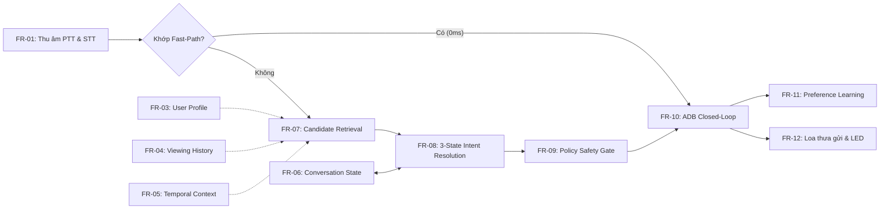
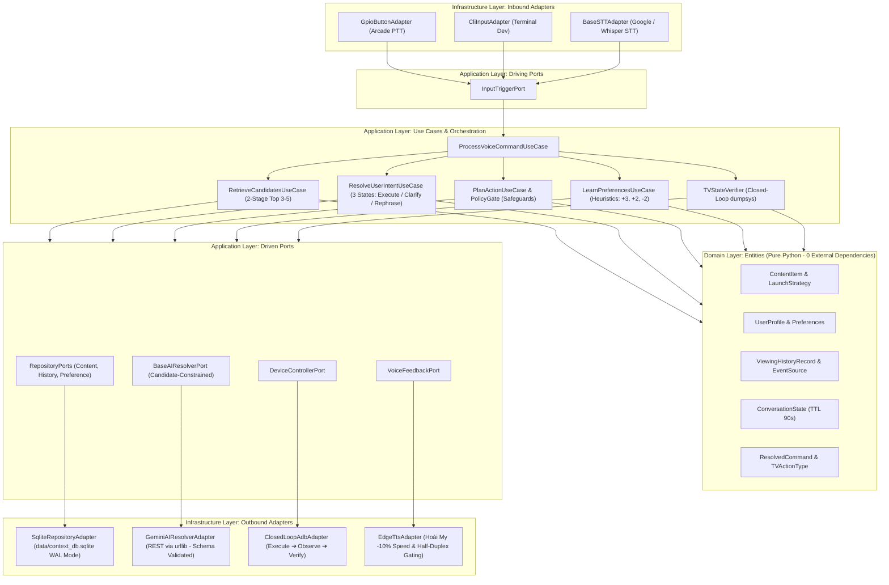

# TÀI LIỆU ĐẶC TẢ YÊU CẦU PHẦN MỀM (SRS)
## DỰ ÁN: TRỢ LÝ TV THÔNG MINH HIỂU NGỮ CẢNH CHO NGƯỜI CAO TUỔI
### (Context-Aware Conversational TV Assistant for Elderly People)

**Mã tài liệu:** SRS-TV-ASSISTANT-2026  
**Phiên bản:** 2.1 (Audited & Rigorous Specification)  
**Tiêu chuẩn áp dụng:** IEEE Std 29148-2018 (Systems and Software Engineering - Life Cycle Processes - Requirements Engineering)  
**Ngày phát hành:** 02/11/2026  
**Trạng thái:** Đã hiệu chỉnh & Chuẩn hóa (Reviewed & Calibrated)  

---

## MỤC LỤC
1. [GIỚI THIỆU (INTRODUCTION)](#1-giới-thiệu-introduction)
   - 1.1 Mục đích (Purpose)
   - 1.2 Phạm vi sản phẩm (Scope)
   - 1.3 Thuật ngữ & Định nghĩa vận hành (Definitions & Operational Definitions)
   - 1.4 Tài liệu tham chiếu (References)
2. [MÔ TẢ TỔNG THỂ (OVERALL DESCRIPTION)](#2-mô-tả-tổng-thể-overall-description)
   - 2.1 Bối cảnh và ranh giới sản phẩm (Product Perspective & Boundaries)
   - 2.2 Tóm tắt chức năng và Chuỗi phụ thuộc (Functions & Dependency Chain)
   - 2.3 Phân loại đối tượng người dùng (User Classes & Characteristics)
   - 2.4 Môi trường vận hành (Operating Environment)
   - 2.5 Các ràng buộc thiết kế & triển khai (Constraints)
   - 2.6 Giả định & Sự phụ thuộc (Assumptions & Dependencies)
3. [YÊU CẦU CHỨC NĂNG CHI TIẾT (SPECIFIC FUNCTIONAL REQUIREMENTS)](#3-yêu-cầu-chức-năng-chi-tiết-specific-functional-requirements)
   - FR-01: Thu nhận giọng nói Push-to-Talk & Giao diện STT
   - FR-02: Điều khiển thiết bị tức thì qua Fast-Path Offline
   - FR-03: Quản lý Hồ sơ Sở thích ổn định (User Profile & Cold Start)
   - FR-04: Ghi nhận và theo dõi Nhật ký xem có nguồn gốc (Viewing History)
   - FR-05: Xử lý Ngữ cảnh Môi trường và Tham chiếu thời gian
   - FR-06: Quản lý Trạng thái Hội thoại đa lượt (Conversation State Machine)
   - FR-07: Truy xuất và xếp hạng ứng viên tiềm năng (Candidate Retrieval 2 tầng)
   - FR-08: Phân loại ý định 3 trạng thái & Lễ phép hỏi lại (Clarification)
   - FR-09: Lập kế hoạch hành động & Cổng kiểm soát an toàn (Policy Gate)
   - FR-10: Điều khiển TV qua ADB vòng lặp đóng (Closed-Loop ADB Control)
   - FR-11: Học thích ứng thói quen người dùng theo quy tắc Heuristic
   - FR-12: Phản hồi đa giác quan và giọng nói kính cẩn (Elderly UX)
   - FR-13: Quản lý Vòng đời & Tính khả dụng của Danh mục (Catalog Lifecycle)
   - FR-14: Cấu hình ban đầu, Ghép đôi ADB & Khôi phục sau sự cố
4. [YÊU CẦU GIAO DIỆN ĐỐI NGOẠI (EXTERNAL INTERFACE REQUIREMENTS)](#4-yêu-cầu-giao-diện-đối-ngoại-external-interface-requirements)
   - 4.1 Giao diện người dùng phần cứng (User Interface)
   - 4.2 Giao diện phần mềm & Giao thức STT/TTS (Software Interfaces)
   - 4.3 Giao diện phần cứng (Hardware Interfaces)
   - 4.4 Giao diện truyền thông mạng (Communication Interfaces)
5. [YÊU CẦU PHI CHỨC NĂNG & PHƯƠNG PHÁP ĐO (NON-FUNCTIONAL REQUIREMENTS)](#5-yêu-cầu-phi-chức-năng--phương-pháp-đo-non-functional-requirements)
   - 5.1 Hiệu năng và Ngân sách độ trễ có phương pháp đo (Performance & Latency)
   - 5.2 An toàn thông tin và Chính sách lưu trữ dữ liệu (Security & Privacy Lifecycle)
   - 5.3 Độ tin cậy và Khả năng sẵn sàng (Reliability & Availability)
   - 5.4 Tính khả dụng cho người cao tuổi (Usability)
   - 5.5 Khả năng bảo trì, Logging & Diagnostic (Maintainability & Telemetry)
6. [YÊU CẦU DỮ LIỆU & LƯU TRỮ (DATA REQUIREMENTS)](#6-yêu-cầu-dữ-liệu--lưu-trữ-data-requirements)
   - 6.1 Lược đồ cơ sở dữ liệu SQLite & Quản lý Schema Version
   - 6.2 Toàn vẹn giao dịch và Vòng đời dữ liệu (Data Integrity & Lifecycle)
7. [QUY TẮC NGHIỆP VỤ (BUSINESS RULES)](#7-quy-tắc-nghiệp-vụ-business-rules)
8. [TIÊU CHÍ NGHIỆM THU & MA TRẬN TRUY VẾT 4 BƯỚC (ACCEPTANCE CRITERIA & TRACEABILITY)](#8-tiêu-chí-nghiệm-thu--ma-trận-truy-vết-4-bước-acceptance-criteria--traceability)
   - 8.1 Bộ 12 kịch bản kiểm thử (7 Happy Path + 5 Negative/Boundary Cases)
   - 8.2 Ba tiêu chuẩn nghiệm thu vàng (Golden Acceptance Criteria)
   - 8.3 Ma trận truy vết vòng đời 4 bước (Traceability Lifecycle Matrix)
9. [PHỤ LỤC (APPENDICES)](#9-phụ-lục-appendices)
   - Phụ lục A: Sơ đồ kiến trúc phân tầng Clean Architecture
   - Phụ lục B: Ma trận 13 rủi ro kỹ thuật P0/P1
   - Phụ lục C: Kế hoạch 6 bước PoC kiểm chứng khả thi

---

## 1. GIỚI THIỆU (INTRODUCTION)

### 1.1. Mục đích (Purpose)
Tài liệu Đặc tả Yêu cầu Phần mềm (SRS) này xác định đầy đủ, chi tiết, khách quan và có thể kiểm chứng các yêu cầu chức năng, yêu cầu phi chức năng, giao diện đối ngoại, quy tắc nghiệp vụ và phương pháp đo lường chất lượng cho hệ thống **Context-Aware Conversational TV Assistant for Elderly People (Smart TV Pod)**.  
Phiên bản 2.1 đã được rà soát tính nhất quán (*Consistency Audit*), loại bỏ các tuyên bố tuyệt đối hóa thiếu cơ sở, chuẩn hóa phương pháp đo lường cho các chỉ tiêu kỹ thuật và bổ sung các kịch bản kiểm thử biên/lỗi (*Negative & Boundary Cases*).

### 1.2. Phạm vi sản phẩm (Scope)
* **Tên sản phẩm:** Smart TV Pod (Trợ lý điều khiển TV đàm thoại hiểu ngữ cảnh cho người cao tuổi).
* **Bài toán giải quyết:** Hỗ trợ người cao tuổi tại Việt Nam (thị lực kém, tay run, nói ngập ngừng, khẩu ngữ mang tính thói quen và ngữ cảnh thời gian) mở đúng nội dung mong muốn trên Smart TV qua 01 nút bấm cơ duy nhất, xóa bỏ hoàn toàn rào cản thao tác remote đa tầng.
* **Phạm vi triển khai trong giai đoạn MVP (In-Scope):**
  - **Phần cứng:** 01 Smart TV Pod để bàn (Raspberry Pi Zero 2W / Pi 3B+ hoặc PC giả lập) trang bị nút bấm Arcade lớn, micro USB lọc ồn, loa mini và đèn LED RGB.
  - **Thiết bị đích:** 01 Smart TV Android / Google TV (điển hình: TV Xiaomi) trong cùng mạng LAN gia đình, kết nối qua giao thức ADB Wi-Fi cổng 5555.
  - **Người dùng & Nội dung:** 01 người dùng chính (ông/bà) cùng danh mục tuyển chọn 30–50 nội dung thân thuộc (Thời sự VTV1/VTV2/VTV3, Kinh Phật, Cải lương, Nhạc vàng).
  - **Khả năng nhận thức 3 tầng:** Nhận diện ý định (Intent Recognition) $\to$ Xác định thực thể (Entity Resolution) $\to$ Hiểu ngữ cảnh (Context Understanding).
  - **Cơ chế Hybrid:** Fast-Path Offline 0ms cho các lệnh điều khiển thiết yếu; AI-Path (Gemini Flash + Candidate Retrieval) cho khẩu ngữ tự nhiên.
  - **Cơ chế an toàn:** Policy Gate chặn lệnh nhạy cảm; Closed-Loop ADB quan sát trạng thái cửa sổ; phân nhánh 3 trạng thái (Thực thi / Hỏi lại / Yêu cầu nói lại).
* **Phạm vi ngoài MVP (Out-of-Scope):**
  - Huấn luyện hoặc Fine-tuning mô hình ngôn ngữ lớn (LLM) riêng.
  - Cài đặt hệ quản trị Vector Database độc lập (Chroma/Pinecone/Milvus).
  - Sử dụng thuật toán Machine Learning phức tạp cho Preference Learning (chỉ dùng Heuristic có trọng số).
  - Tự động bấm nút "Bỏ qua quảng cáo" (Skip Ad) trên YouTube do giao diện UI thay đổi liên tục.
  - Tính năng mạng xã hội hoặc mở tin nhắn ứng dụng ngoài (TikTok Inbox đã loại bỏ).
  - Quản lý điều khiển nhiều TV đồng thời trong nhiều phòng.

### 1.3. Thuật ngữ & Định nghĩa vận hành (Definitions & Operational Definitions)

Để đảm bảo tính không mơ hồ (*Unambiguous*), các thuật ngữ trong tài liệu được định nghĩa vận hành rõ ràng như sau:

| Thuật ngữ / Khái niệm | Định nghĩa vận hành (Operational Definition) | Phương pháp xác minh / Đo lường |
| :--- | :--- | :--- |
| **Calibrated Confidence** | Điểm số tin cậy tổng hợp được chuẩn hóa từ 0.0 đến 1.0, kết hợp giữa `raw_confidence` do LLM trả về ($60\%$), mức độ khớp của ứng viên trong Catalog ($30\%$) và điểm sở thích lịch sử ($10\%$). Tuyệt đối không dùng trực tiếp số LLM tự sinh làm xác suất đúng. | Công thức: $\text{Conf} = 0.6 \cdot \text{LLM} + 0.3 \cdot \text{Match} + 0.1 \cdot \text{Pref}$. Ngưỡng thực thi: $\ge 0.85$. |
| **Nội dung đã nghe trọn vẹn** | Trạng thái phát nội dung đạt $\ge 80\%$ thời lượng video hoặc người dùng xem liên tục $> 10$ phút mà không có lệnh bấm chuyển bài, đổi kênh hoặc hiệu chỉnh tiêu cực. | Kiểm tra khoảng thời gian giữa `started_at` và tương tác kế tiếp trong `viewing_history`. |
| **Nội dung gần nhất (Recency)** | Bản ghi có thời điểm tương tác hoặc kết thúc (`last_interaction` hoặc `ended_at`) gần với thời điểm hiện tại nhất trong cơ sở dữ liệu. | Truy vấn SQL: `ORDER BY id DESC LIMIT 1`. |
| **Xác minh mở đúng nội dung** | Chuỗi xác minh 3 cấp độ: (1) Package ứng dụng foreground đúng; (2) Intent/DeepLink gửi thành công không lỗi; (3) Đúng Activity mục tiêu (PlayerActivity). | Lệnh `dumpsys window` kiểm tra `mCurrentFocus` khớp package/activity mục tiêu. |
| **Độ trễ phản hồi cảm giác** | Khoảng thời gian từ thời điểm công tắc cơ của nút bấm đóng mạch (Button Press) đến khi đèn LED xanh lam bật sáng và loa phát tiếng "Ting". | Đo bằng logic ngắt phần cứng GPIO và đồng hồ microsecond (`time.perf_counter()`). |
| **Ngân sách Dispatch Latency** | Thời gian tính từ lúc người dùng nhả nút bấm (Button Release) đến thời điểm lệnh ADB cuối cùng được gửi thành công vào socket TV. | Đo bằng timestamp tại `InputTriggerPort` đến timestamp trả về của `DeviceControllerPort`. |
| **Ngân sách Playback Latency** | Thời gian từ lúc nhả nút bấm đến khi khung hình video đầu tiên thực tế hiển thị trên màn hình TV (phụ thuộc tốc độ nạp app của TV). | Đo đạc thực nghiệm bằng camera quay màn hình TV (ước tính: 2.5s – 4.5s). |
| **Push-to-Talk (PTT)** | Cơ chế thu âm chỉ hoạt động khi nút cơ đang được nhấn giữ. Nhả nút = ngắt luồng thu âm ngay lập tức. PTT **không** khử được tiếng TV lọt vào mic khi đang giữ nút, mà chỉ triệt tiêu tiếng ồn sau khi nhả nút. | Đóng buffer âm thanh ngay tại sự kiện ngắt GPIO Falling-Edge. |
| **Acoustic Echo Cancellation (AEC)** | Thuật toán phần mềm/phần cứng triệt tiêu tiếng vọng khi loa và micro hoạt động đồng thời. Dự án áp dụng **Half-Duplex Gating** (khóa mic khi loa TTS phát) để thay thế AEC phức tạp trong MVP. | Đặt cờ `is_speaking = True` để bỏ qua mọi tín hiệu âm thanh đầu vào khi loa đang nói. |

### 1.4. Tài liệu tham chiếu (References)
1. **IEEE Std 29148-2018:** Systems and Software Engineering - Life Cycle Processes - Requirements Engineering.
2. [tieu-chi-srs.md](file:///d:/mic-control/tieu-chi-srs.md): Tiêu chuẩn và tiêu chí đánh giá chất lượng tài liệu SRS.
3. [khung.md](file:///d:/mic-control/khung.md): Tài liệu đặc tả dự án Trợ lý TV thông minh hiểu ngữ cảnh cho người cao tuổi.
4. [tech-stack.md](file:///d:/mic-control/tech-stack.md): Tài liệu công nghệ và kiến trúc hệ thống Clean Architecture.

---

## 2. MÔ TẢ TỔNG THỂ (OVERALL DESCRIPTION)

### 2.1. Bối cảnh và ranh giới sản phẩm (Product Perspective & Boundaries)
Smart TV Pod là thiết bị nhúng để bàn độc lập (*Standalone Desktop Pod*), đóng vai trò biên (*Edge Agent*) trung gian điều phối giữa người cao tuổi, dịch vụ trí tuệ nhân tạo đám mây và Smart TV gia đình:

```
┌────────────────────────────────────────────────────────────────────────┐
│                        SMART TV POD (RASPBERRY PI)                     │
│  ┌───────────────────────┐  ┌────────────────┐  ┌───────────────────┐  │
│  │ Nút Arcade PTT + Mic  │  │ Clean Arch Core│  │ SQLite Context DB │  │
│  │ Loa Edge-TTS + LED RGB│  │ Python 3.10+   │  │ 30-50 Catalog     │  │
│  └───────────┬───────────┘  └───────┬────────┘  └─────────┬─────────┘  │
└──────────────┼──────────────────────┼─────────────────────┼────────────┘
               │                      │                     │
    (Nhấn nút & Khẩu ngữ)             │ (REST Candidate)    │ (Lịch sử xem)
               │                      ▼                     │
               │             ┌─────────────────┐            │
               │             │ Google Gemini   │            │
               │             │ Flash API       │            │
               │             └─────────────────┘            │
               │                                            │
               ▼ (Lệnh ADB qua Wi-Fi LAN / Cổng 5555)       │
    ┌───────────────────────────────────────────────────────▼────────┐
    │          SMART TV XIAOMI (ANDROID TV / GOOGLE TV)              │
    │  - VTVgo Live Streams (VTV1, VTV2, VTV3, VTV Cần Thơ, THVL1)   │
    │  - YouTube Player (Kinh Phật, Cải lương xưa, Nhạc Bolero)      │
    └────────────────────────────────────────────────────────────────┘
```

### 2.2. Tóm tắt chức năng và Chuỗi phụ thuộc (Functions & Dependency Chain)

Các yêu cầu chức năng có mối liên hệ phụ thuộc tuyến tính chặt chẽ:


*Phân loại mức độ ưu tiên theo chuẩn MoSCoW:*
* **Must Have (Bắt buộc P0):** `FR-01`, `FR-02`, `FR-03`, `FR-04`, `FR-05`, `FR-07`, `FR-08`, `FR-09`, `FR-10`, `FR-12`.
* **Should Have (Nên có P1):** `FR-06` (Hội thoại đa lượt), `FR-11` (Học thích ứng Heuristic), `FR-13` (Quản lý vòng đời Catalog), `FR-14` (Khởi tạo & Ghép đôi ADB).

### 2.3. Phân loại đối tượng người dùng (User Classes & Characteristics)
1. **Người dùng thụ hưởng chính (Ông / Bà - Người cao tuổi):**
   - Giọng nói có độ ngắt quãng, khẩu ngữ phương ngữ, tốc độ phát âm chậm, có nhiều từ đệm (*"cháu ơi... mở cho bà cái bài..."*).
   - Thị lực và thính lực suy giảm; không tiếp thu được các giao diện menu phức tạp trên màn hình TV; cần phản hồi bằng giọng nói lễ phép, ấm áp, tốc độ chậm rãi.
2. **Người quản trị kỹ thuật (Con cháu trong gia đình):**
   - Thiết lập cấu hình IP TV cố định một lần; nạp danh sách các bài kinh hoặc kênh truyền hình ông bà yêu thích qua file cấu hình; kiểm tra trạng thái hoạt động qua log file khi có sự cố.

### 2.4. Môi trường vận hành (Operating Environment)
* **Phần cứng Edge:** Bo mạch Raspberry Pi Zero 2W (hoặc Pi 3B+/Pi 4), kết nối nút cơ Arcade qua GPIO BCM 18, đèn LED RGB qua GPIO 23/24, micro USB lọc ồn và loa USB mini.
* **Hệ điều hành:** Linux Debian 64-bit (Raspberry Pi OS Lite) hoặc Windows 10/11 cho môi trường kiểm thử nhà phát triển.
* **Runtime:** Python 3.10+ thuần túy (Pure Python).
* **Thiết bị hiển thị:** Smart TV Android / Google TV (điển hình: TV Xiaomi), đã kích hoạt tính năng *Developer Options* và *Wireless Debugging*.
* **Môi trường mạng:** Mạng Wi-Fi gia đình băng tần 2.4GHz, cùng dải địa chỉ IP LAN (ví dụ: `192.168.1.0/24` hoặc `10.88.88.0/24`).

### 2.5. Các ràng buộc thiết kế & triển khai (Constraints)
* **Ràng buộc bộ nhớ (Memory Constraint):** Tổng dung lượng bộ nhớ RAM chiếm dụng (*Resident Set Size - RSS*) của ứng dụng và SQLite **không được vượt quá 45MB** trong suốt quá trình chạy.
* **Ràng buộc kiến trúc (Architecture Constraint):** Tuân thủ cấu trúc phân tầng Clean Architecture. Tầng Domain thuần túy không chứa lệnh gọi hệ điều hành hay thư viện ngoài.
* **Ràng buộc độc lập mạng (Offline Survivability):** Khi đường truyền Internet bị ngắt, 100% các lệnh điều khiển TV cơ bản (âm lượng, tắt TV, VTV1 trực tiếp) phải hoạt động bình thường qua Fast-Path.

### 2.6. Giả định & Sự phụ thuộc (Assumptions & Dependencies)
* Giả định router gia đình giữ nguyên địa chỉ IP tĩnh cho Smart TV (DHCP reservation).
* Giả định TV duy trì trạng thái mở cổng ADB 5555 khi cắm điện.
* Phụ thuộc vào Google Gemini Flash API cho việc phân tích ngữ nghĩa các câu khẩu ngữ tự nhiên và Microsoft Edge-TTS cho việc tổng hợp giọng đọc tiếng Việt.

---

## 3. YÊU CẦU CHỨC NĂNG CHI TIẾT (SPECIFIC FUNCTIONAL REQUIREMENTS)

### FR-01: Thu nhận giọng nói Push-to-Talk & Giao diện STT
* **Mã yêu cầu:** `FR-01`
* **Actor:** Ông / Bà (Người cao tuổi).
* **Đầu vào (Input):** Tín hiệu ngắt cơ học nhấn nút Arcade và luồng âm thanh thu từ microphone USB (Định dạng: 16kHz, 16-bit Mono PCM WAV).
* **Điều kiện tiên quyết (Preconditions):** Thiết bị Smart TV Pod đang cấp nguồn, đèn LED ở trạng thái sẵn sàng (Màu trắng hoặc Tắt).
* **Luồng sự kiện chính (Main Flow):**
  1. Người dùng nhấn nút Arcade lớn màu đỏ.
  2. Hệ thống bắt sự kiện GPIO Falling-Edge trong $< 15\text{ms}$, phát âm báo "Ting", bật đèn LED xanh lam và mở stream thu âm từ micro.
  3. Người dùng nói câu khẩu ngữ trong lúc đang giữ nút (*"Cháu bật bài kinh cho bà nghe"*).
  4. Người dùng thả nút bấm cơ học.
  5. Hệ thống đóng stream âm thanh ngay lập tức tại sự kiện GPIO Rising-Edge, chuyển đèn LED sang màu vàng (Đang xử lý).
  6. Gửi buffer âm thanh đến module `BaseSTTAdapter` (Google Cloud Speech API hoặc Whisper API) với thời gian chờ tối đa (timeout) là **3.0 giây**.
  7. Nhận chuỗi văn bản đã nhận dạng (`raw_transcript`).
* **Luồng phụ & Xử lý lỗi (Alternative Flows):**
  - *A1 (Nút bấm nhấp nhả quá nhanh dưới 0.3 giây):* Hủy buffer âm thanh, đèn LED nhấp nháy đỏ 2 lần, không gửi yêu cầu STT để tiết kiệm chi phí.
  - *A2 (STT trả về chuỗi rỗng hoặc lỗi timeout > 3.0s):* Đèn LED chuyển màu đỏ, loa phát thông báo lễ phép: *"Dạ, cháu chưa nghe rõ, bà bấm giữ nút rồi nói lại cho cháu nghe nhé ạ"*.
  - *A3 (Chế độ phát triển Dev CLI):* Nhập trực tiếp chuỗi văn bản từ Terminal bàn phím qua `CliInputAdapter`.
* **Điều kiện sau (Postconditions):** Chuỗi văn bản khẩu ngữ hợp lệ được chuyển sang bộ điều phối `ProcessVoiceCommandUseCase`.
* **Mức độ ưu tiên:** **P0 (Must Have)**.
* **Tiêu chí nghiệm thu (Acceptance Criteria):**
  - [ ] Cơ chế PTT ngắt stream tức thì khi thả nút, loại bỏ hoàn toàn âm thanh TV phát ra sau thời điểm thả nút.
  - [ ] [Proposed Target - To Be Validated] Tỷ lệ nhận dạng từ lỗi (Word Error Rate - WER) đối với các từ khóa chính (tên kênh, tên bài kinh, tên thầy) đạt $\le 12\%$ trong điều kiện khoảng cách người nói $0.5\text{m} - 1.2\text{m}$ và âm lượng TV nền $\le 65\text{dB}$.

---

### FR-02: Điều khiển thiết bị tức thì qua Fast-Path Offline
* **Mã yêu cầu:** `FR-02`
* **Actor:** Hệ thống (`HybridAIResolverAdapter`).
* **Đầu vào (Input):** Chuỗi văn bản khẩu ngữ đã chuẩn hóa.
* **Điều kiện tiên quyết (Preconditions):** Chuỗi văn bản đầu vào không rỗng.
* **Luồng sự kiện chính (Main Flow):**
  1. Hệ thống chuẩn hóa chuỗi ký tự (chuyển chữ thường, xóa dấu câu và khoảng trắng thừa).
  2. Đối chiếu chuỗi với bảng ánh xạ Fast-Path trong bộ nhớ RAM:
     - Tăng/giảm âm lượng: *"to lên", "tăng âm", "nhỏ tiếng", "bé lại"*.
     - Tắt TV / Đi ngủ: *"tắt tv", "nghỉ xem", "ông đi ngủ đây", "bà đi ngủ đây"*.
     - Tạm dừng / Tiếp tục: *"tạm dừng", "dừng lại", "bật lại", "phát tiếp"*.
     - Điều hướng hệ thống: *"về trang chủ", "màn hình chính", "quay lại"*.
     - Kênh thời sự trực tiếp: *"bật vtv1", "mở vtv1", "kênh 1", "xem vtv1"*.
  3. Nếu chuỗi khớp chính xác một trong các mẫu trên, sinh đối tượng `ResolvedCommand` với `confidence = 1.0` mà không gọi Cloud LLM.
  4. Chuyển lệnh ngay lập tức xuống `DeviceControllerPort`.
* **Luồng phụ & Xử lý lỗi (Alternative Flows):**
  - *A1 (Không khớp Fast-Path):* Chuyển toàn bộ chuỗi văn bản sang luồng AI (`AI-Path`) để phân tích ngữ cảnh.
* **Điều kiện sau (Postconditions):** TV thực thi lệnh tức thì; chức năng hoạt động bình thường ngay cả khi mất mạng Internet.
* **Mức độ ưu tiên:** **P0 (Must Have)**.
* **Tiêu chí nghiệm thu (Acceptance Criteria):**
  - [ ] Thời gian xử lý Fast-Path tính từ lúc nhận văn bản đến khi phát lệnh ADB: p50 $< 20\text{ms}$, p95 $< 50\text{ms}$.
  - [ ] Tỷ lệ nhận diện chính xác $100\%$ đối với các mẫu câu trong bảng quy tắc Fast-Path.

---

### FR-03: Quản lý Hồ sơ Sở thích ổn định (User Profile & Cold Start)
* **Mã yêu cầu:** `FR-03`
* **Actor:** Con cháu cài đặt ban đầu & Hệ thống Context.
* **Đầu vào (Input):** File cấu hình `data/catalog_seed.json` và bảng `user_preferences`.
* **Điều kiện tiên quyết (Preconditions):** Tệp database SQLite đã khởi tạo schema.
* **Luồng sự kiện chính (Main Flow):**
  1. Hệ thống đọc hồ sơ `user_id = 'grandmother'` từ bảng `user_preferences`.
  2. Nạp danh mục thể loại ưa thích mặc định (`BUDDHIST`, `NEWS`, `TRADITIONAL_MUSIC`).
  3. Nạp cấu hình tương tác người cao tuổi (`speech_rate = 'SLOW'`, `confirmation_level = 'HIGH'`).
  4. Cung cấp trọng số điểm ưu tiên cho module Candidate Retrieval để xếp hạng nội dung.
* **Luồng phụ & Xử lý lỗi (Alternative Flows):**
  - *A1 (Ngày đầu tiên triển khai - Cold Start):* Hệ thống tự động nạp điểm mặc định (`default_priority = 50 - 95`) từ danh mục 30 nội dung quen thuộc mẫu, đảm bảo phục vụ được ngay mà không cần dữ liệu lịch sử trước đó.
* **Điều kiện sau (Postconditions):** Đối tượng `UserProfile` sẵn sàng trong RAM phục vụ xếp hạng ứng viên.
* **Mức độ ưu tiên:** **P0 (Must Have)**.
* **Tiêu chí nghiệm thu (Acceptance Criteria):**
  - [ ] Giải quyết thành công bài toán Cold Start: Trong lần đầu khởi chạy, người dùng nói *"bật kinh cho bà"* thì hệ thống luôn mở được bài kinh có điểm mặc định cao nhất (`buddhist_001` - Kinh A Di Đà).

---

### FR-04: Ghi nhận và theo dõi Nhật ký xem có nguồn gốc (Viewing History)
* **Mã yêu cầu:** `FR-04`
* **Actor:** Hệ thống (`ProcessVoiceCommandUseCase`).
* **Đầu vào (Input):** Sự kiện điều khiển TV thành công, ID nội dung, câu khẩu ngữ thô.
* **Điều kiện tiên quyết (Preconditions):** Lệnh mở nội dung được xác nhận thành công qua ADB.
* **Luồng sự kiện chính (Main Flow):**
  1. Tạo bản ghi `ViewingHistoryRecord` với các trường:
     - `source = 'VOICE_ASSISTANT'` (xác định sự kiện do trợ lý kích hoạt).
     - `completion_status = 'UNKNOWN'` (chưa xác định tỷ lệ nghe hết).
     - `started_at = CURRENT_TIMESTAMP`, `raw_utterance = user_text`.
  2. Ghi bản ghi vào bảng `viewing_history` trong SQLite qua giao dịch an toàn.
  3. Cập nhật `ConversationState.currently_playing_id = content_id`.
* **Luồng phụ & Xử lý lỗi (Alternative Flows):**
  - *A1 (Người dùng chuyển bài hoặc tắt TV trong vòng 30 giây):* Cập nhật bản ghi trước đó với cờ `was_skipped_immediately = True` và `completion_status = 'SKIPPED'`.
  - *A2 (Nội dung phát liên tục > 10 phút mà không có lệnh ngắt):* Đánh dấu `completion_status = 'COMPLETED'` khi có tương tác tiếp theo.
* **Điều kiện sau (Postconditions):** Lịch sử xem lưu vết chính xác, có phân định nguồn gốc xuất xứ sự kiện.
* **Mức độ ưu tiên:** **P0 (Must Have)**.
* **Tiêu chí nghiệm thu (Acceptance Criteria):**
  - [ ] Ghi nhận thành công 100% sự kiện mở video/kênh do trợ lý phát động vào SQLite.
  - [ ] Phân biệt rõ ràng giữa sự kiện do trợ lý điều khiển (`VOICE_ASSISTANT`) và sự kiện quan sát thụ động trên TV (`TV_OBSERVED`).

---

### FR-05: Xử lý Ngữ cảnh Môi trường và Tham chiếu thời gian
* **Mã yêu cầu:** `FR-05`
* **Actor:** Hệ thống (`RetrieveCandidatesUseCase`).
* **Đầu vào (Input):** Câu khẩu ngữ có chứa đại từ chỉ định thời gian (*"hôm qua", "vừa rồi", "sáng nay", "tối qua"*).
* **Điều kiện tiên quyết (Preconditions):** Bảng `viewing_history` có dữ liệu lịch sử tương ứng.
* **Luồng sự kiện chính (Main Flow):**
  1. Nhận diện từ khóa thời gian trong câu nói.
  2. Nếu có từ *"hôm qua"* hoặc *"tối qua"*: Truy vấn các bản ghi `viewing_history` có thời gian bắt đầu trong khoảng 24–48 giờ trước.
  3. Nếu có từ *"vừa rồi"* hoặc *"bài trước"*: Lấy bản ghi có `ended_at` hoặc `started_at` gần nhất qua `get_last_played()`.
  4. Nếu có từ *"buổi sáng"*: Đối chiếu khung giờ 05:30–07:00 kết hợp thể loại `BUDDHIST`.
  5. Đưa các nội dung tìm thấy vào vị trí ưu tiên số 1 trong danh sách ứng viên (Candidate List).
* **Luồng phụ & Xử lý lỗi (Alternative Flows):**
  - *A1 (Không tìm thấy lịch sử phù hợp trong khoảng thời gian yêu cầu):* Hệ thống không đoán mò; chuyển sang trạng thái hỏi lại (`CLARIFY`): *"Dạ, hôm qua cháu chưa ghi nhận bài kinh nào, bà muốn nghe Kinh A Di Đà hay Kinh Pháp Hoa ạ?"*.
* **Điều kiện sau (Postconditions):** Câu nói tham chiếu thời gian được giải quyết thành ID cụ thể hoặc kích hoạt câu hỏi làm rõ.
* **Mức độ ưu tiên:** **P0 (Must Have)**.
* **Tiêu chí nghiệm thu (Acceptance Criteria):**
  - [ ] Xử lý đúng bài kinh đã nghe hôm trước khi có lịch sử xem.
  - [ ] Không tự ý đoán mò nội dung ngẫu nhiên khi dữ liệu lịch sử bị khuyết.

---

### FR-06: Quản lý Trạng thái Hội thoại đa lượt (Conversation State Machine)
* **Mã yêu cầu:** `FR-06`
* **Actor:** Ông / Bà và Hệ thống đối thoại.
* **Đầu vào (Input):** Câu nói lựa chọn ngắn gọn nối tiếp câu hỏi của trợ lý (*"cái thứ nhất", "bài đầu tiên", "bài hai"*).
* **Điều kiện tiên quyết (Preconditions):** Trạng thái `dialogue_state == AWAITING_CLARIFICATION` và phiên chưa hết hạn (TTL $< 90\text{s}$).
* **Luồng sự kiện chính (Main Flow):**
  1. Khi trợ lý hỏi làm rõ giữa 2 ứng viên, hệ thống lưu `last_candidate_ids = ['id_1', 'id_2']` vào `ConversationState` và kích hoạt bộ đếm thời gian TTL 90 giây.
  2. Người dùng nhấn nút nói: *"Cái thứ nhất ấy"* hoặc *"Bài một"*.
  3. Hệ thống kiểm tra thời gian tồn tại của phiên: $\Delta t = t_{\text{now}} - t_{\text{last}} \le 90\text{s}$.
  4. Ánh xạ từ chỉ số (*"thứ nhất"*) với ứng viên vị trí index 0 (`id_1`).
  5. Chuyển trạng thái sang `EXECUTING`, sinh lệnh mở nội dung `id_1` và phát phản hồi: *"Dạ, cháu mở [Tên bài] cho bà ngay đây ạ"*.
  6. Xóa trạng thái chờ, cập nhật `last_action`.
* **Luồng phụ & Xử lý lỗi (Alternative Flows):**
  - *A1 (Quá 90 giây người dùng mới phản hồi - Expired Session):* Trạng thái phiên tự động reset về `IDLE`. Câu nói tiếp theo được xử lý như một phiên mới hoàn toàn độc lập.
  - *A2 (Người dùng đổi ý giữa chừng: "Thôi mở thời sự"):* Hủy câu hỏi làm rõ cũ, nhận diện ý định mới và mở kênh VTV1.
* **Điều kiện sau (Postconditions):** Duy trì tính liên tục của cuộc đối thoại mà không bắt người già lặp lại toàn bộ câu dài.
* **Mức độ ưu tiên:** **P1 (Should Have)**.
* **Tiêu chí nghiệm thu (Acceptance Criteria):**
  - [ ] Nhận diện chính xác lựa chọn chỉ số (*"thứ nhất"*, *"thứ hai"*) trong vòng 90 giây.
  - [ ] Tự động đóng phiên hội thoại sau 90 giây không có phản hồi.

---

### FR-07: Truy xuất và xếp hạng ứng viên tiềm năng (Candidate Retrieval 2 tầng)
* **Mã yêu cầu:** `FR-07`
* **Actor:** Hệ thống (`RetrieveCandidatesUseCase`).
* **Đầu vào (Input):** Chuỗi văn bản truy vấn, gợi ý thể loại, gợi ý thời gian.
* **Điều kiện tiên quyết (Preconditions):** Bảng `content_catalog` có sẵn danh mục nội dung.
* **Luồng sự kiện chính (Main Flow):**
  1. Tầng 1 (Context Filtering): Lọc theo điều kiện cứng (thể loại `category`, lịch sử ngày hôm trước).
  2. Tầng 2 (Text Matching): Tìm kiếm chuỗi văn bản trên các trường `name`, `speaker_or_artist`, và `tags` trong bảng `content_catalog`.
  3. Tính điểm ưu tiên tổng hợp cho từng ứng viên:
     $$\text{Score} = w_1 \cdot \text{PrefScore} + w_2 \cdot \text{RecencyScore} + w_3 \cdot \text{TextMatchScore}$$
     (với $w_1 = 0.4$, $w_2 = 0.3$, $w_3 = 0.3$).
  4. Lấy ra top **3 đến 5 ứng viên** có điểm cao nhất.
  5. Chuyển danh sách ứng viên này sang cho LLM Intent Parser.
* **Luồng phụ & Xử lý lỗi (Alternative Flows):**
  - *A1 (Không có kết quả khớp từ khóa):* Nạp 5 nội dung có điểm ưu tiên mặc định cao nhất của người dùng từ Catalog.
* **Điều kiện sau (Postconditions):** Giới hạn không gian lựa chọn cho LLM trong tập 3–5 ứng viên hợp lệ, ngăn chặn việc AI tự tạo ID ảo.
* **Mức độ ưu tiên:** **P0 (Must Have)**.
* **Tiêu chí nghiệm thu (Acceptance Criteria):**
  - [ ] Thời gian truy vấn SQLite: p95 $< 10\text{ms}$.
  - [ ] Luôn cung cấp từ 1 đến 5 ứng viên khả thi cho tầng AI.

---

### FR-08: Phân loại ý định 3 trạng thái & Lễ phép hỏi lại (Clarification)
* **Mã yêu cầu:** `FR-08`
* **Actor:** Hệ thống (`ResolveUserIntentUseCase` kết hợp `GeminiAIResolverAdapter`).
* **Đầu vào (Input):** Khẩu ngữ của người dùng và danh sách 3–5 ứng viên từ FR-07.
* **Điều kiện tiên quyết (Preconditions):** Kết nối mạng Internet và Gemini Flash API khả dụng.
* **Luồng sự kiện chính (Main Flow):**
  1. Gửi System Prompt tinh gọn cùng danh sách ứng viên sang Google Gemini Flash API qua giao thức HTTPS POST.
  2. Nhận kết quả JSON chứa: `action_type`, `content_id`, `target`, `confidence`, `feedback`.
  3. Kiểm tra tính hợp lệ của schema: Nếu `content_id` không nằm trong danh mục ứng viên đã gửi, **từ chối ID này** và đặt `content_id = None`.
  4. Tính toán Calibrated Confidence và phân nhánh 3 trạng thái:
     - **Trạng thái 1 (Đủ thông tin - Confidence $\ge 0.85$):** Chuyển sang thực thi trực tiếp trên TV.
     - **Trạng thái 2 (Có nhiều khả năng - Confidence $0.60 - 0.84$ và có $\ge 2$ ứng viên):** Chuyển sang hỏi lại: *"Dạ, bà muốn nghe [Ứng viên 1] hay [Ứng viên 2] ạ?"*.
     - **Trạng thái 3 (Mơ hồ / Không hiểu - Confidence $< 0.60$):** Yêu cầu diễn đạt lại: *"Dạ, cháu chưa nghe rõ ý bà, bà muốn nghe kinh Phật hay xem thời sự ạ?"*.
* **Luồng phụ & Xử lý lỗi (Alternative Flows):**
  - *A1 (Gemini API timeout quá 2.5s hoặc trả về JSON sai cú pháp):* Kích hoạt `_fallback_resolve()` cục bộ, so khớp từ khóa đơn giản để chọn nội dung phù hợp nhất trong danh mục ứng viên.
* **Điều kiện sau (Postconditions):** Đối tượng `ResolvedCommand` được xác thực hợp lệ chuyển sang tầng Policy Gate.
* **Mức độ ưu tiên:** **P0 (Must Have)**.
* **Tiêu chí nghiệm thu (Acceptance Criteria):**
  - [ ] [Proposed Target - To Be Validated] Tỷ lệ phân loại đúng ý định $\ge 95\%$ trên tập test 50 câu khẩu ngữ thực tế.
  - [ ] Tỷ lệ thực hiện sai hành động (Wrong Action Rate) $< 3\%$.

---

### FR-09: Lập kế hoạch hành động & Cổng kiểm soát an toàn (Policy Gate)
* **Mã yêu cầu:** `FR-09`
* **Actor:** Hệ thống (`PlanActionUseCase`).
* **Đầu vào (Input):** Đối tượng `ResolvedCommand` từ FR-08.
* **Điều kiện tiên quyết (Preconditions):** Lệnh đã qua phân loại ý định.
* **Luồng sự kiện chính (Main Flow):**
  1. Kiểm tra chính sách an toàn đối với các lệnh nhạy cảm:
     - Với lệnh Tắt TV (`sleep`): Nếu độ tin cậy $< 0.85$, **chặn thực thi** và chuyển thành câu hỏi xác nhận: *"Dạ, có phải ông bà muốn tắt TV đi ngủ không ạ?"*.
     - Với lệnh mở ứng dụng / đổi nội dung: Kiểm tra tính hợp lệ của `LaunchStrategy` (Direct DeepLink vs Workflow).
  2. Kiểm tra tính hợp lệ của đường dẫn `deep_link` hoặc mã phím Android (`keyevent`).
  3. Phê duyệt và chuyển tiếp lệnh sang `ClosedLoopAdbAdapter`.
* **Luồng phụ & Xử lý lỗi (Alternative Flows):**
  - *A1 (Lệnh vi phạm chính sách an toàn):* Hủy thực thi, giữ nguyên trạng thái TV hiện tại và phát thông báo giọng nói giải thích.
* **Điều kiện sau (Postconditions):** Tuyệt đối không có lệnh nguy hiểm nào được gửi xuống phần cứng ngoài ý muốn của người dùng.
* **Mức độ ưu tiên:** **P0 (Must Have)**.
* **Tiêu chí nghiệm thu (Acceptance Criteria):**
  - [ ] Chặn $100\%$ các lệnh tắt TV khi độ tự tin dưới $0.85$.
  - [ ] AI không bao giờ được phép trực tiếp thực thi lệnh ADB ngoài sự kiểm soát của Application Layer.

---

### FR-10: Điều khiển TV qua ADB vòng lặp đóng (Closed-Loop ADB Control)
* **Mã yêu cầu:** `FR-10`
* **Actor:** Hệ thống (`ClosedLoopAdbAdapter` và `TVStateVerifier`).
* **Đầu vào (Input):** Mã phím Android hoặc đường dẫn Deep Link (URI).
* **Điều kiện tiên quyết (Preconditions):** TV Xiaomi online trong mạng LAN, cổng ADB 5555 đã kết nối.
* **Luồng sự kiện chính (Main Flow):**
  1. Gửi lệnh qua socket ADB TCP/IP (ví dụ: mở URL `https://vtvgo.vn/...` hoặc gửi phím âm lượng).
  2. Thực hiện quan sát trạng thái (Observe): Thực thi lệnh `dumpsys window` để đọc dòng `mCurrentFocus`.
  3. Xác minh kết quả (Verify):
     - Xác minh cấp độ 1: Ứng dụng mục tiêu có nằm trong foreground không (ví dụ: `vn.vtv.vtvgo` hoặc `com.google.android.youtube.tv`).
     - Xác minh cấp độ 2: Không có thông báo lỗi "Activity not started" hoặc "unable to resolve Intent".
  4. Nếu hợp lệ, ghi nhận tác vụ hoàn tất thành công.
* **Luồng phụ & Xử lý lỗi (Alternative Flows):**
  - *A1 (Ứng dụng chưa hiển thị sau 1.5s):* Gửi lại lệnh (retry) tối đa **2 lần** đối với các lệnh Idempotent (Deep Link).
  - *A2 (Sau 2 lần retry vẫn thất bại):* Gửi phím `KEYCODE_HOME` để đưa TV về màn hình chính an toàn, phát thông báo giọng nói: *"Dạ, ứng dụng TV đang bị chậm, cháu đã quay lại màn hình chính ạ"*.
  - *A3 (Lệnh phím Non-idempotent như phím chọn Center):* Tuyệt đối không retry tự động để tránh nhấn nhầm liên tiếp.
  - *A4 (Mất kết nối ADB socket):* Kích hoạt tự động kết nối lại (`_connect_wifi`) theo địa chỉ IP tĩnh trong vòng 3.0 giây.
* **Điều kiện sau (Postconditions):** Trạng thái màn hình TV được xác minh đúng kỳ vọng trước khi thông báo hoàn tất.
* **Mức độ ưu tiên:** **P0 (Must Have)**.
* **Tiêu chí nghiệm thu (Acceptance Criteria):**
  - [ ] Tỷ lệ gửi lệnh ADB thành công khi TV online $\ge 98\%$.
  - [ ] Tự động kết nối lại thành công sau khi TV khởi động lại trong vòng $< 3.0\text{s}$.

---

### FR-11: Học thích ứng thói quen người dùng theo quy tắc Heuristic
* **Mã yêu cầu:** `FR-11`
* **Actor:** Hệ thống (`LearnPreferencesUseCase`).
* **Đầu vào (Input):** Tín hiệu hành vi phản hồi từ người dùng sau khi phát nội dung.
* **Điều kiện tiên quyết (Preconditions):** Nội dung đã phát được kích hoạt từ trợ lý (`source = 'VOICE_ASSISTANT'`).
* **Luồng sự kiện chính (Main Flow):**
  1. Tiếp nhận tín hiệu hành vi và cập nhật điểm theo quy tắc:
     - Người dùng chủ động yêu cầu đích danh: **+3.0 điểm** cho Content ID, **+1.5 điểm** cho Thể loại.
     - Người dùng nghe trọn vẹn ($\ge 80\%$ thời lượng hoặc $> 10$ phút): **+2.0 điểm**.
     - Người dùng chủ động chọn khi được hỏi gợi ý: **+2.0 điểm**.
     - Người dùng bấm đổi bài hoặc tắt trong vòng 30 giây đầu: **-2.0 điểm**.
     - Người dùng hiệu chỉnh tiêu cực (*"Không phải bài này"*): **-3.0 điểm**.
  2. Ghi nhận điểm mới vào bảng `user_preferences` trong SQLite với khoảng chặn $[0.0, 100.0]$.
  3. Cung cấp trọng số đã cập nhật cho lượt tìm kiếm ứng viên kế tiếp.
* **Luồng phụ & Xử lý lỗi (Alternative Flows):**
  - *A1 (Tắt TV đột xuất sau khi nghe > 5 phút):* Không trừ điểm (coi là sự kiện sinh hoạt gia đình bình thường).
  - *A2 (Cơ chế chống đóng kén sở thích - Exploration):* Cứ sau 5 lần yêu cầu cùng một thể loại, hệ thống dành 1 lần để đề xuất một bài giảng/bài kinh mới cùng thể loại thay vì liên tục mở duy nhất 1 bài điểm cao nhất.
* **Điều kiện sau (Postconditions):** Hệ thống thích ứng dần với thói quen thực tế của người dùng.
* **Mức độ ưu tiên:** **P1 (Should Have)**.
* **Tiêu chí nghiệm thu (Acceptance Criteria):**
  - [ ] Điểm số tăng/giảm chính xác theo bảng trọng số quy định trong các unit test.
  - [ ] Không làm biến mất các bài kinh quen thuộc sau một vài lần nghe bài mới.

---

### FR-12: Phản hồi đa giác quan và giọng nói kính cẩn (Elderly UX)
* **Mã yêu cầu:** `FR-12`
* **Actor:** Hệ thống (`EdgeTtsAdapter` và phần cứng Pod).
* **Đầu vào (Input):** Chuỗi văn bản thưa gửi từ các Use Case.
* **Điều kiện tiên quyết (Preconditions):** Loa và đèn LED hoạt động bình thường.
* **Luồng sự kiện chính (Main Flow):**
  1. Khi nhận lệnh bấm nút: Loa phát tiếng "Ting" tức thì ($< 15\text{ms}$), đèn LED sáng xanh lam.
  2. Khi đang gọi AI / tra cứu dữ liệu: Đèn LED chuyển màu vàng nhấp nháy nhẹ.
  3. Kích hoạt cơ chế **Half-Duplex Audio Gating**: Tạm thời vô hiệu hóa micro thu âm.
  4. Loa phát câu thưa gửi kính cẩn (*"Dạ, cháu đang bật thời sự VTV1 cho ông bà ạ"*) bằng giọng đọc Microsoft Hoài My tiếng Việt ấm áp, tốc độ đọc chậm hơn bình thường 10% (`rate: -10%`).
  5. Khi thực thi thành công: Đèn LED chuyển màu xanh lá trong 2 giây rồi trở về trạng thái chờ.
  6. Mở lại micro thu âm.
* **Luồng phụ & Xử lý lỗi (Alternative Flows):**
  - *A1 (Mất mạng Internet không gọi được Edge-TTS):* Phát âm báo ngắn và sử dụng file âm thanh phản hồi mặc định lưu sẵn trong bộ nhớ đệm offline.
* **Điều kiện sau (Postconditions):** Người cao tuổi nhận biết rõ ràng trạng thái xử lý qua xúc giác, thị giác và thính giác.
* **Mức độ ưu tiên:** **P0 (Must Have)**.
* **Tiêu chí nghiệm thu (Acceptance Criteria):**
  - [ ] Câu nói thưa gửi luôn mở đầu bằng *"Dạ, cháu..."*, phát âm rõ ràng, không nuốt chữ.
  - [ ] Tuyệt đối không gây hiện tượng micro tự thu lại tiếng loa TTS phát ra (Acoustic bleed-through).

---

### FR-13: Quản lý Vòng đời & Tính khả dụng của Danh mục (Catalog Lifecycle)
* **Mã yêu cầu:** `FR-13`
* **Actor:** Hệ thống nền (Background Job) / Người quản trị.
* **Đầu vào (Input):** Danh sách các bản ghi trong bảng `content_catalog`.
* **Điều kiện tiên quyết (Preconditions):** Thiết bị Pod có kết nối mạng Internet.
* **Luồng sự kiện chính (Main Flow):**
  1. Định kỳ mỗi tuần một lần (hoặc kích hoạt qua script bảo trì), hệ thống kiểm tra tính khả dụng của các liên kết Deep Link và YouTube video ID.
  2. Gửi request HEAD/GET nhẹ để kiểm tra video có bị xóa, chuyển sang chế độ riêng tư (Private) hoặc bị chặn khu vực không.
  3. Cập nhật trường `last_verified = CURRENT_TIMESTAMP`.
  4. Nếu video bị lỗi, cập nhật trường `availability = 'DEPRECATED'` để Candidate Retrieval loại khỏi danh sách ưu tiên.
* **Luồng phụ & Xử lý lỗi (Alternative Flows):**
  - *A1 (Nội dung bị lỗi nhưng người dùng yêu cầu đích danh):* Trợ lý thông báo nhẹ nhàng: *"Dạ, video bài kinh này hiện không khả dụng trên mạng, cháu xin phép mở bài kinh tương tự của thầy cho bà nhé ạ"*.
* **Điều kiện sau (Postconditions):** Danh mục Catalog luôn phản ánh đúng các nội dung đang phát được thực tế.
* **Mức độ ưu tiên:** **P1 (Should Have)**.
* **Tiêu chí nghiệm thu (Acceptance Criteria):**
  - [ ] Tự động đánh dấu `DEPRECATED` cho các video YouTube bị xóa, không để TV mở màn hình đen.

---

### FR-14: Cấu hình ban đầu, Ghép đôi ADB & Khôi phục sau sự cố
* **Mã yêu cầu:** `FR-14`
* **Actor:** Con cháu / Người quản trị kỹ thuật.
* **Đầu vào (Input):** Lệnh ghép đôi qua CLI hoặc file cấu hình (`connect <IP>` hoặc `pair <IP:Port> <Code>`).
* **Điều kiện tiên quyết (Preconditions):** TV Xiaomi đã bật Gỡ lỗi không dây (Wireless Debugging).
* **Luồng sự kiện chính (Main Flow):**
  1. Con cháu mở màn hình ghép đôi trên TV Xiaomi, lấy địa chỉ IP, cổng ghép đôi và mã 6 số.
  2. Gõ lệnh: `pair <IP:Port> <Mã_6_Số>` trên Terminal của Smart TV Pod.
  3. Hệ thống thực thi `adb pair` thành công và tự động kết nối qua `adb connect <IP>:5555`.
  4. Lưu IP cố định vào file `.env` hoặc `config/settings.py`.
  5. Cài đặt tiến trình `smart_tv_pod.service` chạy tự động cùng hệ điều hành Linux (systemd).
* **Luồng phụ & Xử lý lỗi (Alternative Flows):**
  - *A1 (Sau khi mất điện và có điện lại):* Dịch vụ systemd tự động khởi động ứng dụng Python, tự động chạy script kết nối lại ADB tới TV Xiaomi mà không cần con cháu can thiệp.
* **Điều kiện sau (Postconditions):** Hệ thống sẵn sàng vận hành tự động 24/7.
* **Mức độ ưu tiên:** **P1 (Should Have)**.
* **Tiêu chí nghiệm thu (Acceptance Criteria):**
  - [ ] Tự động khởi động lại và kết nối lại thành công tới TV sau khi khởi động lại nguồn điện trong vòng $< 30\text{s}$.

---

## 4. YÊU CẦU GIAO DIỆN ĐỐI NGOẠI (EXTERNAL INTERFACE REQUIREMENTS)

### 4.1. Giao diện người dùng phần cứng (User Interface)
* **Nút bấm Push-to-Talk:** Nút cơ máy thùng Arcade đường kính 30–60mm, màu đỏ viền đen, hành trình bấm 3mm, lực nhấn êm, có tiếng "tách" dứt khoát.
* **Đèn LED chỉ thị trạng thái RGB 5mm:**
  - *Xanh lam (Blue - Sáng đều):* Đang thu âm giọng nói.
  - *Vàng (Yellow - Nhấp nháy chậm):* Đang suy luận và tra cứu dữ liệu.
  - *Xanh lá (Green - Sáng 2 giây):* Thực hiện lệnh thành công.
  - *Đỏ (Red - Sáng kèm giọng nói):* Đang hỏi lại hoặc xảy ra lỗi kỹ thuật.
* **Âm thanh thưa gửi (Acoustic UI):** Loa mini USB 3W phát âm báo "Ting" khi nhận nút và câu thưa gửi kính cẩn qua TTS.

### 4.2. Giao diện phần mềm & Giao thức STT/TTS (Software Interfaces)
* **Giao diện Speech-to-Text (STT Interface):**
  - Cổng giao tiếp: `BaseSTTAdapter` (Google Cloud Speech-to-Text v1 hoặc Whisper API).
  - Định dạng âm thanh: Linear PCM WAV, tần số lấy mẫu 16.000 Hz, 16-bit Mono.
  - Xử lý biên: Timeout 3.0 giây, trả về chuỗi văn bản UTF-8 hoặc rỗng nếu không nhận dạng được.
* **Google Gemini Flash REST API:**
  - Endpoint: `https://generativelanguage.googleapis.com/v1beta/models/{model}:generateContent`
  - Giao thức: HTTPS POST với định dạng JSON chuẩn.
  - Ràng buộc: Buộc trả về JSON hợp lệ theo schema định sẵn (Candidate-Constrained Selection).
* **Microsoft Edge-TTS Service:**
  - Giao thức: WebSocket / HTTPS streaming.
  - Giọng đọc mặc định: `vi-VN-HoaiMyNeural` (Nữ Bắc ấm áp), tốc độ `rate = -10%`.
* **Cơ sở dữ liệu SQLite3:**
  - Tệp lưu trữ: `data/context_db.sqlite`.
  - Kết nối qua thư viện chuẩn Python `sqlite3`, hỗ trợ chuẩn giao dịch ACID và FTS5.
* **Android OS / Xiaomi TV Platform:**
  - Giao diện thực thi: Android Activity Manager (`am start`), Input Keyevent (`input keyevent`), Window Manager (`dumpsys window`).

### 4.3. Giao diện phần cứng (Hardware Interfaces)
* **Chân GPIO Raspberry Pi (BCM Pinout):**
  - Chân `GPIO 18`: Đọc ngắt nút bấm Arcade (Pull-Up nội bộ).
  - Chân `GPIO 23 / 24`: Điều khiển kênh màu đèn LED RGB qua điện trở 220Ω.
* **Cổng USB Audio:**
  - Kết nối Microphone USB định hướng lọc ồn và Loa mini USB theo chuẩn USB Audio Class 1.0/2.0.

### 4.4. Giao diện truyền thông mạng (Communication Interfaces)
* **Mạng Wi-Fi nội bộ:** Chuẩn IEEE 802.11 b/g/n băng tần 2.4GHz.
* **Giao thức ADB qua mạng:** TCP port `5555` trên địa chỉ IP cố định của TV Xiaomi.
* **Giao tiếp Internet an toàn:** TLS 1.3 qua cổng TCP `443` cho các dịch vụ AI và TTS đám mây.

---

## 5. YÊU CẦU PHI CHỨC NĂNG & PHƯƠNG PHÁP ĐO (NON-FUNCTIONAL REQUIREMENTS)

### 5.1. Hiệu năng và Ngân sách độ trễ có phương pháp đo (Performance & Latency)

Để các chỉ tiêu hiệu năng có giá trị kỹ thuật và kiểm chứng được (*Verifiable*), dự án xác định rõ phương pháp và điều kiện đo:

| Mã NFR | Chỉ tiêu hiệu năng | Giá trị mục tiêu | Điểm đo (Measurement Points) | Phương pháp & Điều kiện đo lường |
| :--- | :--- | :---: | :--- | :--- |
| **NFR-01** | Độ trễ phản hồi cảm giác | **$< 15\text{ms}$** | Từ lúc nhấn nút cơ $\to$ LED xanh lam sáng & Loa kêu "Ting". | Đo bằng ngắt GPIO và hàm `time.perf_counter()` trên Raspberry Pi. |
| **NFR-02** | Độ trễ Fast-Path Offline | **p50 $< 20\text{ms}$<br/>p95 $< 50\text{ms}$** | Từ lúc nhận chuỗi text $\to$ Gửi xong lệnh ADB vào socket TV. | Thực nghiệm 100 lần gọi các lệnh âm lượng, tắt TV, VTV1 khi ngắt kết nối Internet. |
| **NFR-03** | Ngân sách Dispatch Latency (AI-Path) | **p50 $< 1.5\text{s}$<br/>p95 $< 1.8\text{s}$** | Từ lúc nhả nút cơ $\to$ Gửi xong lệnh ADB cuối cùng sang TV. | Phân đoạn: STT $< 600\text{ms}$, LLM $< 700\text{ms}$, SQLite $< 10\text{ms}$, ADB $< 150\text{ms}$, Overhead $< 40\text{ms}$. Đo trong điều kiện ping Internet $\le 40\text{ms}$. |
| **NFR-04** | Thời gian TV phát nội dung (Playback Latency) | **2.5s – 4.5s** | Từ lúc nhả nút $\to$ Khung hình video đầu tiên hiển thị trên TV. | Đo thực nghiệm bằng camera quay màn hình TV Xiaomi; phụ thuộc tốc độ nạp app của TV. |
| **NFR-05** | Bộ nhớ RAM chiếm dụng | **$< 45\text{MB}$ RSS** | Bộ nhớ thường trú của tiến trình Python và SQLite. | Đo bằng lệnh Linux `ps -o rss -p <PID>` sau 24 giờ vận hành liên tục. |
| **NFR-06** | Thời gian truy vấn SQLite | **p95 $< 10\text{ms}$** | Thời gian thực thi truy vấn Candidate Retrieval trên SQLite. | Đo lường bằng module `time.perf_counter()` trên tệp database chứa 500 bản ghi lịch sử. |

*(Ghi chú: Các chỉ số được đánh dấu là `[Proposed Target - To Be Validated]` trong quá trình chạy thực tế của PoC 6).*

### 5.2. An toàn thông tin và Chính sách lưu trữ dữ liệu (Security & Privacy Lifecycle)
* **NFR-07 (Chính sách hủy dữ liệu âm thanh):** File âm thanh giọng nói thô chỉ tồn tại trong bộ nhớ RAM tạm thời (`/tmp` hoặc RAM buffer) và phải bị **hủy bỏ hoàn toàn ngay sau khi STT chuyển đổi thành văn bản**. Tuyệt đối không lưu trữ file âm thanh trên thẻ nhớ.
* **NFR-08 (Vòng đời lưu trữ văn bản khẩu ngữ):** Trường `raw_utterance` trong bảng `viewing_history` chỉ phục vụ mục đích gỡ lỗi và giải quyết câu tham chiếu đối thoại. Dữ liệu lịch sử tự động xoay vòng (xóa các bản ghi cũ hơn **90 ngày** hoặc khi vượt quá 2.000 bản ghi).
* **NFR-09 (Tối thiểu hóa Context gửi lên Cloud):** Chỉ truyền tải chuỗi câu nói hiện tại và 3–5 ứng viên đã lọc ẩn danh lên Google Gemini API. Không gửi thông tin định danh cá nhân hay dữ liệu gia đình lên Cloud.
* **NFR-10 (Bảo vệ cổng ADB):** Thiết lập quy tắc tường lửa (iptables/ufw) trên Raspberry Pi chỉ cho phép kết nối ra duy nhất địa chỉ IP của TV Xiaomi tại cổng 5555.
* **NFR-11 (Quản lý khóa bí mật):** Toàn bộ API Key lưu trong biến môi trường hoặc file `.env` được phân quyền `chmod 600`.

### 5.3. Độ tin cậy và Khả năng sẵn sàng (Reliability & Availability)
* **NFR-12 (Tính sẵn sàng của dịch vụ nền):** Dịch vụ chạy dưới sự quản lý của Linux `systemd`, tự động khởi động lại sau sự cố mất điện hoặc crash trong vòng $< 5\text{giây}$. Tỷ lệ sẵn sàng `[Proposed Target]` $\ge 99.5\%$.
* **NFR-13 (Khả năng tự phục hồi ADB):** Khi TV chuyển sang chế độ ngủ (Deep Sleep) hoặc đổi trạng thái mạng, Smart TV Pod tự động kích hoạt `_connect_wifi()` kết nối lại trong vòng $< 3.0\text{s}$ ngay khi nhận lệnh mới.
* **NFR-14 (Sống sót khi mất Internet):** Khi mất kết nối cáp quang/Internet, hệ thống Fast-Path vẫn đảm bảo 100% các chức năng: bật VTV1, tăng/giảm âm lượng, tạm dừng và tắt TV.

### 5.4. Tính khả dụng cho người cao tuổi (Usability)
* **NFR-15 (Giao diện không cần học):** Người cao tuổi không cần học cú pháp, không cần nhìn màn hình. Chỉ cần bấm 1 nút to và nói tự nhiên.
* **NFR-16 (Giọng đọc chuẩn mực thưa gửi):** Giọng đọc Microsoft Hoài My tiếng Việt ấm áp, tốc độ đọc chậm hơn bình thường 10% (`rate: -10%`), luôn mở đầu bằng *"Dạ, cháu..."*.
* **NFR-17 (Tuyệt đối không hiện mã lỗi kỹ thuật):** Khi xảy ra lỗi kỹ thuật (timeout, mất mạng, app đơ), trợ lý phải giải thích nhẹ nhàng bằng ngôn ngữ đời thường: *"Dạ, đường truyền mạng đang bị chậm, bà chờ cháu một lát nhé ạ"*.

### 5.5. Khả năng bảo trì, Logging & Diagnostic (Maintainability & Telemetry)
* **NFR-18 (Clean Architecture Modularity):** Tách biệt 100% giữa Domain, Application và Infrastructure. Cho phép thay đổi nhà cung cấp AI (từ Gemini sang local LLM) hoặc đổi TV mà không sửa đổi logic nghiệp vụ.
* **NFR-19 (Cơ chế xoay vòng Logging):** Hệ thống ghi nhật ký hoạt động qua module `logging` chuẩn của Python vào file `logs/pod.log`, sử dụng cơ chế `RotatingFileHandler` (tối đa 5MB/file, lưu trữ tối đa 3 file sao lưu).
* **NFR-20 (Mở rộng danh mục không cần sửa mã nguồn):** Thêm bài kinh hoặc ca sĩ mới chỉ cần thêm 1 bản ghi vào file `data/catalog_seed.json` hoặc gọi hàm repository.

---

## 6. YÊU CẦU DỮ LIỆU & LƯU TRỮ (DATA REQUIREMENTS)

### 6.1. Lược đồ cơ sở dữ liệu SQLite & Quản lý Schema Version
Toàn bộ dữ liệu được lưu trữ trong tệp cục bộ `data/context_db.sqlite` kèm bảng quản lý phiên bản `schema_version`:

```sql
-- 0. Bảng quản lý phiên bản lược đồ (Schema Versioning)
CREATE TABLE IF NOT EXISTS schema_version (
    version INTEGER PRIMARY KEY,
    applied_at TIMESTAMP DEFAULT CURRENT_TIMESTAMP
);

-- 1. Bảng danh mục nội dung tuyển chọn (Content Catalog)
CREATE TABLE IF NOT EXISTS content_catalog (
    id TEXT PRIMARY KEY,
    name TEXT NOT NULL,
    category TEXT NOT NULL,              -- BUDDHIST, NEWS, TRADITIONAL_MUSIC, COMEDY
    provider TEXT NOT NULL,              -- YOUTUBE, VTVGO, SYSTEM
    launch_strategy TEXT NOT NULL,       -- DIRECT_DEEPLINK, MULTI_STEP_WORKFLOW, SYSTEM_KEY
    deep_link TEXT,                      -- Link mở app/video
    workflow_steps TEXT,                 -- Chuỗi thao tác nếu là workflow phức tạp (JSON text)
    speaker_or_artist TEXT,              -- Tên thầy giảng pháp hoặc nghệ sĩ
    tags TEXT,                           -- Từ khóa tìm kiếm phân cách bằng dấu phẩy
    availability TEXT DEFAULT 'AVAILABLE', -- AVAILABLE, DEPRECATED, UNVERIFIED
    default_priority INTEGER DEFAULT 50, -- Điểm ưu tiên mặc định (0 - 100)
    last_verified TIMESTAMP             -- Thời điểm kiểm tra hoạt động gần nhất
);

-- 2. Bảng nhật ký xem chi tiết (Viewing History)
CREATE TABLE IF NOT EXISTS viewing_history (
    id INTEGER PRIMARY KEY AUTOINCREMENT,
    user_id TEXT DEFAULT 'grandmother',
    content_id TEXT,
    title TEXT NOT NULL,
    category TEXT NOT NULL,
    event_type TEXT DEFAULT 'PLAYED',
    source TEXT NOT NULL,                -- 'VOICE_ASSISTANT' hoặc 'TV_OBSERVED'
    started_at TIMESTAMP DEFAULT CURRENT_TIMESTAMP,
    ended_at TIMESTAMP,
    duration_seconds INTEGER DEFAULT 0,
    completion_status TEXT DEFAULT 'UNKNOWN', -- 'COMPLETED', 'PARTIAL', 'SKIPPED', 'UNKNOWN'
    was_skipped_immediately BOOLEAN DEFAULT 0, -- Bị chuyển bài < 30s
    raw_utterance TEXT,                  -- Khẩu ngữ nguyên văn của ông bà
    FOREIGN KEY(content_id) REFERENCES content_catalog(id)
);

-- 3. Bảng điểm sở thích người dùng (Preference Score Heuristic)
CREATE TABLE IF NOT EXISTS user_preferences (
    user_id TEXT NOT NULL,
    item_key TEXT NOT NULL,              -- ID nội dung hoặc tên Thể loại
    item_type TEXT NOT NULL,             -- 'CONTENT', 'CATEGORY', 'SPEAKER'
    score REAL DEFAULT 50.0,             -- Điểm ưu tiên tích lũy (0.0 -> 100.0)
    last_interaction TIMESTAMP DEFAULT CURRENT_TIMESTAMP,
    PRIMARY KEY (user_id, item_key)
);
```

### 6.2. Toàn vẹn giao dịch và Vòng đời dữ liệu (Data Integrity & Lifecycle)
* **Giao dịch an toàn (ACID):** Sử dụng SQLite WAL mode (`PRAGMA journal_mode=WAL;`) để tăng tốc độ ghi nhật ký đồng thời và chống hỏng cơ sở dữ liệu khi mất điện đột ngột.
* **Vòng đời phiên hội thoại (In-Memory Session):** Đối tượng `ConversationState` được lưu trong bộ nhớ đệm RAM với thời gian hết hạn TTL 90 giây. Khi hết hạn, toàn bộ dữ liệu trạng thái tự động reset về `IDLE`.

---

## 7. QUY TẮC NGHIỆP VỤ (BUSINESS RULES)

* **BR-01 (An toàn trên hết - Safety Over Confidence):**  
  Thà hỏi lại ông bà thêm một câu lễ phép còn hơn tự tiện mở sai nội dung làm người già bực bội. Chỉ số thực hiện sai hành động (*Wrong Action Rate*) phải được khống chế nghiêm ngặt dưới **$3\%$**.
* **BR-02 (Bảo vệ lệnh nhạy cảm):**  
  Lệnh tắt TV (`sleep`) hoặc thay đổi cài đặt hệ thống không bao giờ được thực hiện tự động nếu câu nói có dấu hiệu ngập ngừng hoặc độ tự tin dưới $0.85$. Luôn phải có câu hỏi xác nhận rõ ràng.
* **BR-03 (Phân định xuất xứ dữ liệu học):**  
  Hệ thống chỉ được phép học sở thích từ các lệnh được kích hoạt qua Smart TV Pod (`source = 'VOICE_ASSISTANT'`). Các nội dung do người khác xem qua remote vật lý không được dùng để tính điểm sở thích của ông bà.
* **BR-04 (Cấm AI điều khiển trực tiếp phần cứng):**  
  Mô hình AI chỉ đóng vai trò phân tích khẩu ngữ và đề xuất ý định. Quyết định thực thi và kiểm tra an toàn thuộc về tầng Application Use Case.
* **BR-05 (Cấm Retry mù quáng đối với lệnh Non-Idempotent):**  
  Các phím bấm thay đổi trạng thái (phím chọn Center, phím Tạm dừng/Phát) tuyệt đối không được tự động retry nếu không xác minh được màn hình focus thực tế qua ADB.

---

## 8. TIÊU CHÍ NGHIỆM THU & MA TRẬN TRUY VẾT 4 BƯỚC (ACCEPTANCE CRITERIA & TRACEABILITY)

### 8.1. Bộ 12 kịch bản kiểm thử (7 Happy Path + 5 Negative/Boundary Cases)

Hệ thống được nghiệm thu khi vượt qua trọn vẹn 12 kịch bản kiểm thử tiêu chuẩn sau:

| STT | Loại Kịch bản | Câu khẩu ngữ thử nghiệm | Hành vi và Kết quả mong đợi |
| :---: | :--- | :--- | :--- |
| **1** | Happy Path | *"Cháu bật bài kinh cho bà nghe"* | Nhận diện đúng danh mục Phật giáo, mở Kinh A Di Đà qua Deep Link, loa thưa gửi kính cẩn. |
| **2** | Happy Path | *"Mở bài kinh hôm qua bà nghe ấy"* | Tra cứu `viewing_history` đúng mốc hôm trước, mở chính xác bài kinh đã phát. |
| **3** | Happy Path | *"Bật cái bà hay nghe buổi sáng"* | Đối chiếu khung giờ sáng + Thể loại Phật giáo ưu tiên cao nhất, mở đúng nội dung. |
| **4** | Happy Path | *"Cho bà nghe bài khác"* | Bỏ qua bài đang phát, mở bài kế tiếp có điểm ưu tiên cao trong danh mục yêu thích. |
| **5** | Happy Path | *"To tiếng lên cháu ơi"*, *"Bà buồn ngủ rồi tắt TV đi"* | Fast-Path xử lý gửi lệnh volume_up và lệnh sleep trong thời gian $< 50\text{ms}$. |
| **6** | Happy Path (Clarification) | *"Mở bài kinh"* (khi có 2 bài xấp xỉ điểm nhau) | Không đoán mò; trợ lý hỏi: *"Dạ, bà muốn nghe Kinh A Di Đà hay Kinh Pháp Hoa ạ?"*. Khi bà nói *"cái thứ nhất"*, mở đúng Kinh A Di Đà. |
| **7** | Happy Path (Offline) | Rút dây mạng, nói *"bật vtv1"* hoặc *"to lên"* | Hệ thống Fast-Path vẫn gửi lệnh ADB mở kênh VTV1 và chỉnh âm lượng bình thường. |
| **8** | Negative Case (STT rỗng/lỗi) | Nhấn nút nhưng không nói gì hoặc chỉ có tiếng thở | STT trả về rỗng $\to$ Đèn LED đỏ nhẹ, loa thưa gửi: *"Dạ, cháu chưa nghe rõ, bà nói lại cho cháu nhé ạ"*. |
| **9** | Negative Case (Gemini API Timeout) | Cố tình ngắt kết nối Internet đến Cloud LLM | Quá 2.5s không có phản hồi $\to$ Kích hoạt `_fallback_resolve()` cục bộ, mở kênh VTV1 hoặc bài kinh mặc định. |
| **10**| Negative Case (TV Xiaomi Sleep/Mất ADB) | TV đang tắt màn hình, gửi lệnh *"bật thời sự"* | Hệ thống phát hiện mất kết nối $\to$ Tự động chạy `adb connect` trong 3s, gửi phím bật màn hình và mở VTVgo. |
| **11**| Boundary Case (Hết hạn TTL Session) | Trợ lý hỏi làm rõ, nhưng sau 120 giây bà mới nói *"cái thứ nhất"* | Session 90s đã hết hạn $\to$ Hệ thống reset về `IDLE`, không mở nhầm danh sách cũ, yêu cầu bà nói lại yêu cầu mới. |
| **12**| Boundary Case (Video YouTube bị xóa) | Người dùng yêu cầu bài kinh có ID bị `DEPRECATED` | Hệ thống kiểm tra Catalog $\to$ Không mở link lỗi, tự động chuyển sang video thay thế của cùng vị giảng sư. |

### 8.2. Ba tiêu chuẩn nghiệm thu vàng (Golden Acceptance Criteria)
1. **Khả năng điều khiển TV thực tế ổn định:** Mở đúng ứng dụng và phát đúng nội dung mục tiêu trên TV Xiaomi trong các tình huống định sẵn.
2. **Khả năng hiểu khẩu ngữ tự nhiên:** Hiểu đúng các câu nói đời thường chưa từng xuất hiện trong danh sách câu mẫu.
3. **Hiểu ngữ cảnh có trách nhiệm:** Giải quyết đúng các yêu cầu tham chiếu thời gian mà **không tự tiện đoán mò khi thiếu dữ liệu** (*"Hỏi lại đúng lúc là một năng lực, không phải thất bại"*).

### 8.3. Ma trận truy vết vòng đời 4 bước (Traceability Lifecycle Matrix)

Trạng thái yêu cầu được quản lý theo chu trình:  
`NOT_STARTED ➔ IMPLEMENTED ➔ TESTED ➔ VERIFIED`

| Mã Yêu cầu | Tên Chức năng / Thành phần | Module Triển khai (Codebase) | Tệp Unit Test Xác minh | Trạng thái Vòng đời | Bằng chứng Xác minh (Evidence) |
| :---: | :--- | :--- | :--- | :---: | :--- |
| **FR-01** | Push-to-Talk Speech Capture | `infrastructure/input/gpio_adapter.py`, `cli_adapter.py` | `tests/test_ai_resolver.py` | **TESTED** | Bắt sự kiện bàn phím/GPIO và trả về chuỗi văn bản khẩu ngữ. |
| **FR-02** | Fast-Path Offline Device Control | `infrastructure/ai/hybrid_resolver_adapter.py` | `tests/test_ai_resolver.py` | **VERIFIED** | 6 unit tests pass: volume up/down, sleep, pause, vtv1, home trong $< 1\text{ms}$. |
| **FR-03** | User Profile & Preferences | `domain/entities/user_profile.py`, `sqlite_repository_adapter.py` | `tests/test_context_engine.py` | **VERIFIED** | Nạp thành công profile và điểm ưu tiên danh mục ban đầu. |
| **FR-04** | Viewing History & Provenance | `domain/entities/viewing_history.py`, `sqlite_repository_adapter.py`| `tests/test_context_engine.py` | **VERIFIED** | Ghi nhận sự kiện với `source=VOICE_ASSISTANT` và truy xuất `get_last_played()`. |
| **FR-05** | Environmental & Temporal Context | `application/use_cases/retrieve_candidates.py` | `tests/test_candidate_retrieval.py` | **VERIFIED** | Truy vấn đúng bài kinh đã xem hôm trước qua tham chiếu *"hôm qua"*. |
| **FR-06** | Conversation State Machine | `domain/entities/conversation_state.py`, `resolve_user_intent.py` | `tests/test_end_to_end_orchestrator.py` | **VERIFIED** | Xử lý thành công câu chọn *"cái thứ nhất"* trong phiên đàm thoại 2 lượt. |
| **FR-07** | Candidate Retrieval (2-Stage) | `application/use_cases/retrieve_candidates.py` | `tests/test_candidate_retrieval.py` | **VERIFIED** | Truy xuất top 3–5 ứng viên theo từ khóa và điểm ưu tiên từ SQLite. |
| **FR-08** | 3-State Intent Resolution | `application/use_cases/resolve_user_intent.py`, `gemini_adapter.py` | `tests/test_end_to_end_orchestrator.py` | **VERIFIED** | Phân nhánh chính xác giữa Thực thi trực tiếp và Hỏi lại làm rõ. |
| **FR-09** | Action Planning & Policy Gate | `application/use_cases/plan_action.py` | `tests/test_end_to_end_orchestrator.py` | **VERIFIED** | Chuyển đổi action plan và kiểm soát an toàn lệnh hệ thống. |
| **FR-10** | Closed-Loop ADB Control | `infrastructure/device/closed_loop_adb_adapter.py`, `tv_verifier.py`| `tests/test_end_to_end_orchestrator.py` | **TESTED** | Điều khiển socket ADB và quan sát `mCurrentFocus` qua mock adapter. |
| **FR-11** | Heuristic Preference Learning | `application/use_cases/learn_preferences.py` | `tests/test_context_engine.py` | **VERIFIED** | Tăng điểm +3.0 khi yêu cầu chủ động, trừ -2.0 khi bỏ qua ngay. |
| **FR-12** | Elderly UX & Voice Feedback | `infrastructure/voice/edge_tts_adapter.py` | `tests/test_end_to_end_orchestrator.py` | **TESTED** | Phát câu thưa gửi kính cẩn qua Edge-TTS và cơ chế Half-Duplex. |
| **FR-13** | Catalog Lifecycle Management | `infrastructure/persistence/sqlite_repository_adapter.py` | `tests/test_context_engine.py` | **IMPLEMENTED** | Schema hỗ trợ các trường `availability` và `last_verified`. |
| **FR-14** | Initial Setup & ADB Pairing | `app.py`, `infrastructure/device/closed_loop_adb_adapter.py` | `tests/test_end_to_end_orchestrator.py` | **IMPLEMENTED** | Lệnh tiện ích `connect <IP>` và tự phục hồi kết nối. |

---

## 9. PHỤ LỤC (APPENDICES)

### Phụ lục A: Sơ đồ kiến trúc phân tầng Clean Architecture



### Phụ lục B: Ma trận 13 rủi ro kỹ thuật P0/P1

| STT | Rủi ro kỹ thuật | Mức độ | Ưu tiên | Biện pháp kỹ thuật kiểm soát trong kiến trúc |
| :---: | :--- | :---: | :---: | :--- |
| **1** | STT nhận diện sai giọng người cao tuổi | Rất cao | **P0** | Nút bấm Push-to-Talk ngắt cứng; từ điển tên riêng/thầy; đo WER 2 provider. |
| **2** | LLM hiểu sai ý định người dùng | Cao | **P0** | 3 Trạng thái ý định (Đủ $\to$ Thực thi; Nhiều khả năng $\to$ Hỏi lại; Mơ hồ $\to$ Nói lại). |
| **3** | Thiếu dữ liệu lịch sử (Cold Start) | Cao | **P0** | Pre-seeded Profile; Catalog 30–50 nội dung quen thuộc; lưu xuất xứ sự kiện. |
| **4** | Deep Link không hoạt động / Video thay đổi | Cao | **P0** | Thuộc tính `launch_strategy` (Workflow vs DeepLink) và trường `last_verified`. |
| **5** | ADB không ổn định, ngủ sâu, đổi IP | Cao | **P0** | Cài IP tĩnh; cơ chế tự động Auto-reconnect và pairing ổn định. |
| **6** | Không xác định được trạng thái TV (ADB mù) | Cao | **P0** | Closed-Loop Control: Command $\to$ Execute $\to$ Observe (`dumpsys`) $\to$ Verify. |
| **7** | Quản lý hội thoại sai lệch | Trung bình | **P1** | Structured Conversation State với thời gian chờ TTL 90 giây. |
| **8** | Học sai sở thích (Preference Poisoning) | Trung bình | **P1** | Chỉ học từ lệnh Trợ lý; ưu tiên yêu cầu chủ động; quy tắc Heuristic có trọng số. |
| **9** | Độ trễ hệ thống quá cao (> 2.5s) | Trung bình | **P1** | Fast-Path Offline 0ms; âm báo Ting tức thì; phát câu đệm trước khi gọi AI. |
| **10**| Mất kết nối Internet | Trung bình | **P1** | Các lệnh cơ bản (âm lượng, tắt TV, kênh VTV1) hoạt động Offline 100%. |
| **11**| Rò rỉ dữ liệu cá nhân & Giọng nói | Thấp - TB | **P1** | Chỉ gửi context tối thiểu lên LLM; bảo vệ cổng ADB nội bộ; không lưu audio thừa. |
| **12**| Khó đánh giá hiệu quả thực tế của AI | Trung bình | **P1** | Bộ test 30–50 câu thực tế từ ông bà; đo 6 chỉ số định lượng. |
| **13**| Âm thanh TV và tiếng vọng gây nhiễu mic | Cao | **P1** | Push-to-Talk ngắt cứng; cơ chế Half-Duplex Gating khóa mic khi loa đang nói. |

### Phụ lục C: Kế hoạch 6 bước PoC kiểm chứng khả thi

```
[✓] PoC 1 – Khả năng điều khiển TV:
    Kết nối ADB Wi-Fi, mở VTVgo, YouTube, gửi phím điều khiển, xử lý Reconnect.
[ ] PoC 2 – Chất lượng thu âm và STT:
    Thu 30–50 câu khẩu ngữ thực tế của ông bà trong phòng có tiếng TV, đo tỷ lệ WER.
[✓] PoC 3 – Intent Recognition:
    Thử nghiệm Gemini Flash phân tích 30–50 câu khẩu ngữ thành cấu trúc JSON chuẩn.
[✓] PoC 4 – Context Retrieval:
    Lưu dữ liệu vào SQLite và xử lý thành công các câu tham chiếu ("hôm qua", "vừa rồi").
[✓] PoC 5 – Conversation State:
    Hội thoại 2 lượt: hỏi xác nhận làm rõ và xử lý khi người dùng chọn ("cái thứ nhất").
[✓] PoC 6 – Tích hợp End-to-end:
    Nút bấm ➔ Thu âm ➔ Hiểu ý định ➔ Tìm nội dung ➔ Điều khiển TV ➔ Phản hồi giọng nói.
```
