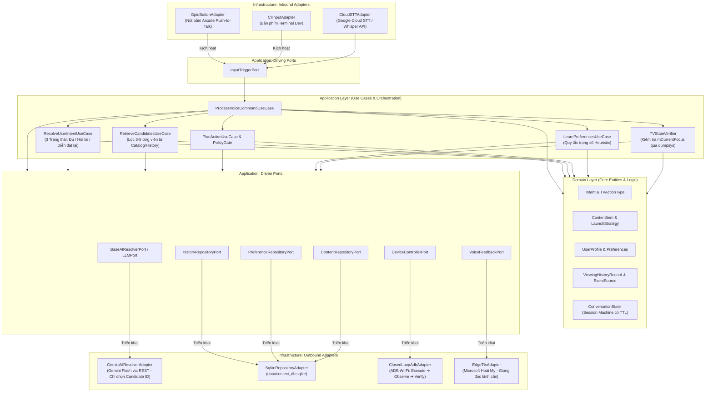
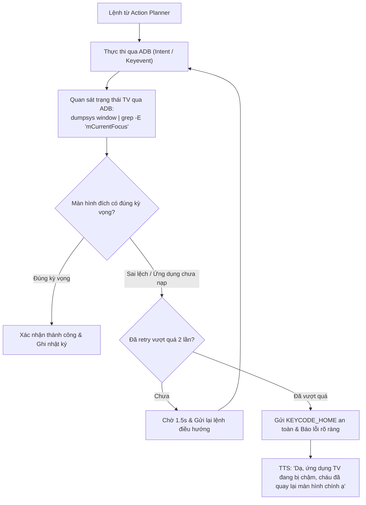

# TÀI LIỆU CÔNG NGHỆ & KIẾN TRÚC HỆ THỐNG
**(Context-Aware Conversational TV Assistant Architecture)**

**Dự án:** Trợ lý TV thông minh hiểu ngữ cảnh cho người cao tuổi  
**Ngôn ngữ cốt lõi:** 100% Pure Python 3.10+ (Không phụ thuộc Node.js hay framework cồng kềnh)  
**Kiến trúc phần mềm:** Clean Architecture / Hexagonal Architecture (Ports and Adapters)  
**Mục tiêu triển khai:** Vận hành bền bỉ 24/7 trên phần cứng nhúng chi phí thấp (Raspberry Pi Zero 2W / Pi 3B+ / Pi 4) hoặc máy tính cá nhân.

---

## 1. SO SÁNH KIẾN TRÚC & QUYẾT ĐỊNH CÔNG NGHỆ

| Tiêu chí | Mô hình NestJS + Python cũ | Mô hình Pure Python Clean Architecture (Hiện tại) |
| :--- | :--- | :--- |
| **Môi trường Runtime** | Phải cài cả Node.js runtime lẫn Python. | **Chỉ 1 môi trường Python duy nhất**, cực kỳ tinh gọn. |
| **Tiêu tốn RAM trên Pi** | Node.js chiếm ~180MB - 250MB RAM. | Python chiếm **< 45MB RAM**, chạy mượt mà ngay cả trên Pi Zero 2W (512MB RAM). |
| **Giao tiếp liên tiến trình**| Phải dùng IPC/HTTP giữa Node.js và Python. | Giao tiếp trực tiếp qua In-process Memory Call, độ trễ gần như bằng $0\text{ms}$. |
| **Tính module & Cắm rút** | Phụ thuộc chặt vào framework NestJS. | **Ports & Adapters**: Đổi AI từ Gemini sang Local LLM, đổi TV Xiaomi sang Samsung, đổi Nút bấm sang Bàn phím chỉ bằng cách cắm Adapter mới. |
| **Cơ chế lưu trữ ngữ cảnh** | Cần Redis hoặc MongoDB cồng kềnh. | **SQLite3 nhúng sẵn trong Python standard library**, 0 cấu hình, hỗ trợ ACID và FTS5 cực nhanh. |

---

## 2. KIẾN TRÚC PHẦN MỀM CLEAN ARCHITECTURE (PORTS & ADAPTERS)

Hệ thống được tổ chức nghiêm ngặt theo 3 tầng độc lập, tuân thủ nguyên tắc Dependency Inversion:



### 2.1. Tầng Domain (Domain Layer)
Thuần Python, không chứa bất kỳ thư viện bên ngoài hay SDK hệ điều hành:
- `core/models.py`: Định nghĩa các Enum và Data Structure lõi: `TVActionType`, `LaunchStrategy` (`DIRECT_DEEPLINK`, `MULTI_STEP_WORKFLOW`), `ResolvedCommand`, `ExecutionResult`.
- `domain/user_profile.py`: Thực thể `UserProfile` lưu trữ danh mục ưa thích ban đầu (Pre-seeded profile) và cấu hình tương tác người cao tuổi.
- `domain/viewing_history.py`: Thực thể `ViewingHistoryRecord` lưu vết sự kiện cùng với `source` (`VOICE_ASSISTANT` vs `TV_OBSERVED`) và `completion_status`.
- `domain/conversation_state.py`: Máy trạng thái quản lý phiên đối thoại đa lượt có cơ chế tự hủy (TTL 90 giây).

### 2.2. Tầng Application (Use Cases & Policy Gate)
- `ResolveUserIntentUseCase`: Triển khai phân nhánh 3 trạng thái:
  1. *Đủ thông tin ($\ge 0.85$)*: Lập Action Plan thực thi.
  2. *Có nhiều khả năng ($0.60 - 0.84$)*: Sinh câu hỏi làm rõ (Clarification).
  3. *Không hiểu / Mơ hồ ($< 0.60$)*: Yêu cầu diễn đạt lại hoặc chuyển sang tìm kiếm an toàn.
- `RetrieveCandidatesUseCase`: Truy vấn danh sách 3–5 ứng viên có thực trong SQLite trước khi đưa cho LLM lựa chọn.
- `PlanActionUseCase`: Ánh xạ sang lệnh điều khiển và chuyển qua `PolicyGate` kiểm tra an toàn.
- `TVStateVerifier`: Thực hiện kiểm tra trạng thái màn hình TV sau khi gửi lệnh điều khiển.

### 2.3. Tầng Infrastructure (Adapters)
- `GeminiAIResolverAdapter`: Kết nối Google Gemini Flash API qua thư viện chuẩn `urllib.request`. **Quy tắc bảo mật:** Chỉ gửi Intent và danh sách ID ứng viên hợp lệ, LLM không được tự ý sinh `content_id` hay lệnh ADB.
- `ClosedLoopAdbAdapter`: Quản lý kết nối ADB Wi-Fi cổng 5555 với cơ chế tự phục hồi (`auto-reconnect`), kiểm tra trạng thái màn hình và giới hạn retry.
- `SqliteRepositoryAdapter`: Triển khai lưu trữ cục bộ tại `data/context_db.sqlite`.
- `EdgeTtsAdapter`: Tổng hợp tiếng nói tiếng Việt giọng Hoài My tự nhiên với tốc độ chậm (`rate: -10%`).

---

## 3. THIẾT KẾ CƠ SỞ DỮ LIỆU CONTEXT & RETRIEVAL (SQLITE NHÚNG)

Toàn bộ dữ liệu được quản lý tập trung trong file `data/context_db.sqlite`, đảm bảo tính toàn vẹn và không tốn tiến trình server ngoài:

```sql
-- 1. Bảng danh mục nội dung tuyển chọn (Content Catalog)
CREATE TABLE IF NOT EXISTS content_catalog (
    id TEXT PRIMARY KEY,
    name TEXT NOT NULL,
    category TEXT NOT NULL,              -- BUDDHIST, NEWS, MUSIC, COMEDY
    provider TEXT NOT NULL,              -- YOUTUBE, VTVGO, SYSTEM
    launch_strategy TEXT NOT NULL,       -- DIRECT_DEEPLINK, MULTI_STEP_WORKFLOW
    deep_link TEXT,                      -- vtvgo://live/vtv1 hoặc vnd.youtube://...
    workflow_steps TEXT,                 -- JSON mô tả chuỗi thao tác nếu là Workflow
    speaker_or_artist TEXT,              -- Thầy Thích Trí Thoát, Hoài Linh...
    tags TEXT,                           -- kinh phat, an lac, thoi su vtv1
    availability TEXT DEFAULT 'AVAILABLE', -- AVAILABLE, DEPRECATED, UNVERIFIED
    last_verified TIMESTAMP,             -- Thời điểm kiểm tra hoạt động gần nhất
    default_priority INTEGER DEFAULT 50
);

-- 2. Bảng nhật ký xem (Viewing History có nguồn gốc & độ tin cậy)
CREATE TABLE IF NOT EXISTS viewing_history (
    id INTEGER PRIMARY KEY AUTOINCREMENT,
    user_id TEXT DEFAULT 'grandmother',
    content_id TEXT,
    title TEXT NOT NULL,
    category TEXT NOT NULL,
    event_type TEXT DEFAULT 'PLAYED',
    source TEXT NOT NULL,                -- 'VOICE_ASSISTANT' hoặc 'TV_OBSERVED'
    started_at TIMESTAMP DEFAULT CURRENT_TIMESTAMP,
    ended_at TIMESTAMP,
    duration_seconds INTEGER DEFAULT 0,
    completion_status TEXT DEFAULT 'UNKNOWN', -- 'COMPLETED', 'PARTIAL', 'SKIPPED', 'UNKNOWN'
    was_skipped_immediately BOOLEAN DEFAULT 0, -- Chuyển bài trong vòng 30s
    raw_utterance TEXT,                  -- Khẩu ngữ nguyên văn của ông bà
    FOREIGN KEY(content_id) REFERENCES content_catalog(id)
);

-- 3. Bảng điểm sở thích người dùng (Preference Score Heuristic)
CREATE TABLE IF NOT EXISTS user_preferences (
    user_id TEXT NOT NULL,
    item_key TEXT NOT NULL,              -- ID nội dung hoặc tên Thể loại
    item_type TEXT NOT NULL,             -- 'CONTENT', 'CATEGORY', 'SPEAKER'
    score REAL DEFAULT 50.0,             -- Điểm ưu tiên tích lũy
    last_interaction TIMESTAMP DEFAULT CURRENT_TIMESTAMP,
    PRIMARY KEY (user_id, item_key)
);
```

---

## 4. QUY TRÌNH ĐIỀU KHIỂN TV VÒNG LẶP ĐÓNG (CLOSED-LOOP CONTROL)

ADB bản chất là giao thức gửi lệnh một chiều ("bắn rồi quên"). Để biến thành hệ thống đáng tin cậy cho người cao tuổi, TV Controller áp dụng cơ chế xác minh vòng lặp đóng:



### Nguyên tắc xử lý lệnh an toàn:
1. **Lệnh Idempotent (Deep Link, mở app):** Được phép retry tối đa 2 lần nếu quan sát thấy app chưa lên màn hình chính.
2. **Lệnh Non-idempotent (Phím chuyển đổi, phím chọn Center):** **Tuyệt đối không retry mù quáng** khi không xác định chắc chắn phần tử đang được focus trên TV.

---

## 5. XỬ LÝ ÂM THANH, TIẾNG VỌNG & BẢO MẬT (AUDIO & PRIVACY)

### 5.1. Xử lý tiếng vọng & Tạp âm TV (Acoustic Echo & Noise)
- **Cơ chế Push-to-Talk bằng nút cơ:** Chỉ thu âm khi nút đang được nhấn/giữ. Khi thả nút, ngắt kết nối stream âm thanh tức thì, loại bỏ hoàn toàn việc STT thu nhầm lời thoại từ phim/thời sự đang phát trên TV.
- **Cơ chế Half-Duplex Gating:** Trong lúc loa của Trợ lý đang phát âm thanh phản hồi (TTS), microphone sẽ bị khóa phần mềm hoàn toàn để tránh hiện tượng thiết bị tự nghe lại chính tiếng của mình và kích hoạt vòng lặp vô tận.

### 5.2. Bảo vệ quyền riêng tư & Tối thiểu hóa dữ liệu (Privacy & Minimal Context)
- **Tối thiểu hóa Context gửi lên LLM:** Không gửi toàn bộ lịch sử xem hay thông tin đời tư gia đình lên Google Gemini. Chỉ gửi cấu trúc câu khẩu ngữ hiện tại và 3–5 ứng viên đã được lọc từ SQLite cục bộ.
- **Bảo mật kết nối ADB:** Chỉ cho phép thiết bị Smart TV Pod có địa chỉ IP cố định được kết nối tới cổng 5555 của TV, chặn truy cập ngoài mạng LAN gia đình.
- **Quản lý khóa bí mật:** Toàn bộ API Key lưu trong biến môi trường hoặc file `.env` được phân quyền chặt chẽ trên Linux OS của Raspberry Pi.

---

## 6. KHUNG ĐÁNH GIÁ KIỂM THỬ KHOA HỌC (BENCHMARKING FRAMEWORK)

Để chứng minh giá trị kỹ thuật thực tế của hệ thống có Context Engine thay vì chỉ là một ứng dụng gọi API thông thường, dự án thiết lập ma trận kiểm thử 4 phiên bản kiến trúc:

| Phiên bản Kiến trúc | Mô tả công nghệ | Mục tiêu năng lực |
| :--- | :--- | :--- |
| **V1 (Baseline)** | Regex + Fuzzy Matching thuần túy | Khớp câu lệnh chính xác theo danh sách mẫu. |
| **V2 (Intent LLM)** | Gemini Flash trích xuất ý định đơn lẻ | Hiểu các cách diễn đạt tự nhiên không mẫu. |
| **V3 (Context-Aware)**| LLM + Candidate Retrieval + Viewing History | Xử lý câu tham chiếu (*"hôm qua"*, *"sáng nay"*). |
| **V4 (Personalized)** | Context + Preference Heuristic Learning | Tự thích ứng theo tần suất và hành vi nghe. |

### 6 Chỉ số đo lường định lượng bắt buộc:
1. **Intent Accuracy:** Tỷ lệ nhận diện đúng ý định của người dùng ($\ge 95\%$).
2. **Entity Accuracy:** Tỷ lệ gán đúng nội dung cụ thể trong Catalog ($\ge 90\%$).
3. **Context Resolution Accuracy:** Tỷ lệ giải quyết đúng các từ tham chiếu thời gian và lịch sử ($\ge 88\%$).
4. **Task Completion Rate:** Tỷ lệ yêu cầu được thực hiện thành công trọn vẹn ($\ge 92\%$).
5. **Wrong Action Rate (Chỉ số tối thượng):** Tỷ lệ thực hiện sai hành động hoặc mở sai nội dung ($< 3\%$).
6. **Average Response Time:** Thời gian từ lúc nhả nút đến khi TV nhận lệnh ($< 1.65\text{s}$).

---

## 7. NGÂN SÁCH ĐỘ TRỄ (LATENCY BUDGET) & PHẦN CỨNG (BOM)

### 7.1. Ngân sách thời gian phản hồi
| Phân đoạn xử lý | Mục tiêu thời gian | Phương thức tối ưu |
| :--- | :---: | :--- |
| **Bấm nút $\to$ Đèn LED sáng & Ting** | **$< 15\text{ms}$** | Bắt ngắt phần cứng GPIO trực tiếp. |
| **Lệnh tức thì (Fast-Path Offline)** | **$< 30\text{ms}$** | Khớp Regex trong RAM, không cần Internet. |
| **Thu âm & Chuyển giọng nói (STT)** | **$< 600\text{ms}$** | Cloud STT API streaming hoặc Vosk nhỏ. |
| **Phân tích ý định & Reranking** | **$< 700\text{ms}$** | Gemini Flash với System Prompt tinh gọn. |
| **Truy vấn Context Engine (SQLite)** | **$< 10\text{ms}$** | Chỉ mục SQLite Index tối ưu. |
| **Closed-Loop ADB Command** | **$< 150\text{ms}$** | Socket ADB TCP/IP trực tiếp trong mạng LAN. |
| **Tổng thời gian hoàn tất** | **$< 1.65\text{giây}$** | Giữ trải nghiệm phản hồi nhanh nhẹn cho người già. |

### 7.2. Danh mục thiết bị phần cứng (Bill of Materials - BOM)
| Linh kiện | Mẫu mã khuyến nghị | Giá tham khảo | Tác dụng |
| :--- | :--- | :---: | :--- |
| **Bo mạch xử lý** | **Raspberry Pi Zero 2W** (hoặc Pi 3B+/Pi 4) | ~450.000đ - 650.000đ | Chạy ứng dụng Python Clean Architecture, kết nối Wi-Fi tới TV. |
| **Nút bấm cơ** | **Nút bấm Arcade máy thùng 30mm/60mm** màu đỏ viền đen | ~30.000đ - 45.000đ | Nút to, lò xo đàn hồi tốt, tạo tiếng "tách" dứt khoát xác nhận lệnh. |
| **Micro thu âm** | **USB Mini Microphone lọc ồn** hoặc Mic I2S | ~70.000đ - 120.000đ | Thu âm tiếng nói cự ly 0.5m – 1.5m. |
| **Loa phát âm thanh**| **Loa mini USB 3W / Jack 3.5mm** | ~60.000đ - 90.000đ | Phát câu phản hồi thưa gửi kính cẩn và tiếng "Ting" xác nhận. |
| **Đèn tín hiệu** | **LED RGB 5mm** cathode chung + trở 220Ω | ~10.000đ | Báo 4 trạng thái: Đang nghe (Lam), Xử lý (Vàng), Xong (Lục), Lỗi (Đỏ). |
| **Vỏ hộp bảo vệ** | Hộp nhựa ABS hoặc in 3D để bàn | ~50.000đ - 80.000đ | Đóng gói thành Smart TV Pod sang trọng, vững chãi tại bàn trà. |
| **Tổng chi phí** | | **~670.000đ - 995.000đ** | Phần cứng hoàn chỉnh, chi phí cực kỳ tối ưu. |
